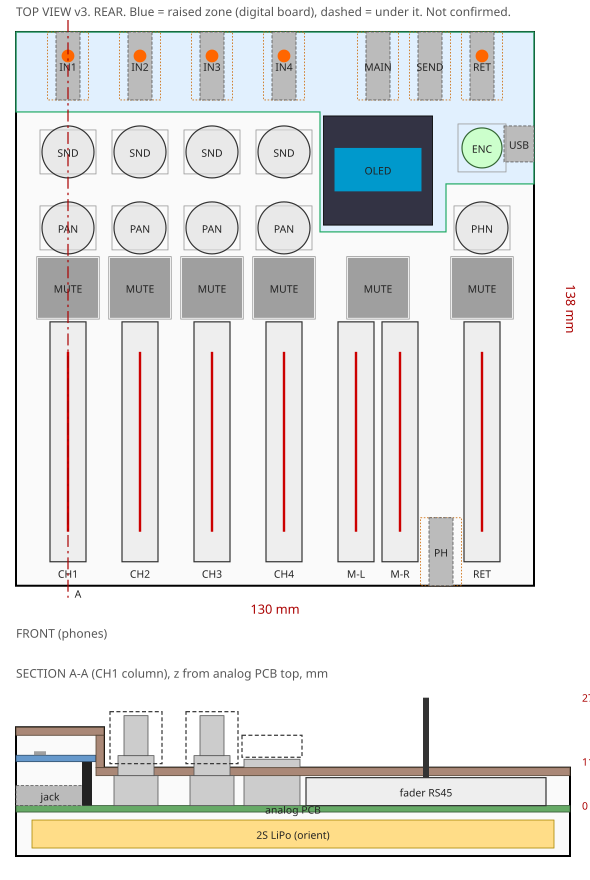
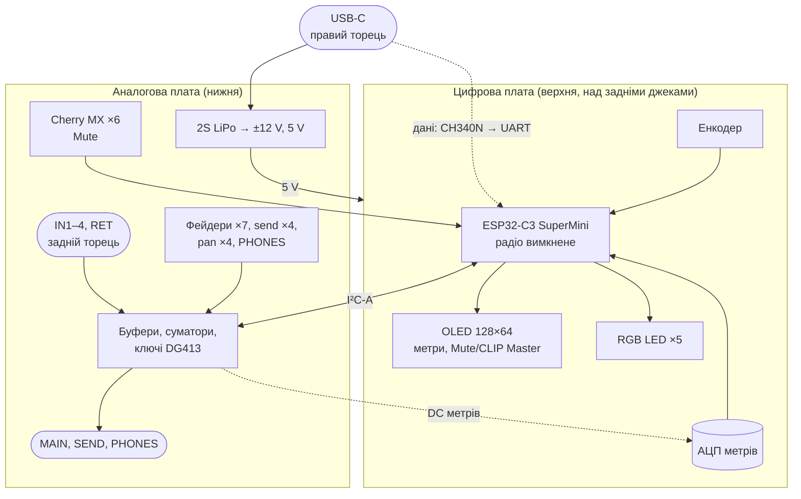
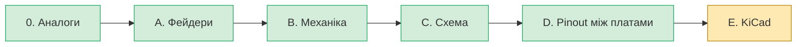

# analog-mixer — Rev A

Портативний аналоговий стереомікшер Rev A: 4 стереоканали з pan і FX-петлею
(send/return), Master L/R, вихід на навушники, OLED-метри та Mute/Solo через ESP32-C3,
живлення від 2S LiPo з USB-C.

> [!WARNING]
> Стан: крок E — схеми (ERC чистий) і обидві плати розведено, DRC без розривів і порушень міді;
> Gerber, свердління й BOM — у `hw/fab/` ([14-kicad.md](docs/14-kicad.md), п. 6). Плати ще не
> замовлені й не перевірені в залізі. Команди з документації запускати з теки `analog-mixer/`.

## Архітектура

## Хід роботи

## Документація

| Документ | Зміст |
|---|---|
| [spec-rev-a.md](docs/spec-rev-a.md) | ТЗ |
| [decisions.md](docs/decisions.md) | Журнал рішень D1–D50, має пріоритет над ТЗ |
| [00-prior-art.md](docs/00-prior-art.md) | Аналоги та схожі проєкти |
| [01-faders.md](docs/01-faders.md) | Фейдери Alps RS45 |
| [02-mixerli-analysis.md](docs/02-mixerli-analysis.md) | Розбір mixerli v2.0.1 |
| [03-power-2s.md](docs/03-power-2s.md) | Живлення 2S |
| [04-mixerli-datasheets.md](docs/04-mixerli-datasheets.md) | Висновки з datasheets mixerli |
| [05-mechanics.md](docs/05-mechanics.md) | Механіка, компоновка, висоти |
| [06-signal-flow.md](docs/06-signal-flow.md) | Signal flow, Mute/Solo, метри, керування |
| [07-gain-structure.md](docs/07-gain-structure.md) | Рівні по тракту, запас, шум, вибір op-amp |
| [08-meter-detector.md](docs/08-meter-detector.md) | Детектор метрів і CLIP |
| [09-sourcing.md](docs/09-sourcing.md) | Наявність і ціни ключових компонентів |
| [10-passives.md](docs/10-passives.md) | Пасивні компоненти: правила, перелік, кількості |
| [11-power.md](docs/11-power.md) | Розрахунок живлення ±12 V і 5 V, час роботи |
| [12-parts.md](docs/12-parts.md) | Вибір решти компонентів |
| [13-interboard.md](docs/13-interboard.md) | Крок D: роз'єм і pinout між платами |
| [calc/](docs/calc/), [sim/](docs/sim/) | Скрипти розрахунків (Python) і симуляцій (ngspice) |
| [hw/lib/](hw/lib/README.md) | Бібліотека KiCad: футпринти з креслень |
| [14-kicad.md](docs/14-kicad.md) | Крок E: як згенеровано схеми й плати, стан ERC/DRC |
| [15-3d.md](docs/15-3d.md) | 3D-моделі й збірка |
| [datasheets/](docs/datasheets/README.md) | Усі datasheets проєкту |

## Походження та ліцензія

Проєкт є похідним від **mixerli** (Stahl, 2023):
<https://github.com/stahlnow/mixerli> (базова версія — коміт `18a4a8e`).

SPDX-License-Identifier: CERN-OHL-S-2.0+

This source describes Open Hardware and is licensed under the CERN-OHL-S v2
or any later version. You may redistribute and modify this source and make
products using it under the terms of the CERN-OHL-S v2 or any later version
(https://ohwr.org/cern_ohl_s_v2.txt). This source is distributed WITHOUT ANY
EXPRESS OR IMPLIED WARRANTY, INCLUDING OF MERCHANTABILITY, SATISFACTORY QUALITY
AND FITNESS FOR A PARTICULAR PURPOSE. Please see the CERN-OHL-S v2 for applicable
conditions.

Source location (original): https://github.com/stahlnow/mixerli
Source location (this project): _TBD — указати після публікації репозиторію._

Згідно з розд. 4 CERN-OHL-S v2, на PCB має бути видно source location.
Повний текст ліцензії: [LICENSE](../LICENSE).
