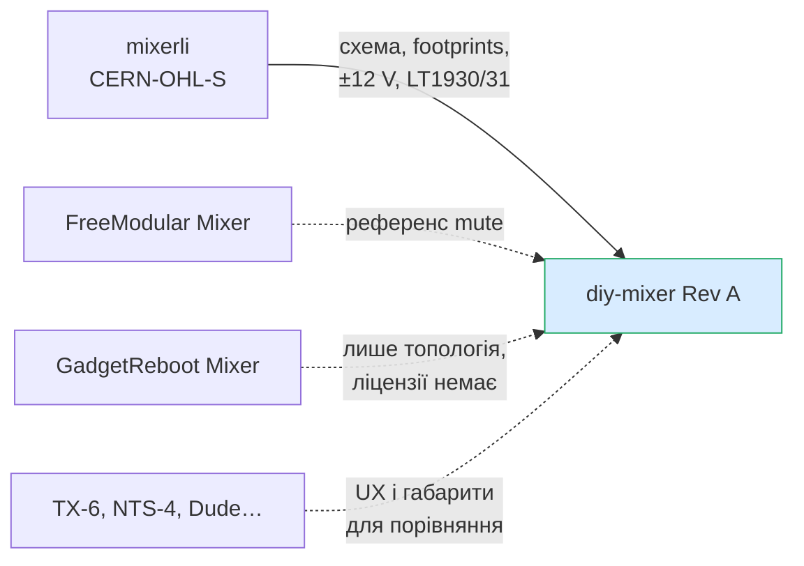

# 0. Аналоги та схожі DIY-проєкти

> [!NOTE]
> Це перший крок проєкту. Частина висновків наприкінці вже змінена рішеннями: габарит
> (D2), живлення ±12 V замість 5 V (D5), фейдери з ходом 45 мм (D1). Див.
> [decisions.md](decisions.md).

Пошук від 24.10.2026. Ціни, наявність і характеристики взято з оголошень та оглядів.
Якщо параметр не перевірено за datasheet або первинним джерелом, він позначений
`НЕ ПІДТВЕРДЖЕНО`.

## Відкриті DIY-проєкти (є файли)

### mixerli — найближчий відкритий аналог

<https://github.com/stahlnow/mixerli> · ліцензія CERN-OHL-S-2.0+ · KiCad 9
(`version 20250114` у `.kicad_sch`).

Це портативний стереомікшер на батареї з фейдерами: 4 стереоканали і ще 1 стереоканал,
у кожного рівень (dual-фейдер) та aux send (dual-ротатор). Дані нижче я взяв із
KiCad-файлів репозиторію (клонував і розібрав):

| Вузол       | Що використано                                                                |
|-------------|-------------------------------------------------------------------------------|
| Фейдер      | Alps `RS451121400A`, dual, 10k B. Хід 45 мм, довжина 60 мм (за даними реселерів) |
| Pan/send    | Alps `RK14K12D0A18`, dual 50k A                                               |
| Op-amp      | NJM4580 (SOIC-8), 9 шт.                                                       |
| Живлення    | **±12 V** з китайського dual-output boost-модуля (AliExpress), не з дискретної схеми |
| Заряджання  | 1 × MCP73831, Schottky + p-FET ZXMP6A13F (load sharing), USB-C UJC-HP-3-SMT-TR |
| Роз’єми     | QingPu WQP-PJ366ST (Thonkiconn stereo, вертикальні)                           |
| Пасивні     | 1206                                                                          |
| Плата       | Одна, 126 × 108 мм (виміряно за Edge.Cuts)                                    |
| MCU/метри   | Немає                                                                         |

Що з цього варто взяти:

- **Еррата USB-C (v2.0.0):** живлення працювало лише з кабелем A→C, бо не було
  pulldown 5.1k на CC1/CC2. У v2.0.1 це виправили. Те саме перевірити у нас для BQ24074.
- **Автор пішов на ±12 V заради headroom.** У нас один рейл 5 V, тож headroom — ризик
  №1 для кроку C (ТЗ, розділ 5).
- Навіть у цьому «портативному» проєкті фейдери з ходом 45 мм, а плата 126 × 108 мм.
  Це більше за наш цільовий корпус 100–115 × 60–75 мм.
- Можна підглянути footprint dual-фейдера Alps і роз’ємів (бібліотеку `stahllabs`).
  Перевіряти по datasheet, а не брати наосліп.

### GadgetReboot Mixer

<https://github.com/GadgetReboot/Mixer> · опис на
[PCBWay](https://www.pcbway.com/project/shareproject/Audio_Mixer.html). Файл ліцензії
в репозиторії **відсутній**.

- 3 стереовходи 3,5 мм, рівні виставляються тримерами (фейдерів немає).
- LM358 на одному рейлі 5 V, тобто топологія як у нашій ідеї: інвертувальний суматор
  навколо VREF.
- У схемі такі номінали: 10K (13 шт.), 3K3, 4K3, 10 µF, 100 Ω, 4,7 µF. Ролі елементів
  я не розбирав.
- LM358 погано підходить для аудіо (crossover distortion). Як референс топології він
  годиться, як вибір компонента — ні.

### Інше

- **FreeModular Mixer** — відкритий 5-входовий Eurorack-мікшер з mute:
  <https://modulargrid.net/e/free-modular-mixer>. Живлення від Eurorack; підходить як
  референс реалізації mute.
- **Elektor «Small audio mixer»** — дві плати, стерео, pan, є KiCad:
  <https://www.elektormagazine.com/news/small-audio-mixer>. Ліцензію й деталі не
  перевіряв.

## Готові комерційні рішення

| Пристрій | Канали | Живлення | Габарит | Ціна | Примітка |
|---|---|---|---|---|---|
| [Teenage Engineering TX-6](https://djmag.com/tech/teenage-engineering-launch-new-mini-mixer-tx-6) | 6 стерео | вбудований акумулятор, до ~8 год | розміром з Game Boy | $1199 на старті | є аудіоінтерфейс і синт; один ритейлер пише «discontinued» |
| [Korg Nu:Tekt NTS-4](https://kraftmusic.com/products/korg-nu-tekt-nts-4-performance-mixer-kit) | 4 стерео + 2 моно, 3,5 мм | USB-C або 9 V, **без батареї** | 195 × 125 × 38 мм | — | кіт без пайки, є FX, USB audio |
| [Bastl Dude](https://bastl-instruments.com/instruments/dude) | 5 **моно**, mute | 4 × AA або 9–12 V | 75 × 70 × 45 мм | ~€75–79 | вихід dual mono |
| [Porta Party](https://www.matrixsynth.com/2026/05/uk-garage-on-tiny-setup.html) | 4 стерео, volume + pan | USB-C PD (power bank) | `НЕ ПІДТВЕРДЖЕНО` | — | Etsy; є clip LED, line out і окремий вихід на навушники; первинної сторінки не знайшов |
| [Rakit Rakimix](https://www.tindie.com/products/rakit/rakimix-5-channel-mixer-kit) | 4 + aux, сума моно | 9 V PP3 | «розміром з кредитку» | $30 | кіт, 2 × NE5532, mute-перемикачі |
| [SyntherJack 4sum](https://synthtopia.com/content/2018/10/03/4sum-portable-audio-mixer-now-available) | 4 моно → dual mono | `НЕ ПІДТВЕРДЖЕНО`, ~100 год | — | ~$56 (кіт) | |
| Cubilux / MC5-BX тощо ([Newegg](https://www.newegg.ca/p/2SV-04ZH-000K4), [eBay](https://www.ebay.de/itm/266901372022)) | 4 стерео, 3,5 мм, ручки | USB 5 V | — | ~$40 | дешеві китайські мікшери, зазвичай є на AliExpress |

## Що беремо з аналогів

## Висновки для Rev A

1. **Готового пристрою з усіма нашими вимогами немає.** Стерео dual-фейдери, LiPo,
   метри на OLED, Mute/Solo і розмір ~110 × 70 мм разом ніде не зустрічаються. За
   функціями найближчий TX-6, але він дорогий, з ротаторами і, схоже, знятий з
   виробництва. Тож DIY має сенс.
2. **Головний механічний ризик — компактні dual-фейдери.** Навіть mixerli узяв хід
   45 мм. Кандидати для кроку A (усі `НЕ ПІДТВЕРДЖЕНО`):
   - Alps **RS15** dual (`RS151121…`, хід 15 мм, Mouser — non-stocked);
   - Alps **RS30H** 2-gang 10k (`RS30H121A00B`, хід 30 мм; у RS знятий з продажу);
   - китайські аналоги цих серій на AliExpress.
3. **Headroom на 5 V.** Відкриті проєкти з фейдерами беруть ±12 V. Для 5 V single-supply
   у кроці C треба окремо порахувати рівні. Як варіанти оцінити: rail-to-rail op-amp,
   менший внесок каналу або локальний ±V (charge pump чи boost-модуль, як у mixerli),
   з огляду на шум.
4. **USB-C:** обов’язково 5.1k на CC1 і CC2 окремо (досвід mixerli).
5. Дешевий китайський мікшер на 4 стерео-канали (~$40) можна купити як еталон для
   порівняння шуму або розібрати. Купувати не обов’язково.
