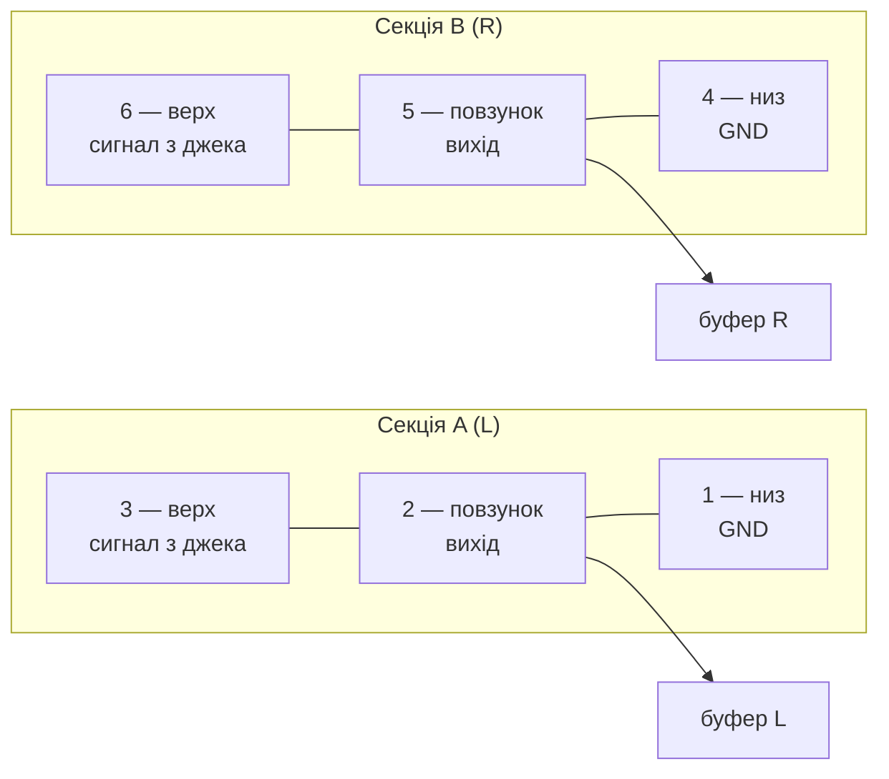

# A. Фейдери

> [!NOTE]
> **Статус на 24.10.2026:** усі 7 фейдерів — `RS451121400A` (D1, D23). D14 (`RS451111B010` на Master) скасовано.

> [!IMPORTANT]
> **Підтверджено каталогом Alps 2026** ([alps-rsxx1-series.pdf](datasheets/alps-rsxx1-series.pdf), с. 386, 391–392):
> `RS451121400A` — каталожна позиція, **креслення №20**.
>
> | Параметр | Значення |
> |---|---|
> | Тип | dual, хід 45 мм, 10 kΩ, **1B (лінійна)**, без фіксації |
> | Важіль | металевий, тип 4, **L1 = 20 мм** |
> | Монтажна пластина | **немає** (на відміну від `RS45112A400G`, кресл. 21) |
> | Корпус | 60 × 9 мм, кріплення 2 × M2 з кроком 56 мм |
> | Висоти | монтажна поверхня 7 мм над платою, важіль ще 20 мм → верх **27 мм** |
> | Отвори в платі | 6 × Ø1,1, ряди через **55 мм**, **без фіксаторів Ø2** (вони лише в кресл. 21 з пластиною) |
> | Потужність | 0,125 W (dual, 45 мм, 1B) |
> | Макс. напруга | 200 V AC, **10 V DC** |
> | Мін. партія Alps | 1150 шт. (Japan / Export) — купувати через дистриб'юторів |
>
> Отже, footprint mixerli (6 × Ø1,1, 55 мм, без Ø2) збігається з кресленням. Питання про фіксатори Ø2 закрито.

## Канали, return і Master (7 шт.): Alps `RS451121400A`

На Master L і Master R працює одна секція, друга вільна (D23).

| Параметр         | Значення                                  | Джерело / статус |
|------------------|-------------------------------------------|------------------|
| Секції           | dual (2-gang)                             | реселери, KiCad mixerli (`R_Potentiometer_Dual`) |
| Опір, характер.  | 10 kΩ ±20 %, B (лінійна)                  | реселери, [Findchips](https://findchips.com/search/RS451121400A) |
| Хід              | 45 мм                                     | реселери — `НЕ ПІДТВЕРДЖЕНО` datasheet |
| Габарит корпусу  | 60 × 9 мм (висота з важелем ~27 мм?)      | onlinecomponents через Findchips — `НЕ ПІДТВЕРДЖЕНО` |
| Потужність       | 0,125 W                                   | реселери |
| Gang error       | 2 dB у точці 50 % ходу                    | реселер — `НЕ ПІДТВЕРДЖЕНО` |
| Монтаж           | THT                                       | реселери |
| Важіль           | тип/довжина невідомі — сумісність ручок   | `НЕ ПІДТВЕРДЖЕНО` |

Footprint у mixerli (`stahllabs:RS451121400A`, витягнуто з `mixerli.kicad_pcb`),
**лише як референс** — перевірити за кресленням Alps:

- 6 THT-пінів, drill 1,1 мм, pad Ø2 мм;
- пін 1, 2, 4, 5 — на одному торці (x = −27,5), y = −1,25 / −3,75 / +3,75 / +1,25;
- пін 3, 6 — на іншому торці (x = +27,5), y = −1,25 / +3,75;
- відстань між торцевими рядами 55 мм; кріпильних лапок у footprint немає.
- З нетлиста mixerli (плата v2.0.1 реально виготовлялась): **пін 1/4 — GND,
  2/5 — повзунки, 3/6 — верх (сигнал)**; секція A = 1-2-3, B = 4-5-6.
  Див. [02-mixerli-analysis.md](02-mixerli-analysis.md). Звірити з кресленням Alps.

На Master L/R (D23) працює одна секція. Вільну секцію не лишати плаваючою (крок C).

> [!NOTE]
> Абзац нижче написано за старим каталогом з mixerli. Його закриває каталог Alps 2026 (див. вище).

Datasheet Alps на саме цей суфікс не знайдено; у PDF серії RS (з репо mixerli,
`RS__1-1370683.pdf`) у списку моделей є `RS45112A400G`, але не `RS451121400A`.
Сайт Alps і TME повертають 403 для автоматичного запиту — креслення треба
скачати вручну.

## ~~Master L/R: Alps `RS451111B010`~~ — скасовано D23, лишено для історії

Той самий ряд RS45, **single unit**, 10 kΩ B, хід 45 мм, ізольований важіль
(за Mouser, Mouser P/N 688-RS451111B010, ~993 шт. на складі на момент пошуку).
`НЕ ПІДТВЕРДЖЕНО`: габарит/pinout/важіль ідентичні канальному.

Альтернатива: `RS45111A900F` — 10 kΩ, лінійний, 45 мм, металевий важіль,
є на LCSC (C470640), TME, DigiKey.

> **Оновлення після datasheet Alps** ([04-mixerli-datasheets.md](04-mixerli-datasheets.md)):
> `RS451111B010` має ізольований важіль 10 мм, а каталожний dual `RS45112A400G` —
> металевий 20 мм. Master і канали матимуть різні ручки й висоту. Варіанти:
> напівстандартний Alps mono з важелем 4/20 мм або серія Bourns PTA (mono й dual
> з однаковим важелем, є log-характеристика).

## Наслідки рішення

1. **Фейдери — найбільший елемент і задають габарит.** Фіксованого габариту з
   ТЗ більше немає (KPI — мінімум під елементну базу). Груба оцінка верхньої
   панелі `ПРИПУЩЕННЯ`: 6 фейдерів з кроком ~16–18 мм → ширина ~115–125 мм;
   глибина ~60 мм фейдер + ~35–45 мм під OLED/кнопки → ~100–110 мм. Мінімізувати
   в кроці B (крок фейдерів, розміщення OLED/енкодера, роз’ємів на торцях).
2. B (лінійна) характеристика: відчуття гучності не як у log-фейдера. Можна
   частково компенсувати схемно (law-faking резистор) — розглянути в кроці C.
3. Номінал 10k визначає навантаження джерела й вхідні імпеданси суматора —
   врахувати в кроці C.

## Що зробити до замовлення

- [ ] Завантажити офіційне креслення Alps для `RS451121400A` і `RS451111B010`.
- [ ] Звірити footprint, нумерацію пінів, секції A/B, лапки/кріплення.
- [ ] Тип важеля та сумісні ручки.
- [ ] Ціна й доставка в Україну (TME / Mouser / DigiKey / LCSC) — `НЕ ПЕРЕВІРЕНО`.
