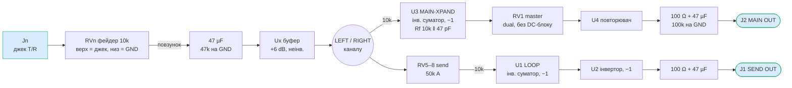
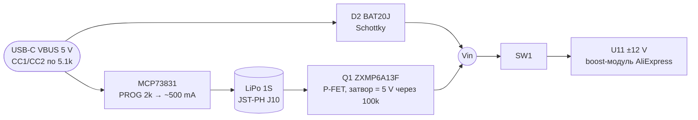

# Розбір mixerli v2.0.1 і модифікація під наше ТЗ

Джерело: <https://github.com/stahlnow/mixerli> (клон від 24.10.2026).
Нетлист і BOM експортовано з `mixerli.kicad_sch` через `kicad-cli` 10.0.7.
Розміщення компонентів взято з `mixerli.kicad_pcb`, габарит корпусу — з
`enclosure/v2.0/laser/mixerli_v2.0_case.scad`. Висновки нижче зроблено з нетлиста,
плату я не вимірював.

## 1. Керуючі елементи та роз’єми оригіналу

| Позиція | Компонент | Призначення |
|---|---|---|
| RV2, RV3, RV4, RV9 | Alps RS451121400A, dual 10k B | Фейдери рівня каналів 1–4, стоять **до** вхідного буфера (джек → фейдер → буфер) |
| RV10 | те саме | Фейдер входу 5 — стерео return (наприклад, з FX), без send |
| RV1 | те саме | **Master** — один dual-фейдер на L+R, стоїть після суматора |
| RV5–RV8 | Alps RK14K12D0A18, dual 50k A, ротатор | **Send level** каналів 1–4 у шину LOOP. Відгалуження після фейдера й буфера (post-fader) |
| SW1 | Alps SSSS916400, SPDT | Вимикач живлення (подає Vin на DC-DC) |
| JP1–JP5 | solder jumper | Перемичка T↔R на вході: моно-джерело йде в обидва канали. Це налаштування на платі, а не орган керування |
| D1 | LED | Статус заряджання (MCP73831 STAT) |
| D3 | LED | Індикатор живлення |
| J3–J7 | QingPu WQP-PJ366ST (Thonkiconn stereo, вертикальний) | Входи 1–5 |
| J2 | те саме | Main out |
| J1 | те саме | Send out (LOOP) |
| J8 | USB-C UJC-HP-3-SMT-TR | Лише заряджання/живлення |

Важливо: попри назву аркуша «Pan/Send», **панорами в схемі немає**, є тільки send.
Також немає mute, solo, метрів, MCU і окремого виходу на навушники.

### Компонування (top view, з `.kicad_pcb`)

Координати центрів, мм (крок колонок 20 мм):

| y \ x | 93,5 | 113,5 | 133,5 | 153,5 | 173,5 | 193,5 |
|---|---|---|---|---|---|---|
| **37** — джеки | J3 | J4 | J5 | J6 | J7 | J2 main |
| **53** — send | RV5 send1 | RV6 send2 | RV7 send3 | RV8 send4 | J1 send out | D3 |
| **100** — фейдери | RV2 ch1 | RV3 ch2 | RV4 ch3 | RV9 ch4 | RV10 ret5 | RV1 master |

Одна плата 126 × 108 мм, внутрішня висота корпусу 25 мм. Усі органи керування
й джеки стоять зверху, SMD — знизу. USB-C, вимикач і батарея — на нижньому краю (B.Cu).

## 2. Сигнальний тракт (відновлено з нетлиста)

- Живлення ±12 V, op-amp NJM4580 (9 корпусів): 5 вхідних буферів, U1/U2 — send,
  U3 — main sum, U4 — master buffer.
- **Полярність main out інвертована**: буфер (+), суматор (−), follower (+).
  На send out дві інверсії, тож полярність правильна. Для мікшера це не критично,
  але в нашій версії варто виправити.
- Gain structure розрахована на ±12 V: +6 dB на вході й unity-сума. На 5 V таке
  не працюватиме, ми це вже бачили в ТЗ (коефіцієнт ≈ 0,15).

### Живлення

Це простий load-sharing: від USB живлення йде через діод, без USB — через P-FET.
Модуль U11 — готова китайська плата, тож шум і якість невідомі.

> Виправлення до `00-prior-art.md`: MCP73831 стоїть **один**, а не два. Раніше я
> порахував символ двічі.

### Підтвердження pinout фейдера

З нетлиста фейдер виходить таким: **пін 1/4 — GND, пін 3/6 — сигнал (верх),
пін 2/5 — повзунки**. Секція A — піни 1-2-3, секція B — піни 4-5-6. Плата v2.0.1
реально виготовлялась, тож це сильний аргумент на користь footprint. Креслення
Alps однаково треба звірити.

## 3. Порівняння з нашим ТЗ

| Вимога ТЗ | mixerli | Що змінити |
|---|---|---|
| 4 стереовходи | 4 + стерео return | Прибрати вхід 5 (RV10, J7, U9) |
| Master: 2 mono-фейдери L/R | 1 dual | RV1 → 2 × RS451121400A, одна секція (D23) |
| Line out L/R | є (J2) | Виправити полярність |
| Окремий вихід на навушники з підсилювачем | немає (J2 від NJM4580 через 100 Ω) | Додати headphone amp. На його місце піде send-тракт (U1/U2, J1) |
| Send/Aux | є | **Не потрібен у ТЗ** → прибрати RV5–RV8, U1, U2 |
| Mute/Solo аналогові | немає | Додати ключі між LEFT/RIGHT каналу та сумувальним резистором 10k |
| Метри ch1–4 + master L/R, CLIP | немає | Детектори на LEFT/RIGHT каналів (post-fader) і на виході master |
| OLED, енкодер, 4 кнопки, 6 RGB LED, ESP32-C3 | немає | Новий цифровий вузол |
| LiPo + USB-C | MCP73831 + діод/P-FET | За ТЗ: BQ24074 (power-path); вимір батареї для MCU |
| Живлення аудіо | ±12 V з китайського модуля | **Ключове рішення**, див. розділ 4 |
| 0805 | 1206 | Перевести |
| Дві плати | одна | Див. розділ 4 |

## 4. Наскільки реально модифікувати

### Що береться майже без змін

- **Механічна сітка**: 6 колонок фейдерів з кроком 20 мм, ширина 126 мм. У нас теж
  6 фейдерів (4 канали + 2 master), тож **ширина та сама**. Звільняються ряд send-потів
  (y ≈ 53) і колонка входу 5.
- Footprint фейдера RS451121400A і джека PJ366ST (перевірені виробництвом, але не
  звірені з datasheet).
- Вхідний вузол каналу (джек → фейдер → DC-блок → буфер) як топологія. Номінали
  треба перерахувати під наші рейли.
- Виправлення USB-C CC.

### Що треба переробити

> [!NOTE]
> Історичний розділ: варіанти нижче вже вирішено (D5, D7, D8, D9, D31). Лишаю як обґрунтування.

1. **Живлення аудіо — перше рішення, від нього залежить решта:**
   - **(a) Лишити ±12 V через готовий модуль.** Найбільший headroom, схема майже як в
     оригіналі. Мінуси: модуль невідомої якості й шуму, AliExpress, крім нього ще
     потрібні 5 V/3,3 V для MCU, ключі Mute/Solo мають бути на ±12 V (DG4xx-клас).
   - **(b) ±5 V (boost 5 V + інвертор, напр. charge pump).** Компроміс: NJM4580
     лишається, headroom ≈ ±3,5 V (`ОЦІНКА`). Ключі можна взяти 74HC4053-клас з VEE.
     5 V спільний з MCU, тож треба розв’язка.
   - **(c) Один рейл 5 V + VREF (як у ТЗ).** Найменше компонентів. Але потрібен
     rail-to-rail op-amp (TLV9064), низький коефіцієнт сумування й DC-блоки скрізь.
     Від гілки mixerli лишається мало.
   Цифри для всіх трьох варіантів порахуємо в кроці C. Зараз потрібен лише напрям.
2. **Mute/Solo**: точка вставки — між виходом буфера каналу (`/Input n/LEFT|RIGHT`) і
   сумувальним резистором. Це 8 ключів (4 канали × L/R) з керуванням від ESP32
   (3,3 V логіка). Від клацання захищає ключ у віртуальну землю, а не послідовний
   розрив. Деталі — крок C.
3. **Метри**: 4 × (L, R) + master L/R = 10 детекторів. Якщо канал показує max(L, R)
   через діодне «АБО» після окремих детекторів, на ADC ідуть 6 сигналів + батарея.
   Чи вистачить вбудованого ADC ESP32-C3 — `НЕ ПЕРЕВІРЕНО`, інакше зовнішній ADC
   (MCP3208 або I²C-аналог, спільний з OLED).
4. **Headphone amp** — на місце send-тракту, живиться від master.
5. **Цифровий вузол** (ESP32-C3, OLED, енкодер, 4 кнопки, 6 RGB LED) — новий. У
   звільненому ряду y ≈ 53 стають кнопка й RGB LED над кожним каналом. OLED і
   енкодер — над колонками master (там, де були J1/J2).
6. **Джеки**: якщо їх перенести з верхньої панелі на задній торець (горизонтальні,
   напр. SJ-43514 з ТЗ), глибина корпусу менша й зверху звільняється місце під OLED.
   Мінус — інший footprint і механіка.

### Одна плата чи дві

mixerli показує, що весь аналог 5 каналів уміщується на одну плату 126 × 108 мм
(SMD знизу). Наш KPI — мінімальний габарит, і одна плата дала б меншу висоту
корпусу й менше міжплатних з’єднань. Аргументи за дві плати з ТЗ: шум від
ESP32/LED/boost і окремий шар під UI. Рішення не ухвалене, потрібна ваша думка.

## 5. Ліцензія

mixerli розповсюджується під **CERN-OHL-S-2.0+** (strongly reciprocal). Якщо наш дизайн
буде похідним (взяті схема, footprints, layout), то:

- наш дизайн теж має бути відкритим під CERN-OHL-S, якщо ми його поширюємо
  (публікуємо, продаємо чи віддаємо плати);
- на PCB має бути видно source location оригіналу (розд. 4 ліцензії).

Корпус (`.scad`) — під MIT. Якщо ми лише запозичимо ідеї й напишемо схему з нуля,
вимоги слабші. Перед стартом KiCad варто вирішити, похідний це проєкт чи ні.

## 6. Питання до рішення

1. Шина живлення аудіо: (a) ±12 V модуль / (b) ±5 V / (c) 5 V single + VREF?
2. Одна плата чи дві?
3. Джеки зверху (як mixerli) чи на задньому торці?
4. Робимо похідний проєкт від mixerli (CERN-OHL-S) чи свою схему за мотивами?

**Відповіді (24.10.2026):** FX-петля лишається (D4); аналог ±12 V (D5); master — 2 mono (D6);
дві плати (D7); джеки на задньому торці, навушники спереду (D8); похідний проєкт,
CERN-OHL-S (D9); гучність навушників — окремий стерео-ротатор (D10).
Див. [decisions.md](decisions.md).
