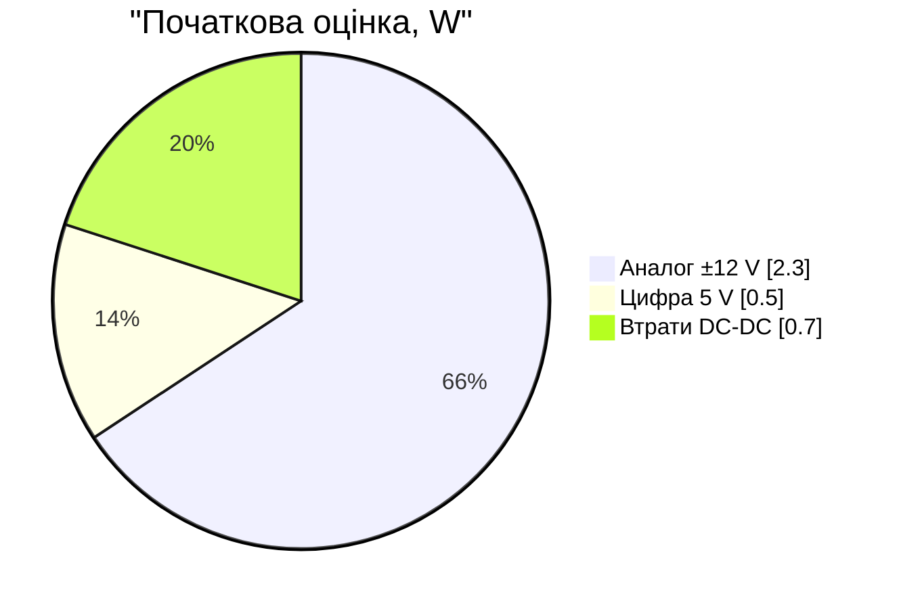
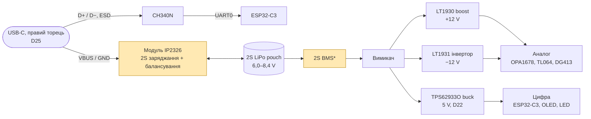
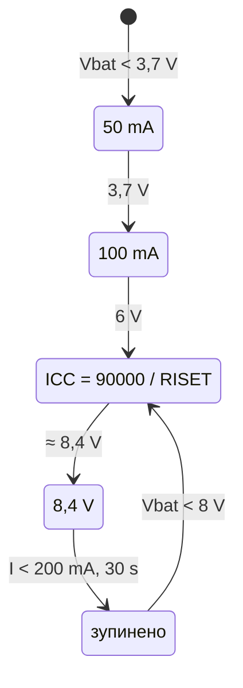

# Живлення: 1S чи 2S

> [!TIP]
> Розрахунок перетворювачів і часу роботи — [11-power.md](11-power.md) (≈ 4,6 год типово).

> [!NOTE]
> **Статус:** 2S прийнято (D16, 24.10.2026), ±12 V — дискретно на LT1930/LT1931 (D18),
> 5 V — TPS62933O (D22). Позначки `ОЦІНКА` — мої розрахунки, вони не підтверджені ні
> datasheet, ні вимірюваннями.

## 1. Грубий power budget (`ОЦІНКА`)

> [!NOTE]
> Уточнений бюджет ±12 V (17–18 корпусів op-amp, ~2 год від 2S 1500 mAh) — у
> [06-signal-flow.md](06-signal-flow.md), п. 5. Нижче — початкова оцінка, на якій
> вирішували 1S чи 2S.

| Споживач | Розрахунок | Потужність |
|---|---|---|
| Аналог ±12 V | ~16 корпусів NJM4580 × ~6 mA ≈ 0,1 A на рейл | ≈ 2,3 W |
| Цифра 5 V | ESP32-C3 без радіо (D27), OLED, RGB LED з обмеженою яскравістю | ≈ 0,5 W |
| Разом на виході DC-DC | | ≈ 2,8 W |
| З батареї (ККД ~80 %) | | **≈ 3,5 W** |

| Батарея | Енергія | Час роботи | Струм з батареї |
|---|---|---|---|
| 1S 1500 mAh (3,7 V) | 5,6 Wh | **~1,6 год** | ~1 A |
| 2S 1500 mAh (7,4 V) | 11,1 Wh | **~3,2 год** (уточнено: ~2 год) | ~0,5 A |

Висновок: найбільший споживач — аналог на ±12 V. На 1S час роботи виходить
коротким, а boost ±12 V працює з коефіцієнтом ×3–4 при струмі близько 1 A.
У mixerli з 1S це працювало, але там немає метрів, MCU й навушників.

## 2. Що дає 2S

| | 1S (D11, як mixerli) | 2S |
|---|---|---|
| Батарея | 1 pouch | 2 pouch (стос або поруч), балансувальні виводи |
| Заряджання від USB-C | MCP73831 (лінійний, 500 mA) | boost-charger 5 V → 8,4 V (модуль на IP2326) |
| Балансування | не потрібне | потрібне: є в IP2326 (лише для 2S, ~20–40 mA) |
| ±12 V | boost ×3–4 від 3,0–4,2 V | LT1930/LT1931 від 6,0–8,4 V: менший коефіцієнт, менші пульсації |
| 5 V цифра | boost від 3,0–4,2 V | **buck** від 6,0–8,4 V (простіше й тихіше) |
| Робота під час заряджання | load sharing (діод + P-FET) | **`НЕ ВИЗНАЧЕНО`** для IP2326 |
| Вимір батареї | дільник → ADC | дільник 8,4 V → 3,3 V; по банках — лише якщо дуже треба |
| Від mixerli | power_supply майже без змін | power_supply переробляється |

## 3. Кандидат: модуль USB-C 2S boost-charger на IP2326

Знайдено як типовий модуль (LX-LISC тощо), що продається в багатьох магазинах:

- Вхід USB-C 5 V (за даними [done.land](https://done.land/components/power/powersupplies/battery/chargers/charge/powermanagementics/ip2326/)
  чип вміє запитувати вищу напругу через PD/QC), діапазон входу 4,5–9,5 V.
- Заряджання CC/CV до 8,4 V (2S), струм ~0,75–1,5 A задається резистором ISET; ліміт
  15 W на вході.
- Вбудоване балансування для 2S (20–40 mA).
- Захисти: OCP, OVP, КЗ, переразряд, перегрів (135 °C), NTC, таймаут.
- ККД ~94 % (2S, 5 V → 8 V/1 A) — за китайським datasheet V1.11
  ([LCSC PDF](https://wmsc.lcsc.com/wmsc/upload/file/pdf/v2/lcsc/2304062030_INJOINIC-IP2326_C2832094.pdf)).
  Я його не читав, бачив лише перекази.
- Корпус IP2326 — QFN, але це не проблема: він на готовому модулі (D13).

Лістинги: [sigmanortec](https://sigmanortec.ro/en/lithium-2s-3s-charging-module-with-balancing-type-c-voltage-booster),
[robu.in](https://robu.in/product/2s-8-4v-2a-18650-lithium-battery-charger-module-type-c),
[Fritzing forum](https://forum.fritzing.org/t/2s-3s-type-c-usb-step-up-boost-li-ion-battery-charger-module/32481).
Струм у різних оголошеннях різний (1 / 1,5 / 2 A). Datasheet виробника модуля немає.

Модуля «все в одному» (заряджання + балансування + ±12 V + 5 V) я не знайшов.
Поточна топологія (D16, D18, D22, D25):

\* якщо pouch без власної плати захисту. Жовте — вузли з відкритими питаннями (розділ 4).

## 3a. IP2326 за datasheet

Джерело: [datasheet ChipSourceTek](datasheets/ip2326.pdf) (китайською, 17 с.).

| Параметр | Значення |
|---|---|
| Корпус | QFN24 4 × 4 мм — лише у складі готового модуля (D13) |
| Вхід | 4,5–9,5 V рекомендовано, abs max 25 V; струм спокою від входу 10–30 mA (2S) |
| Режим | 2S, якщо CON_SEL не підключений (3S — через 1k на GND) |
| Заряджання | CC/CV, **8,4 V** (RVSET дає 8,1–8,4 V), ефективність 94 % (5 V → 8 V / 1 A) |
| Струм заряду | **ICHG = 90 000 / RISET** (RISET = 90k → 1,0 A), до 1,5 A, 500 kHz |
| Етапи | < 3,7 V: 50 mA; 3,7–6 V: 100 mA; > 6 V: ICC; біля 8,4 V: CV |
| Завершення | у CV при струмі < 200 mA через 30 s; повторний старт, якщо батарея < 8 V |
| Балансування | вмикається, коли одна банка досягає **4,1 V**, струм ≤ 40 mA (RCB > 100 Ω), **лише під час заряджання** |
| Швидка зарядка | через **DP/DM** просить у джерела 5,4 / 6 / 7 V залежно від напруги батареї; якщо не вдалося, заряджає від 5 V |
| Захисти | вхід: UV/OV; вихід: струм, напруга, КЗ; NTC; таймер; перегрів 135 °C |
| Споживання з батареї | 0,7–1 µA при EN = 0 і без входу |

## 4. Ризики й що перевірити

1. **IP2326 не захищає банки від розряду** (у datasheet немає захисту від переразряду, лише
   захисти заряджання). **2S BMS/PCM обов'язковий.** Попередження на OLED (D35) — це лише
   UX, а не захист.
2. **Power-path немає:** VOUT з'єднаний прямо з батареєю, а мікшер живиться з того ж вузла. Тому
   струм мікшера (~0,4 A з батареї, `ОЦІНКА`) IP2326 бачить як струм заряду:
   - під час CC до батареї доходить ICC − 0,4 A;
   - у CV струм не впаде нижче 200 mA, поки мікшер увімкнений, і заряджання не завершиться.
     IP2326 триматиме 8,4 V, доки не спрацює таймер (TIME_SET) — це прийнятно, але таймер треба
     налаштувати з урахуванням навантаження;
   - бустер на 500 kHz працює, поки мікшер грає. Його шум під час гри з підключеним USB
     треба перевірити на прототипі.
3. **DP/DM модуля не підключати до USB-C.** Лінії даних ідуть на CH340N (D40). Без DP/DM
   IP2326 просто заряджає від 5 V (так сказано в datasheet), тобто до ~1,4 A при 1 A заряду.
   На модулі перевірити, що DP/DM не з'єднані з його власним роз'ємом — або не використовувати
   роз'єм модуля.
4. **Струм заряду:** RISET задає струм на виході, тобто батарея плюс мікшер. Для 2S 1500 mAh
   і 0,5–1C — 0,75–1,5 A (RISET 120k…60k). Узгодити з даними банок.
5. **Балансування лише під час заряджання і лише вище 4,1 V** на банку. Якщо банки сильно
   розбалансовані, BMS зі своїм балансуванням надійніший.
6. **Механіка:** дві pouch-банки дають або подвійну товщину, або подвійну площу. Це
   впливає на висоту корпусу (крок B).
7. Підібрати пару однакових банок (ємність, внутрішній опір).

## 5. Побічна знахідка

NJM4580 за datasheet придатний для headphone amp (output current до ±50 mA abs max,
[Digikey](https://www.digikey.com/en/products/detail/nisshinbo-micro-devices-inc/NJM4580E/673773)).
Тож окремий чип для навушників може не знадобитися. Перевірити навантаження 16–32 Ω.

## 5a. Оновлення з datasheet mixerli

- NJM4580: 6 mA тип., **9 mA макс.**, тож аналог споживає 2,3–3,5 W. Час роботи
  відповідно менший за таблицю вище.
- У mixerli v1.0 ±12 V зроблено дискретно на **LT1930 (+12 V) + LT1931 (−12 V)**,
  ThinSOT-5. Vin до 16 V, тож вони працюють від 2S. Це альтернатива AliExpress-модулю.
  Деталі в [04-mixerli-datasheets.md](04-mixerli-datasheets.md).

## 6. Рекомендація

2S виправданий, найсильніший аргумент — удвічі довший час роботи при тій самій ємності
банки. Пропоную прийняти **2S умовно**, за умови перевірки пунктів 1–2 розділу 4.
D11 (MCP73831) у такому разі скасовується.

## 7. USB-C з даними (D25)

Один USB-C (правий торець, D29): VBUS/GND → вхід модуля IP2326, D+/D− → USB ESP32-C3 (через ESD-захист).
Ризик: IP2326 вміє запитувати вищу напругу через QC, а QC працює саме по D+/D−. Тому лінії
даних модуля не підключати й живити його лише від VBUS/GND. Тоді заряджання йде від 5 V,
до 15 W. Чи модуль коректно працює з непідключеними D+/D− — `НЕ ПЕРЕВІРЕНО`.
