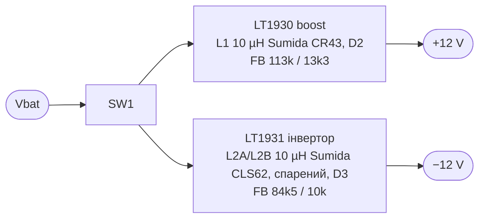

# Datasheets з mixerli: висновки

Джерело: <https://github.com/stahlnow/mixerli/tree/master/documentation/datasheets>
(копії PDF — у [datasheets/](datasheets/)),
а також схема `documentation/schematics/v1.0/pocket_mixer_schematics_v1.0.pdf`.
Сторінки PDF я відрендерив і прочитав (24.10.2026).

## 1. Фейдери Alps RS (Super Slide, `RS__1-1370683.pdf`)

> [!NOTE]
> Старий каталог з mixerli. У каталозі Alps 2026 `RS451121400A` є: креслення №20, без
> монтажної пластини й фіксаторів Ø2. Див. [01-faders.md](01-faders.md). Висновки про
> `RS451111B010` неактуальні після D23.

**`RS451121400A` у каталожній таблиці немає.** Найближча каталожна позиція —
`RS45112A400G` (креслення №11):

| | Dual `RS45112A400G` (кресл. 11) | Mono `RS451111B010` (кресл. 4) | Mono `RS45111A900F` (кресл. 8) |
|---|---|---|---|
| Хід | 45 мм | 45 мм | 45 мм |
| Корпус | 60 × **9** мм, кріплення 2 × M2 з кроком 56 мм | 60 × **8** мм | 60 × 8 мм |
| Важіль | **метал, тип 4, L1 = 20 мм** | **ізольований, тип B, L1 = 10 мм** | метал, тип 9-1, L1 = 10 мм |
| Монтажна пластина | є | немає | є |
| Виводи | 6 × Ø1,1, ряди через **55 мм**, + 2 × Ø2 (фіксатори) | 3 × Ø1,5, ряди через **50 мм** | 3 × Ø1,5, 50 мм, + 2 × Ø2 |
| Опір, характеристика | 10k, 1B (лінійна) | 10k, 1B | 10k, 1B |
| Потужність | 0,125 W | 0,25 W | 0,25 W |
| **Макс. напруга** | **10 V DC** | 10 V DC | 10 V DC |

Висновки:

- **Mono `RS451111B010` не збігається з dual ні важелем, ні висотою.** Важіль 10 мм
  проти 20 мм, інший тип важеля, отже інша ручка. Master-фейдери стирчатимуть
  нижче канальних. `RS45111A900F` теж не підходить: важіль 9-1 довжиною 10 мм.
- Точна пара для dual з важелем 4/20 мм — лише **напівстандартне замовлення**
  (див. схему кодування нижче). Це складніше для DIY.
- Footprint з mixerli збігається з кресленням 11 за рядами виводів (55 мм, Ø1,1),
  але **не має 2 × Ø2 фіксаторів**. Або в `RS451121400A` їх немає, або автор їх
  пропустив. `НЕ ВИЗНАЧЕНО`, з'ясуємо по реальному зразку або фото.
- **Макс. 10 V DC на резистивному елементі.** Подавати DC-зміщення на фейдери
  не можна. У mixerli фейдер стоїть одразу після джека, без DC, і так має лишитися.
- Схема кодування напівстандартних позицій (с. 357):
  `RS[хід][1=single|2=dual]1 – [важіль/довжина] – [C0 без фіксації] – [P0|P1 пластина] – [характеристика][опір]`.
  Характеристики: 1B (лін.), **15A (log/audio)**, 10A, 4B, 3B. Log для dual замовляється
  як напівстандарт.
- Цокольовка dual (с. 355): секції 1-2-3 і 1'-2'-3', 2 — повзунок. Це збігається з
  нетлистом mixerli: 1/4 → GND, 2/5 → повзунки, 3/6 → сигнал.

## 2. Bourns PTA (`pta.pdf`) — альтернатива фейдерам

- Хід 15, 20, 30, 45, 60 мм; **single і dual в одній серії** з однаковими важелями.
- Характеристики: **лінійна й audio (log)** у стандартній лінійці.
- Tracking error: 3 dB у діапазоні −40…0 dB.
- Найімовірніше, саме з цього автор mixerli обирав фейдери.

Чим PTA кращий за пару Alps: mono й dual з однаковим важелем, є log-характеристика,
можна взяти коротший хід. Потрібно перевірити наявність і ціну конкретних P/N.

## 3. NJM4580 (`NJM4580_E-218114.pdf`)

| Параметр | Значення |
|---|---|
| Живлення | ±2…±18 V |
| Струм споживання | **6 mA тип., 9 mA макс.** (на корпус) |
| Макс. вихід (RL ≥ 2k) | ±12 V мін. / ±13,5 V тип. (умови таблиці — `НЕ ВИЗНАЧЕНО`, ймовірно ±15 V) |
| GBW | 15 MHz |
| Slew rate | 5 V/µs |
| Шум | 0,8 µVrms (RIAA) |

У datasheet прямо сказано, що він придатний для headphone amp. Оновлена оцінка
споживання аналогу: ~16 корпусів × 6–9 mA = 0,1–0,15 A на рейл, тобто **2,3–3,5 W**.

## 4. Живлення ±12 V у mixerli v1.0 — дискретне, на LT1930 + LT1931

Схема v1.0 (аркуш 5/6) підтверджує, що до AliExpress-модуля (v2) автор мав
**власний ±12 V перетворювач**:

| | LT1930 / LT1930A | LT1931 / LT1931A |
|---|---|---|
| Функція | boost | інвертувальний |
| Корпус | **ThinSOT-5 (SOT-23-5)**, паяється вручну | ThinSOT-5 |
| Частота | 1,2 / 2,2 MHz | 1,2 / 2,2 MHz |
| Vin макс. | 16 V | 16 V (line reg. до 16 V) |
| З datasheet | 12 V @ 250 mA з 5 V (LT1930A) | −12 V @ 150 mA з 5 V; пульсації ~1 mVp-p |

Наслідки для нас:

- **Це сильна альтернатива китайському модулю.** Схема перевірена автором, корпуси
  під ручне паяння (D12). Шум і пульсації задокументовані, а в модуля вони невідомі.
  І це однаково перевикористання з mixerli (D9).
- З 2S (6,0–8,4 V) обидва чипи працюють у межах Vin ≤ 16 V з меншим коефіцієнтом
  перетворення, ніж з 5 V, тож запас по струму більший. Наш бюджет 0,1–0,15 A на
  рейл укладається в цифри datasheet, але для −12 V (150 mA з 5 V) запас невеликий.
  Перерахувати.
- Для 1S (3,0–4,2 V) струм був би суттєво меншим. Це ще один аргумент за 2S.
- Ціна й доступність LT1930/LT1931 в Україні — `НЕ ПЕРЕВІРЕНО`.

## 5. Інше

- **v1.0 мала аркуш «VU Meter»** з LM3914 (bar-graph на 10 LED), недороблений: вхід
  SIG ні до чого не під'єднаний. У v2 метр прибрано. Метри на OLED з ESP32 у нас
  закривають цю ж задачу.
- `RK14K12` — Alps 14 мм dual ротатор (send у mixerli). Беремо його для send і
  гучності навушників (D10).
- `PTVPTT` — Bourns PTV/PTT ротатори (dual, з центральною фіксацією) — альтернатива RK14.
- `SSSS9` — Alps слайд-перемикач живлення. `UJC-HP-3-SMT-TR` — USB-C (лише живлення).
- `74404054680` — Würth-дросель, `CR43`/`CLS62` — Sumida-дроселі для ±12 V перетворювача.

## 6. Перевірка номіналів ±12 V з v1.0 (для D18)

- LT1930: `VOUT = 1,255 V × (1 + R1/R2)` → 113k / 13k3 → **+11,9 V**.
- LT1931: опорна −1,255 V, струм NFB ~6 µA витікає з виводу. За формулою datasheet
  (текст формули витягся частково) 84k5 / 10k → **≈ −12,4 V** (`ОЦІНКА`). Для
  референсної схеми datasheet (29k4 / 10k → −5 V) формула дає узгоджений результат.
- Ліміт струму ключа обох чипів — 1,2 A (ном.). LT1931 у datasheet використовує
  спарений дросель Sumida CLS62-100 (2 × 10 µH), як і mixerli v1.0.
