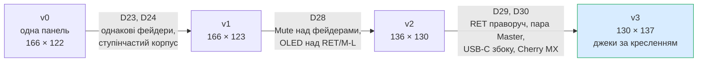
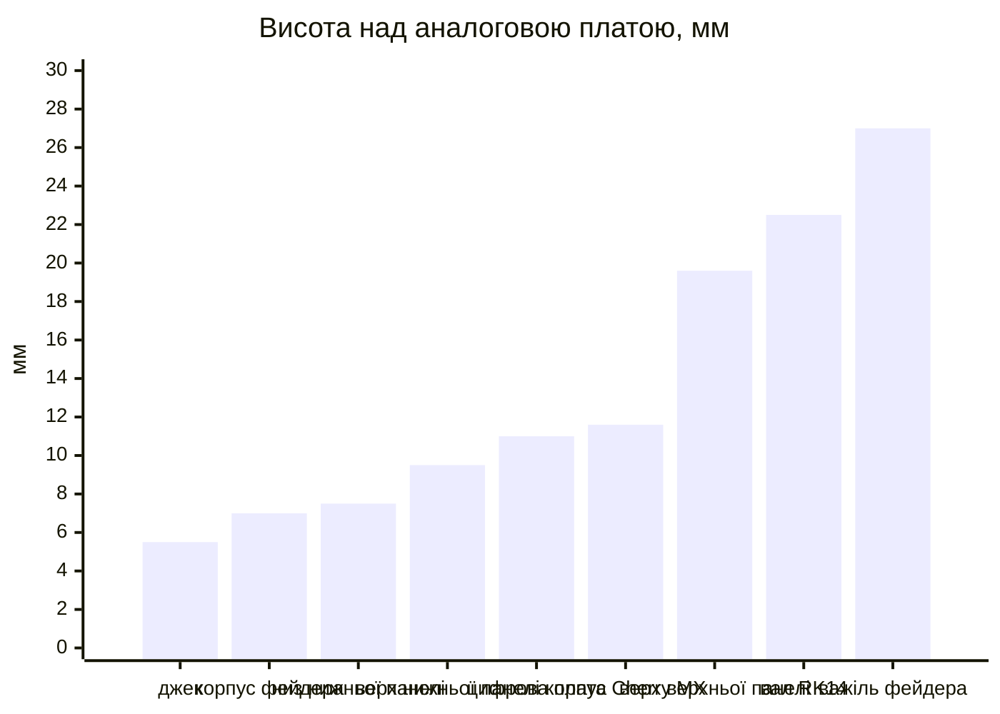

# B. Механіка — ітерація 3 (ступінчастий корпус, D24, D28–D30)

> [!NOTE]
> **Статус:** ескіз, 24.10.2026. Розміри з позначкою `ОРІЄНТИР` кресленнями не підтверджені.
> Генератор ескізу — [mech/layout_v3.py](mech/layout_v3.py), усі розміри задані параметрами
> на початку файлу. Корпус малює користувач (D24), тут лише компоновка й висоти.

> [!IMPORTANT]
> **Оновлено D54–D56 (25.10.2026):** ряд Mute тепер **під фейдерами** (y 125), фейдери зсунуто
> до ряду pan; 2S LiPo — знизу **від y 36 мм**, а не під усією платою; DIP моно/стерео — окремий на
> кожен канал. Ескіз v3 нижче цього ще не показує. Актуальна розстановка — [топологія v4](mech/topology-v4.svg)
> і 3D-модель ([15](15-3d.md)).
>
> **D57 (26.10.2026):** отвори M2 — H1 (стійка між платами + до дна), H3/H4 (передні кути до дна),
> H2 (цифрова, біля енкодера, до верхньої панелі); зона батареї тепер до y 131. Карта — [mech/mounting.svg](mech/mounting.svg).
>
> **D59 (26.10.2026):** SuperMini — згори на цифровій, USB-C на задньому краї; OLED +2,55 мм уперед, край цифрової — y 52.

Історія ітерацій:

## 1. Висоти

Над аналоговою платою (верх PCB = 0):

| Компонент | Точка кріплення до панелі | Верх органу керування | Джерело |
|---|---|---|---|
| Фейдер `RS451121400A`, 7 шт. | монтажна поверхня **7,0** (2 × M2) | важіль **27,0** (L1 = 20) | Alps 2026, кресл. 20 |
| Ротатор `RK14K12…` (send, pan, навушники) | корпус **7,5**, втулка M9 до 12,5 | вал **22,5** | Alps RK14K, кресл. 1 |
| Джек 3,5 мм горизонтальний SJ-43514-SMT | — | **5,0** | [креслення CUI](datasheets/sj-4351x-smt-series.pdf) |
| PLS + PBS (стандартні) | — | ~11 `ОРІЄНТИР` | типові висоти: PBS ~8,5, пластик PLS ~2,5; перевірити по конкретних P/N |
| OLED-модуль на своїй гребінці над цифровою платою | — | ≈ 4,9 | пластик 2,5 + плата ~1 + скло ~1,4 ([12](12-parts.md)) |
| Cherry MX (Mute, D30), PCB-mount | у панелі виріз ≥ 16 мм | корпус ~11,6 `ОРІЄНТИР` | MX2A: корпус 15,63 мм, висота 18,5 мм |

Дві панелі:

| Зона | Що під нею | Низ панелі | Верх панелі |
|---|---|---|---|
| **Нижня** (фейдери, send, pan, навушники) | аналогова плата | **7,5** | 9,5 |
| **Верхня** (задня смуга 20 мм + над RET/M-L до y ≈ 50, над M-R до y ≈ 38) | цифрова плата на 11…12,6 | **≈ 17,6** | ≈ 19,6 |

Сходинка ≈ **10 мм** `ОЦІНКА`. Вона зменшиться, якщо взяти нижчий роз'єм між платами
або нижчий OLED. Але міняти це варто лише тоді, коли корпус цього вимагатиме.

Переріз A-A через колонку CH1 — на ескізі вище (нижня частина SVG). Висоти над
аналоговою платою, мм:

Під платою: SMD ~2, 2S LiPo ~7, дно ~2, тобто −12,6 мм.

Що це дає:

1. **Роз'єм між платами — звичайні PLS/PBS** з кроком 2,54. Низькопрофільна пара більше не потрібна.
2. **Під цифровою платою ~11 мм.** Туди вільно влазять горизонтальні джеки (~5,5) і
   USB-C. ESP32-C3 SuperMini (22,52 × 18,00 мм, ряди виводів через 15,24 мм — datasheet; висота з USB-C ~3,2 мм `ОРІЄНТИР`) можна ставити
   на низ або на верх цифрової плати. Над платою ~5 мм, тож верх теж підходить.
3. **Ручки фейдерів** виступають над нижньою панеллю на ~17,5 мм (27 − 9,5), над верхньою на ~7.
   Вони однакові на всіх 7 колонках.
4. **Вал ротатора** виступає над нижньою панеллю на ~13 мм (22,5 − 9,5). Тому ротатори
   лишаються тільки в нижній зоні: під верхньою панеллю виступу не залишиться.
5. **Висота корпусу** `ОЦІНКА`: нижня зона ≈ 22 мм (−12,6…9,5), верхня ≈ 32 мм (−12,6…19,6).

## 2. Сітка (top view), ітерація 3 (D29)

Колонки зліва направо: ch1–ch4, Master L, Master R, RET (ефекти).

| Параметр | Значення | Чому |
|---|---|---|
| Крок каналів, CH4 → M-L | **18 мм** | корпус RK14 14 мм, ручка Ø ~12–15 |
| Крок M-R → RET | **20,5 мм** | footprint джека навушників 10,2 мм + 2 × 0,5 мм між корпусами фейдерів |
| Крок Master L → Master R | **11 мм** `ПРИПУЩЕННЯ` | корпус 9 мм + 2 мм; pad Ø2 на ±3,75 мм від осі → ~2 мм між міддю сусідніх фейдерів |
| Ширина | ≈ **130 мм** | крок M-R → RET 20,5 мм під footprint джека навушників |
| Верхня зона, задня смуга | y = 0…20 | RGB LED ch1–4 і RET, під ними джеки |
| Верхня зона над парою Master | y = 0…50 | OLED (y 21…49), між ручкою pan CH4 і енкодером ~31 мм |
| Верхня зона над RET | y = 0…38 | енкодер, центр y = 29 |
| Ряд send, pan (ch1–4) | y = 30, 47 | |
| Ротатор навушників | колонка RET, y = 47 | у нижній зоні, під енкодером |
| Кнопки Mute, Cherry MX (D30) | ch1–4, одна на пару Master, RET; центр y = 62,5 | корпус 15,63 мм, ковпачок ~15 мм відстоїть від ручки pan на ~1,5 мм |
| Фейдери | y = 71…131 | корпус фейдера починається за корпусом MX |
| Глибина | ≈ **137 мм** | |

Задній торець: IN1–IN4 під своїми колонками, MAIN під парою Master, SEND між MAIN і RET,
вхід RET під колонкою RET. Крок MAIN–SEND–RET ≈ 13 мм, між pad (10,2 мм) лишається 2,8 мм.

Правий торець: USB-C (y ≈ 28), під цифровою платою, за джеком RET.
Вертикальний USB-C (кабель зверху через панель) відкинуто: штекер стирчав би над
панеллю, і роз'єм приймав би навантаження згину на плату.

Передній торець: джек навушників між фейдерами Master R і RET. Від краю його pad до
корпусів обох фейдерів 0,5 мм, від корпусу джека ~2,6 мм (за кресленням CUI, п. 2a).

Ручка навушників від сходинки під енкодером відстоїть лише на ~2,5 мм. Якщо буде
незручно, ряд pan і кнопки зсуваються вперед.

ESP32-C3 SuperMini — **на верхньому боці цифрової плати, плоско, USB-C на задньому краї (D59)**; OLED зсунуто вперед
на 2,55 мм (центр y 37,2), нижній край цифрової плати — y 52. Верх USB-C ≈ 18,45 мм проти низу верхньої панелі ~17,6:
у панелі над модулем виїмка ~1 мм (`ОЦІНКА`).

## 2a. Джеки SJ-4351X-SMT (креслення CUI)

| Параметр | Значення |
|---|---|
| Корпус | 6,0 мм завширшки, 5,0 мм заввишки, 15,5 мм завдовжки + носик 1,5 мм |
| Footprint | **10,2 мм завширшки**: pad виступають на 2,1 мм з кожного боку корпусу; 2 фіксатори Ø1,7 |
| Контакти | **4-полюсний (TRRS):** 1 sleeve, 2 tip, 3 ring 1, 4 ring 2; варіанти з перемикачами T/R (43515TS/RS, 43516) |
| Монтаж | SMD, pad збоку корпусу — паяється паяльником (D12); у datasheet лише профіль reflow |
| Номінал | 12 V DC, 1 A |

Що з цього випливає:

- **TRRS замість TRS.** Звичайний стерео-штекер TRS своєю гільзою перекриває і ring 2, і
  sleeve. Тому **ring 2 з'єднуємо з GND**, tip = L, ring 1 = R. Моно-штекер замикає ring 1 на
  GND, як і в звичайному гнізді, тож ключ моно/стерео (D21) працює так само.
- **Ширина footprint 10,2 мм** визначає відстані. Джек навушників стоїть між фейдерами
  Master R і RET, тому крок M-R → RET збільшено з 18 до **20,5 мм**. Корпус тепер **≈ 130 × 137 мм**.
- Задні джеки MAIN–SEND–RET стоять з кроком 13 мм, між pad лишається 2,8 мм.
- USB-C на правому торці зсунуто до y ≈ 28 мм, щоб не впиратися в джек RET.

## 3. Pan-потенціометр — прийнято (D26)

У тій самій серії Alps RK14K є `RK14K124003H`: dual, 10k, 1B (лінійний),
**з центральною фіксацією**, вертикальний, каталожний (с. 325). Висота й footprint
ті самі, що в send-ротаторів, тож ряд виходить однаковим. Для пасивного pan
вистачає однієї секції. Номінал 10k перевірити в кроці C. Це альтернатива
Bourns PTV з D17.

## 4. Деталі, розміри яких ще треба підтвердити

| Деталь | Що потрібно | Статус |
|---|---|---|
| Горизонтальний джек 3,5 мм SJ-43514-SMT | ✅ креслення є: корпус 6,0 × 5,0 × 15,5 мм + носик 1,5; footprint 10,2 мм завширшки | див. п. 2a |
| PJ (навушники, передній торець) | те саме | — |
| PLS/PBS | конкретні P/N і висота стека | стандартні, `ОРІЄНТИР` 11 мм |
| OLED 0,96" 128×64 (SSD1306) | ✅ креслення Rajguru: 27,3 × 27,3 мм, отвори 20,7 × 23,2 | звірити з купленим модулем |
| ESP32-C3 SuperMini | висота з USB-C | ✅ 22,52 × 18,00 мм, ряди 15,24 мм ([datasheet](datasheets/esp32-c3-supermini.pdf)) |
| Cherry MX або сумісні (6 шт.) | креслення Cherry: footprint PCB-mount, висота корпусу над PCB; доступність в Україні (Cherry, Gateron, Kailh) | висота 18,5 і корпус 15,63 — з datasheet MX2A |
| RGB LED (SK6812 / WS2812) | корпус, світловод | — |
| Енкодер з кнопкою | ✅ референс Alps EC12D (кресл. 5): вал 17,5 мм над платою, без втулки | звірити з отриманим лотом ([12](12-parts.md)) |
| 2S LiPo pouch | 2 банки під 130 × 137 | — |
| `RS451121400A` | ✅ кресл. 20 каталогу Alps 2026: фіксаторів Ø2 немає, важіль метал 4 / 20 мм | footprint mixerli збігається |
| USB-C (задній торець), з даними (D25) | конкретний P/N горизонтального USB-C 2.0, креслення | — |

## 5. Закриті питання

1. USB-C на задньому торці — з даними для прошивки ESP32 (D25).
2. Pan — `RK14K124003H` (D26).
