# C. Signal flow і керування — ітерація 0

> [!NOTE]
> **Статус:** чернетка, 24.10.2026. Прийнято D31 (Mute після буфера), D32 (навушники
> до Master Mute) і D33 (метр Master на сумі). Номінали ще не наводжу, їх рахуємо в
> наступній ітерації.
>
> Позначки: `ПРОПОЗИЦІЯ` — ще не підтверджено користувачем; `ОЦІНКА` — мій розрахунок;
> `НЕ ПЕРЕВІРЕНО` — дані не з datasheet.

## 1. Signal flow

Топологія — mixerli v2.0.1 ([02-mixerli-analysis.md](02-mixerli-analysis.md)) плюс
рішення D4, D6, D17, D23, D29–D33, D42. На схемі один вхідний канал; ch1–4 однакові,
RET без send і pan.

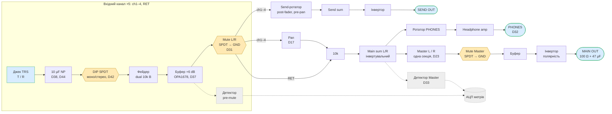

Жовті вузли — аналогові ключі під керуванням ESP, пунктир — метри.

## 2. Mute і Solo

### 2.1 Solo — лише прошивка

Окремої Solo-шини (PFL) немає. Solo реалізується тими самими ключами Mute:

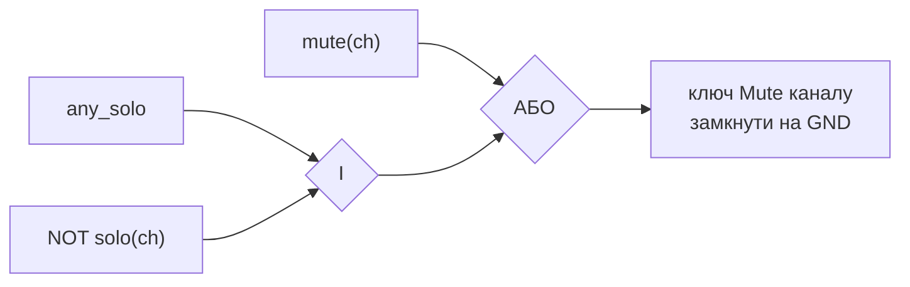

Це відповідає ТЗ: Solo non-destructive, Mute має пріоритет. Додаткового заліза не треба.

### 2.2 Де стоїть ключ Mute — прийнято (D31)

**Після вхідного буфера, перед send, pan і сумувальним резистором.** Ключ — DG413 (D41),
схема підключення в п. 3.0: SW1/SW4 (NO) послідовно, SW2/SW3 (NC) на GND, IN1–IN4 разом на
вихід MCP23017 з **pull-down**. Логіка 0 → **Mute**, 1 → звучить. При старті розширювач ще не
налаштований, тож на IN 0 і все заглушене.

- Mute глушить і main, і send. Це звичайна поведінка для post-fader send.
- Метр каналу береться **до** ключа, тож видно, що на заглушеному каналі є сигнал.
- Вихід буфера низькоімпедансний, а після ключа ≈ 8k, тож опір ключа (35 Ω макс.) дає ≈ 0,04 dB.
- У стані Mute вузол після ключа замкнений на GND, тож ізоляція висока. За datasheet
  off isolation DG413 — 68 dB на 1 MHz (RL = 50 Ω), на звукових частотах має бути краще.
- DG413 має break-before-make (25 ns), тож вихід буфера ніколи не замикається на GND.
- **Pull-down на IN дає тихий старт:** поки шини ±12 V встановлюються, усе заглушене.
  Прошивка знімає Mute після затримки.
- Клацання: DC на виході буфера — лише offset op-amp (мВ). Charge injection DG413 —
  5 pC (CL = 10 nF). Плавного згасання немає. Якщо клацання буде чутно,
  наступний крок — ключ у віртуальній землі. Перевіряти на прототипі.

### 2.3 Mute Master

Ключ SPDT у кожному плечі: після Master-фейдера, перед буфером, SxB → GND. Навушники
відгалужені до Master-фейдера, тому Master Mute їх не глушить (D32). Повзунок фейдера
сидить на виході суматора без DC-блокування (як у mixerli), тож на ньому може бути
offset суматора. Щоб не клацало, додати 47 µF + резистор зміщення перед ключем — `ПРОПОЗИЦІЯ`.

### 2.4 Метри й CLIP

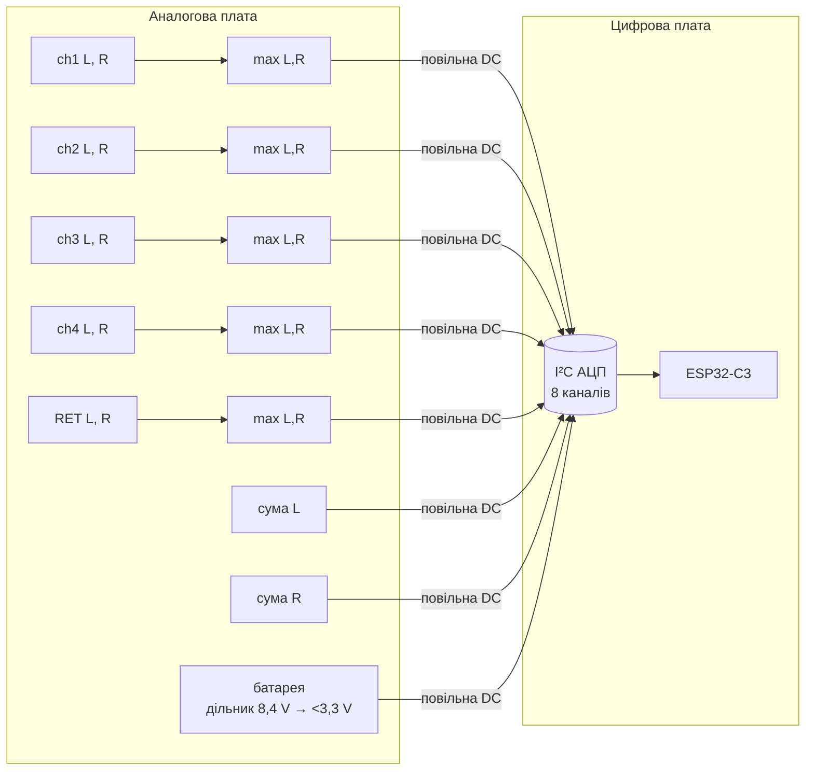

| Метр | Точка | Детекторів | Каналів АЦП |
|---|---|---|---|
| ch1–4 | вихід буфера, pre-mute | 2 на канал, max(L, R) через діодне АБО | 4 |
| RET | вихід буфера, pre-mute | 2 | 1 |
| Master L, R | вихід суматора, до Master-фейдера (D33) | 1 + 1 | 2 |
| Батарея | дільник | — | 1 |
| **Разом** | | **12** | **8** |

Master міряється на виході суматора, бо кліпінг виникає саме там, коли сума кількох
каналів перевищує запас. Після Master-фейдера рівень уже знижений, і перевантаження
суми не видно.

АЦП ESP32-C3 має лише 5 каналів ADC1 (GPIO0–4). Тому АЦП зовнішній, I²C, 8 каналів, на
цифровій платі. Кандидат — **TI ADS7828** ([datasheet](datasheets/ads7828.pdf)): 12 біт,
8 каналів, I²C, живлення 2,7–5 V, внутрішня опора 2,5 V, TSSOP-16. Отже, вихід детекторів
масштабуємо в 0…2,5 V (або опора = VDD). Детектори дають повільну
DC-напругу, тож через роз'єм між платами йдуть 8 «тихих» ліній.

Детектори не стоять в аудіотракті, тож вони на економних op-amp (D34), не на NJM4580. Атаку, спад і поріг CLIP визначимо в наступній ітерації.

## 3. Аналогові ключі

### 3.0 DG413 замість ADG1436 — прийнято (D41)

ADG1436 занадто дорогий: на AliExpress 980 ₴ за 5 шт., в Україні ~396 ₴/шт. Кандидат —
**Vishay DG413**: чотири ключі в корпусі SOIC-16, два NO + два NC
([datasheet rev. E](datasheets/dg411-dg413-vishay.pdf)).

| Параметр | DG413 | ADG1436 |
|---|---|---|
| Ключів у корпусі | **4 SPST** (SW1, SW4 — NO; SW2, SW3 — NC) | 2 SPDT |
| Живлення | V+ − V− ≤ 44 V, аналог ±15 V | ±4,5…±16,5 V |
| Опір ключа | 25 Ω тип., 35 Ω макс. (±13,5 V) | 1,5 Ω |
| Логіка | 0 ≤ 0,8 V, 1 ≥ 2,4 V при VL = 5 V | 2,0 / 0,8 V, VL немає |
| Break-before-make | є, 25 ns (лише DG413) | є |
| Charge injection | **5 pC** | −20 pC |
| Off isolation | 68 dB на 1 MHz | −80 dB на 100 kHz |
| Ціна | [LCSC C141600](https://www.lcsc.com/product-detail/Analog-Switches_VISHAY_DG413DY-T1-E3_DG413DY-T1-E3_C141600.html): ~$1,13, ~9000 шт. | ~$5–8 |

Розпиновка SOIC-16 (datasheet): 1 IN1, 2 D1, 3 S1, 4 V−, 5 GND, 6 S4, 7 D4, 8 IN4,
9 IN3, 10 D3, 11 S3, 12 VL, 13 V+, 14 S2, 15 D2, 16 IN2. Логіка 1 → SW1/SW4 замкнені,
SW2/SW3 розімкнені.

**Mute стереоканалу — один DG413, одна лінія керування:**

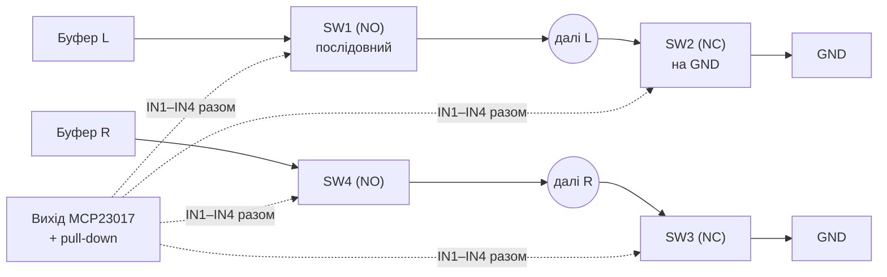

Логіка 0 (і pull-down при старті) → послідовні розімкнені, на землю замкнені → **Mute**.
Моно/стерео — механічний DIP-перемикач (D42), тож DG413 працюють лише на Mute.

| Функція | Корпусів DG413 |
|---|---|
| Mute ch1–4, RET, Master (стерео) | **6 × ~$1,13 ≈ $7** |

Що змінюється:

- Опір ключа 35 Ω замість 1,5 Ω. Після ключа Mute навантаження ≈ 8k (Rs 10k ‖ send 50k), тож
  втрата ≈ 0,04 dB. Нелінійність опору ключа на такому навантаженні спотворень майже не дає
  (`ОЦІНКА`, перевірити вимірюванням THD).
- Потрібен **VL = 5 V** (логічне живлення) — 5 V buck уже є на аналоговій платі (D22).
  3,3 V з MCP23017 вище порога 2,4 V.
- DigiKey пише, що `DG413DY` знятий з виробництва, а суфікси `-E3` / `-T1-E3` продаються
  (LCSC ~9000 шт.). Є аналог Maxim/ADI DG413. На AliExpress можливі підробки.

Інші варіанти, які я переглянув:

| Ключ | Ключів у корпусі | Ціна | Чому ні |
|---|---|---|---|
| DG333A (Vishay) | 4 SPDT, SOIC-20 wide | [LCSC](https://www.lcsc.com/product-detail/analog-switches-multiplexers_vishay-intertech-dg333adw-e3_C1546002.html) ~$3,9 | 5 корпусів ≈ $20 — удвічі дорожче за DG413 |
| ADG333A / MAX333A | 4 SPDT | $4,75 / $5,38 (1k, ADI) | дорожче |
| CD4066 / 4053 / 74HC4053 | 4 / 3 | центи | VDD − VSS ≤ 18–20 V, не тягнуть ±11 V сигналу |

### 3.0a Моно/стерео — механічний перемикач (D42)

Моно/стерео змінюється рідко, тож замість ключів і меню — механічний **SPDT** на кожен із
5 входів. Саме перемикач на два положення, а не просто вимикач (SPST): моно-штекер замикає R
на GND, тож перемичка T↔R замкнула б і T.

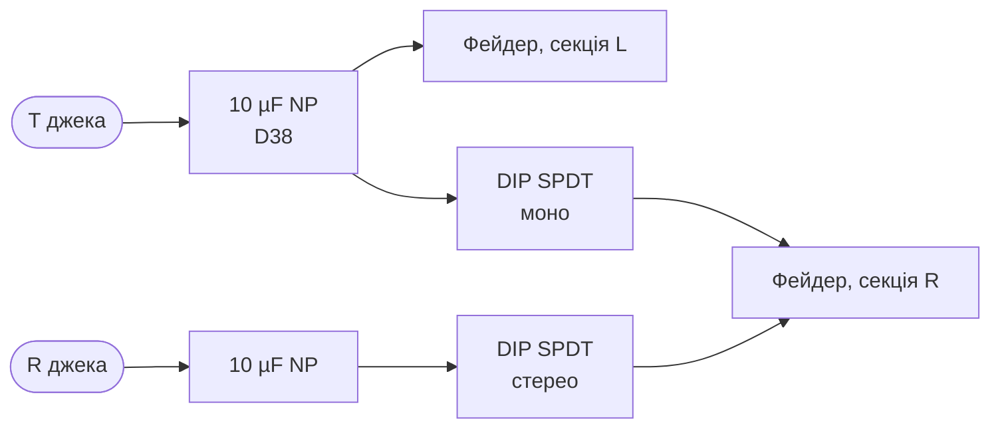

Перемикач стоїть **після** розділових конденсаторів, тож через контакти не тече постійний струм.

| Кандидат | Що | Статус |
|---|---|---|
| SPDT DIP-блок SMD, 5–6 позицій (напр. CTS 204-12x, Grayhill 76HP) | один компонент, крок 2,54 мм | `НЕ ПЕРЕВІРЕНО`: конкретний P/N, ціна, footprint |
| 5 мініатюрних SMD SPDT слайд-перемикачів | дешево | більше місця |

**Розміщення (D43):** SMD-перемикачі на нижньому боці аналогової плати, доступ через вікно в
дні корпусу. Під вікном не має бути батареї.

### 3.1 ADG1436 (відкинуто через ціну, D41) — для історії

> [!IMPORTANT]
> **Виправлення.** Під назвою DG419L продаються дві **різні** мікросхеми:
>
> | | Vishay DG419L | Maxim DG419L ([datasheet](datasheets/dg417l.pdf), 19-2170 rev 0) |
> |---|---|---|
> | Живлення | 3–12 V або ±3…±6 V (за Mouser) — **не підходить** | **±4,5…±20 V** або +9…+36 V — підходить |
> | Опір ключа | — | 35 Ω макс. |
> | Логіка | — | VIH 2,0 V, VIL 0,8 V, «+3 V-сумісна від ±12 V» |
> | Корпус | — | SO-8, µMAX, DIP; один SPDT |
>
> Раніше я назвав DG419L непридатним за даними Vishay, і для Vishay це правда. Але Maxim DG419L
> працює від ±12 V. Після D41 основний ключ — DG413 (4 ключі в корпусі); Maxim DG419L
> (1 SPDT у корпусі) — запасний варіант, lifecycle після переходу Maxim в ADI не перевіряв.

Попередній кандидат — **Analog Devices ADG1436** (dual SPDT, TSSOP-16, паяється вручну, D12).
Дані з [datasheet rev. B](datasheets/adg1436.pdf):

| Параметр | Значення | Умови |
|---|---|---|
| Живлення | **±4,5…±16,5 V** dual, abs max VDD−VSS 35 V | табл. 1 |
| Аналоговий діапазон | VSS…VDD | |
| Опір ключа | 1,5 Ω тип. | ±15 V, VS = ±10 V |
| Логіка | **VINH 2,0 V мін., VINL 0,8 V макс.**, VL не потрібен | 3,3 V від розширювача — з запасом |
| Break-before-make | 20 ns тип., 10 ns мін. | |
| Charge injection | −20 pC тип. | VS = 0 V, CL = 1 nF |
| Off isolation | −80 dB тип. | 100 kHz, RL = 50 Ω |
| THD+N | 0,011 % тип. | RL = 110 Ω, 15 V p-p, 20 Hz–20 kHz |
| Струм споживання | 0,001 µA тип. (входи 0 V або VDD); 170 µA при вході 5 V | |
| Таблиця істинності (TSSOP) | IN = 0 → SxB; IN = 1 → SxA | табл. 7 |
| Розпиновка TSSOP | 1 IN1, 2 S1A, 3 D1, 4 S1B, 5 VSS, 6 GND, 9 IN2, 10 S2A, 11 D2, 12 S2B, 13 VDD; 7, 8, 14–16 NC | табл. 6 |

> [!WARNING]
> Табличні значення специфіковані для ±15 V ±10 % і для +12 V single. Для ±12 V
> гарантованих цифр немає. Опір ключа буде трохи більшим, для нашого застосування це некритично.

Запасний — DG403 (dual SPDT, ±5…±17 V, < 45 Ω, логіка 0,8/2,4 V). Деякі варіанти
(Renesas DG403DVZ-T) Obsolete, тож статус перевіряти.

| Функція | SPDT | Корпусів ADG1436 |
|---|---|---|
| Mute ch1–4, RET (L + R, IN1 і IN2 разом) | 10 | 5 |
| Mute Master (L + R) | 2 | 1 |
| Моно/стерео ch1–4, RET (D21) | 5 | 3 (1 SPDT вільний) |
| **Разом** | 17 | **9** |

Ціну й наявність в Україні ще не перевіряв.

## 4. Лінії керування

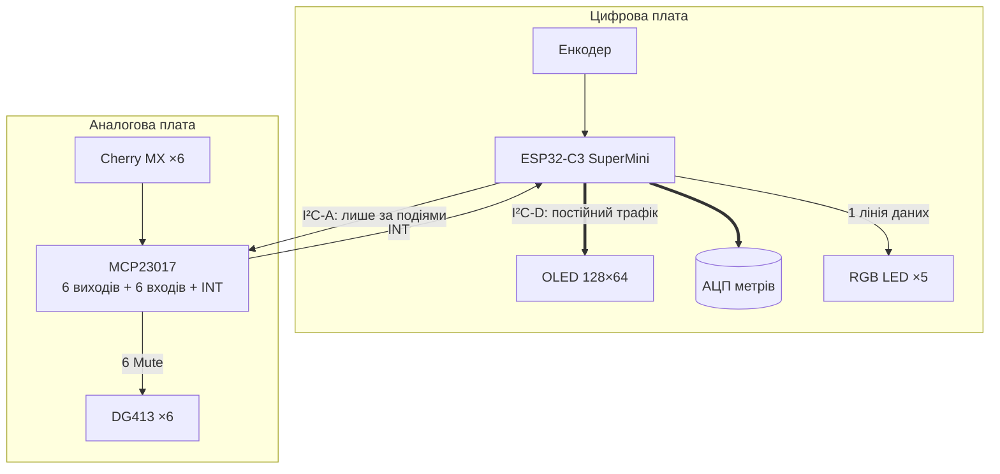

### 4.1 Розширювачі `ПРОПОЗИЦІЯ`

| Чіп | Де | Що | I/O |
|---|---|---|---|
| MCP23017 ([datasheet](datasheets/MCP23017.pdf) DS20001952D: SOIC-28 wide, 1,8–5,5 V, INTA/INTB) | аналогова плата | **порт A:** GPA0–GPA5 — 6 виходів Mute; **порт B:** GPB0–GPB5 — 6 кнопок Cherry MX (interrupt-on-change); INTA/INTB віддзеркалені → один INT на ESP | 16 (4 вільні: GPA6, GPB6; GPA7 і GPB7 — лише виходи) |

Після D42 потрібно 12 ліній: 6 виходів і 6 входів. Один MCP23017 їх вміщує, тож
**MCP23008 більше не потрібен**.

За datasheet чип стартує з усіма пінами як входи. Тому на лініях IN DG413 потрібні
pull-down (п. 2.2). Від 2,7 V чип працює з I²C 400 kHz.

MCP23017 живиться від 3,3 V. Тоді I²C сумісний з ESP без перетворювача рівнів, а
3,3 V на виході перевищує поріг логічної 1 DG413 (2,4 V при VL = 5 V). 3,3 V можна взяти з SuperMini через
роз'єм, бо струм тут мізерний.

### 4.2 Дві шини I²C

На цифровій платі OLED оновлюється постійно, кілька разів на секунду. Якщо ця сама
шина йде на аналогову плату, тактовий сигнал I²C безперервно проходить біля аудіо.
Тому шин дві:

- **I²C-D** (цифрова плата): OLED і АЦП метрів. Трафік постійний.
- **I²C-A** (аналогова плата): MCP23017. Трафік лише при натисканні кнопки
  або зміні стану. Решту часу лінії стоять.

У ESP32-C3 один апаратний контролер I²C. Для I²C-A з малим трафіком вистачить
програмного I²C на двох інших пінах (`ПРИПУЩЕННЯ`, перевірити в прошивці).

### 4.3 Піни ESP32-C3 SuperMini

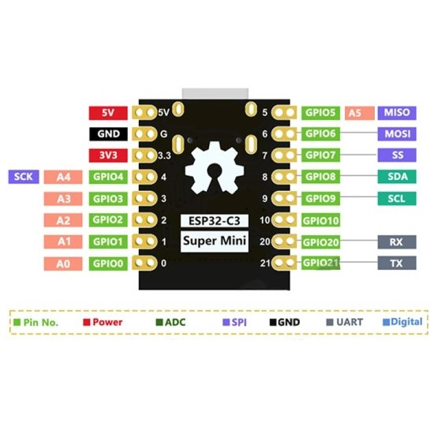

Розпиновка з картинки продавця ([mini-tech.com.ua](https://www.mini-tech.com.ua/image/cache/catalog/communication/esp32-c3-3-550x550.jpg)):
ліворуч 5V, GND, 3V3, GPIO4…0; праворуч GPIO5…10, 20, 21. Разом **13 GPIO: 0–10, 20, 21**,
ADC — GPIO0–4. Це збігається з описами плати.

За [datasheet ESP32-C3](datasheets/esp32-c3_datasheet_en.pdf) (табл. 3-1, 3-3): strapping —
**GPIO2, GPIO8, GPIO9**. Для звичайного старту GPIO9 = 1 (є слабка підтяжка, на платі — кнопка
BOOT), GPIO8 = 1 для режиму завантаження, GPIO2 рекомендовано підтягнути до 1. GPIO8 на платі
керує синім LED.

**Схема плати з [datasheet SuperMini](datasheets/esp32-c3-supermini.pdf)** підтверджує:

| Що | За схемою | Наслідок для нас |
|---|---|---|
| Чип | ESP32-C3FN4 (4 MB flash у корпусі) | — |
| Розмір | 22,52 × 18,00 мм, ряди виводів через 15,24 мм, крок 2,54 | footprint модуля |
| Пін «5V» | це **VBUS**: з'єднаний з USB-C напряму, далі діод Шотткі BAT60J → VSYS → LDO ME6211 (SOT-23-5) → 3,3 V | наш 5 V іде через діод модуля; **див. попередження нижче** |
| GPIO9 | кнопка BOOT на GND + підтяжка 10k до 3,3 V | кнопка енкодера паралельно — працює (D40) |
| GPIO8 | синій LED від 3,3 V через 5,1k, світиться при 0 | лишити вільним або як вихід |
| EN (CHIP_EN) | підтяжка 10k, 100 nF, кнопка RST; **на піни не виведено** | автоматичного скидання немає (D40) |
| UART0 | **U0TXD = GPIO21, U0RXD = GPIO20** (так і в datasheet ESP32-C3) | CH340N TXD → GPIO20, GPIO21 → CH340N RXD — як заплановано |
| USB D−/D+ (GPIO18/19) | лише на USB-C модуля через 22 Ω | підтверджено: на піни не виведено (D40) |

> [!WARNING]
> **Не підключати USB-кабель до роз'єму самого SuperMini, коли мікшер увімкнений.** Пін 5V
> з'єднаний з VBUS його USB-C напряму, тож наш 5 V пішов би в комп'ютер або зарядку (datasheet:
> «USB і зовнішнє живлення — лише щось одне»). Прошивка — через USB-C корпусу й CH340N.
> У тексті datasheet SuperMini GPIO20/21 названо навпаки (20 — TX); схема й datasheet ESP32-C3
> кажуть інакше — довіряємо схемі.

> [!NOTE]
> **GPIO18/19 (USB D−/D+) на піни SuperMini не виведено**, тому USB-C на корпусі
> підключено через міст **CH340N** до UART0 (D40).

#### USB-UART міст (D40)

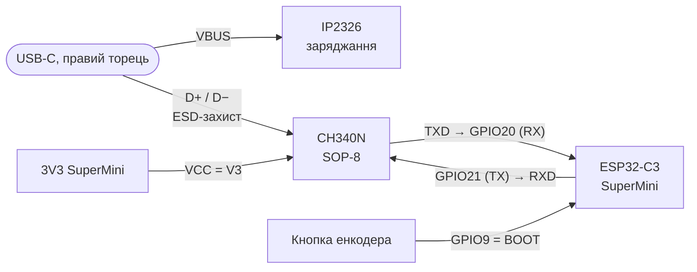

| Параметр CH340N | Значення | Джерело |
|---|---|---|
| Корпус | SOP-8, крок 1,27 мм; кварц не потрібен | [datasheet WCH](datasheets/CH340DS1.pdf), розд. 3, 5.1 |
| Виводи | 1 UD+, 2 UD−, 3 GND, 4 RTS#, 5 VCC, 6 TXD, 7 RXD, 8 V3 | розд. 4 |
| Живлення 3,3 V | VCC і V3 разом; інші сигнали ≤ 3,3 V | розд. 5.1 |
| Струм при 3,3 V | 4 mA тип. / 12 mA макс.; **у сні USB 0,04 / 0,15 mA** | розд. 6 |
| D+/D− | напряму на роз'єм, без послідовних резисторів; підтяжка USB вбудована | розд. 4, 5.1 |

Рішення в схемі:

- **Живлення CH340N — від 3V3 SuperMini**, а не від VBUS. Datasheet радить живити міст від
  того ж джерела, що й MCU, щоб струм не тік через I/O у вимкнений ESP. Без USB-кабелю міст спить:
  ~40 µA, на автономність не впливає. Наслідок: прошивати можна лише з увімкненим мікшером.
- **Звичайне оновлення:** прошивка за командою з меню перезавантажує ESP у режим завантажувача
  ROM, далі esptool по UART без автоматичного скидання (`ПРИПУЩЕННЯ`: перевірити механізм
  примусового завантажувача для ESP32-C3 в ESP-IDF).
- **Аварійне відновлення:** кнопка енкодера підключена до **GPIO9 (BOOT)**. Затиснути її,
  увімкнути живлення — і ESP стартує в режимі завантаження (datasheet ESP32-C3, табл. 3-3:
  GPIO9 = 0). Режим завантаження підтримує UART0. Пін EN на SuperMini не виведено, тому
  автоматичного скидання через DTR/RTS немає. RTS# лишається не підключеним.
- **ESD на D+/D−:** малоємнісна збірка в SOT-23-6, кандидат USBLC6-2SC6 (`НЕ ПЕРЕВІРЕНО`).
- **CC1, CC2:** по 5,1k на GND окремо (досвід mixerli).

| Функція | Ліній | GPIO |
|---|---|---|
| I²C-D SDA/SCL (OLED, АЦП) | 2 | 4, 5 |
| I²C-A SDA/SCL (розширювачі) | 2 | 6, 7 |
| INT кнопок (MCP23017) | 1 | 3 |
| Енкодер A/B | 2 | 0, 1 |
| Кнопка енкодера = BOOT | 1 | **9** (strapping, слабка підтяжка, кнопка BOOT на платі паралельно) |
| Дані RGB LED (5 × SK6812MINI-E, D36) | 1 | 10, через перетворювач рівня 3,3 → 5 V |
| UART0 ↔ CH340N (D40) | 2 | 20 (RX), 21 (TX) |
| **Разом** | **11** | вільні: 2, 8 (обидва strapping — лише як виходи або з підтяжкою до 1) |

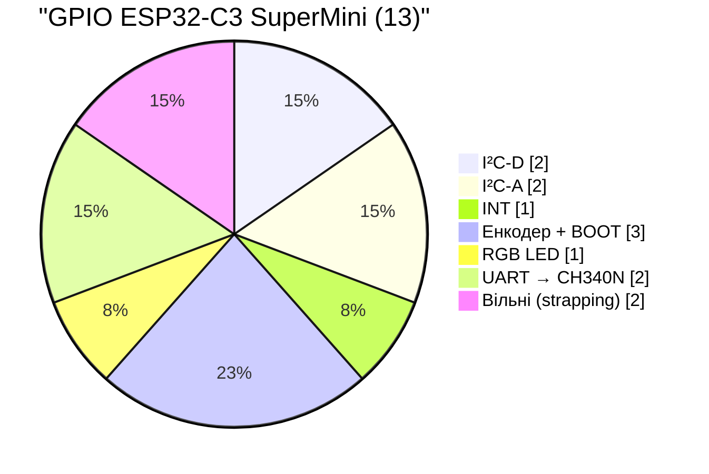

Напругу батареї міряє зовнішній АЦП (п. 2.4), тож пін ESP під неї не потрібен.

## 5. Живлення ±12 V — бюджет `ОЦІНКА`

> [!NOTE]
> Бюджет нижче розраховано для NJM4580 скрізь. Після D37 (OPA1678 + TL062) і D39 струм
> ≈ 50–80 mA на шину — див. [07-gain-structure.md](07-gain-structure.md), п. 4.1.

| Вузол | Корпусів dual op-amp |
|---|---|
| Вхідні буфери ch1–4, RET | 5 |
| Main sum L/R | 1 |
| Master: буфер + інвертор (полярність) | 2 |
| Send: sum + інвертор | 2 |
| Headphone amp | 1–2 |
| Детектори метрів (12) | 6 (або 3 quad) |
| **Разом** | **17–18** |

NJM4580: 6 mA тип. / 9 mA макс. на корпус. Отже ≈ 105–160 mA на кожну шину в спокої,
плюс до ~30 mA на навушники 32 Ω. Разом **≈ 135–190 mA на шину**.

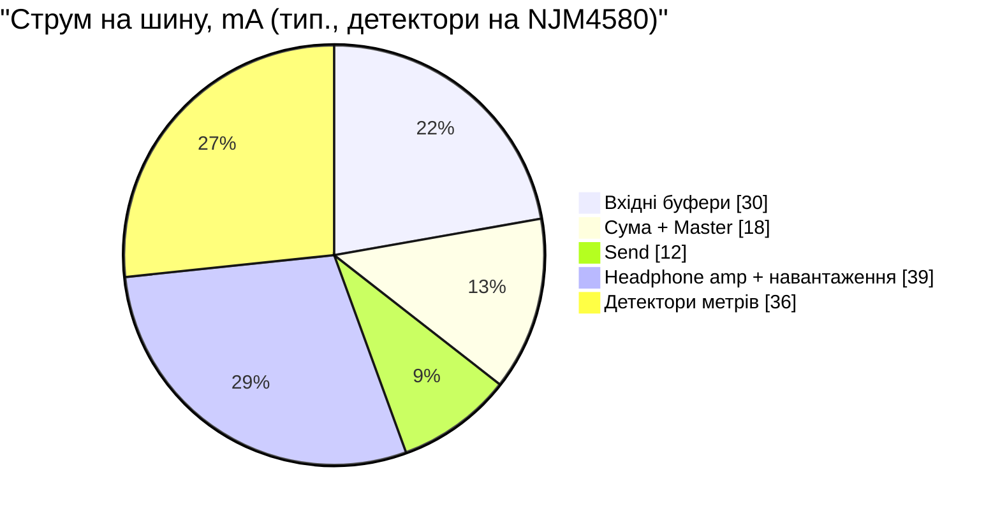

Оцінка LT1931 від батареї. Струм ключа — це вхідний плюс вихідний струм (інвертор з
двома дроселями), ліміт ключа 1 A мін. (datasheet). Модель
Iout ≈ (1 A − пульсації) / (1 + |Vout| / (Vin · η)) дає при 5 V ~200 mA, а datasheet
каже 150 mA. Тому модель масштабую на 0,75:

| Vin (2S) | Iout max −12 V `ОЦІНКА` | Потрібно (NJM4580 скрізь) | Потрібно (економні детектори) |
|---|---|---|---|
| 6,0 V (розряджена) | ~170 mA | 135–190 mA ⚠️ | ~100–140 mA ✅ |
| 7,4 V (номінал) | ~210 mA | ✅ | ✅ |
| 8,4 V (заряджена) | ~230 mA | ✅ | ✅ |

LT1930 (+12 V) за тією самою логікою від 6,0 V дає ~300 mA. Запас там є.

Висновки:

1. **−12 V — вузьке місце** при розрядженій батареї.
2. **Прийнято D34: детектори на економних op-amp.** Це −40…50 mA на шину, і запас
   з'являється навіть при 6,0 V.
3. **D35: окремої апаратної відсічки немає.** Прошивка попереджає на OLED (п. 5.1).
   Захист банок від глибокого розряду дає BMS/PCM.
4. Перевірити на прототипі реальний струм і пульсації під навантаженням.
5. Споживання ≈ 2 × 12 V × 0,17 A ≈ 4 W, з батареї ~5 W при ККД 80 %. Від 2S
   1500 mAh це **≈ 2 год** — менше, ніж оцінка в [03-power-2s.md](03-power-2s.md).

### 5.1 Автономність (KPI, D34) і попередження про розряд (D35)

Що впливає на час роботи, від найбільшого:

| Важіль | Ефект | Статус |
|---|---|---|
| Op-amp аудіотракту (11–12 корпусів NJM4580 × 6 mA) | найбільший споживач | шукати економніший кандидат разом з розрахунком шуму |
| Детектори на економних op-amp | −40…50 mA на шину | прийнято (D34) |
| RGB LED: ~1 mA кожен навіть вимкнений (datasheet SK6812MINI-E) | ~5 mA на 5 V | вимикати шину LED ключем, коли всі погашені — `ПРОПОЗИЦІЯ` |
| Радіо ESP32 вимкнене | — | прийнято (D27) |
| Яскравість OLED і LED | | обмежити програмно (ТЗ) |

Попередження про розряд — у прошивці, за каналом «батарея» АЦП. Пороги `ПРОПОЗИЦІЯ`:

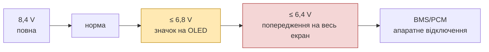

Точні пороги прив'язати до розрядної кривої обраних банок і до мінімальної напруги, від
якої LT1931 ще тримає −12 V під навантаженням.

## 6. RGB LED (D36)

**SK6812MINI-E** (OPSCO, [datasheet Rev. 04](datasheets/SK6812MINI-E.pdf)):

| Параметр | Значення |
|---|---|
| Корпус | 3,2 × 2,8 × 1,78 мм, 4 бічні виводи (5,6 мм по виводах) |
| Монтаж | корпус у вирізі плати, світить на інший бік (рекомендований footprint у datasheet) |
| VDD | 3,7–5,5 V |
| Логіка | VIH ≥ 0,7·VDD, VIL ≤ 0,3·VDD (при 5 V: VIH ≥ 3,5 V) |
| Струм LED | 12 mA на колір (версія -E) |
| Струм спокою | ~1 mA |
| PWM | **1,2 kHz** |

Що з цього випливає:

1. **Ручне паяння:** виводи збоку корпусу, D12 виконується. Менші корпуси (1515, 2020)
   мають pad під корпусом, їх паяють лише reflow, тож їх відкинуто.
2. **Монтаж через виріз** підходить нам якраз: LED паяється на **низ** цифрової плати й
   світить угору через виріз до панелі. Під цифровою платою вільно ~11 мм.
3. **Рівень даних:** ESP дає 3,3 V, а при VDD = 5 V потрібно ≥ 3,5 V. Ставимо
   перетворювач рівня, кандидат — 74AHCT1G125 у SOT-23-5 (`НЕ ПЕРЕВІРЕНО`).
4. **PWM 1,2 kHz лежить у звуковому діапазоні.** Імпульси струму LED на цій частоті можуть
   пролізти в аудіо через живлення й землю. Що робимо: окремий фільтр на шині LED
   (LC або RC + bulk), LED тільки на цифровій платі, низька яскравість (менша амплітуда
   імпульсів), землю LED повертати до входу 5 V, а не через аналогову зону. Перевіряти на прототипі.

## 7. Роз'єм між платами — попередньо

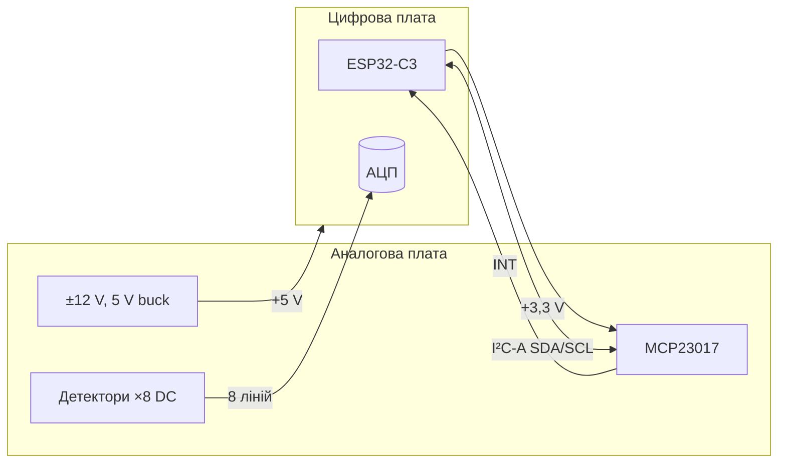

| Група | Ліній |
|---|---|
| I²C-A + INT | 3 |
| Метри (DC) + батарея | 8 |
| +5 V, +3,3 V | 2+ |
| GND (між групами) | 4+ |
| **Разом** | ~17–20 → 2 × 10 або 2 × 12 |

Кнопки, LED, OLED і енкодер стоять на тій самій платі, що й їхні споживачі, крім кнопок
Mute: вони йдуть на MCP23017 на аналоговій платі. Повний pinout — крок D.

## 8. Що далі

- [x] Ключі: DG413 (D41), звірено з datasheet Vishay.
- [x] LT1931/LT1930 від 6,0 V — оцінка (п. 5).
- [x] Datasheets MCP23017/MCP23008 і ADS7828 — ключові параметри звірено.
- [x] Gain structure й headroom на ±12 V — [07-gain-structure.md](07-gain-structure.md).
- [x] Схема детектора метра й CLIP — [08-meter-detector.md](08-meter-detector.md).
- [ ] Headphone amp: NJM4580 на 16–32 Ω чи окремий чип.
- [ ] Економніший op-amp для аудіотракту (D34): порівняти струм і шум з NJM4580.
- [ ] Перетворювач рівня для LED: datasheet 74AHCT1G125 або аналога.
