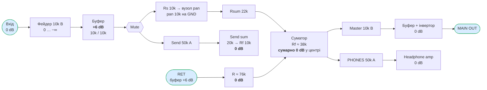
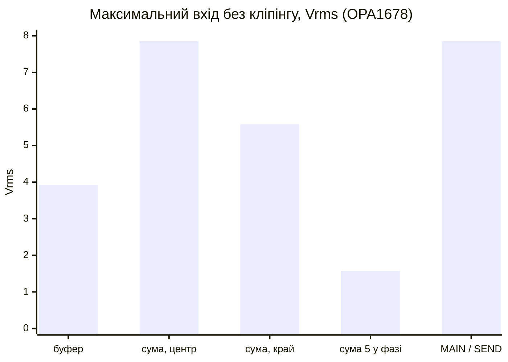
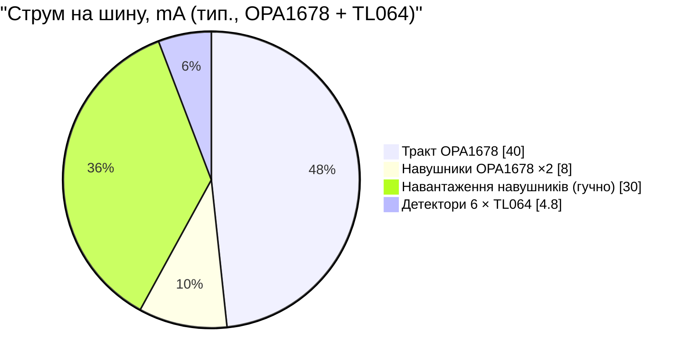
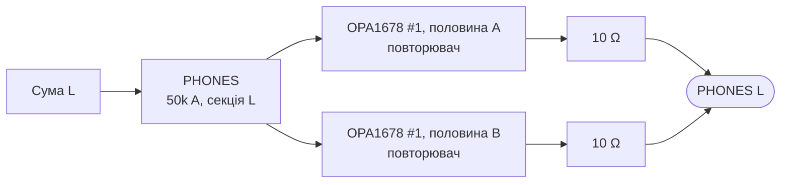
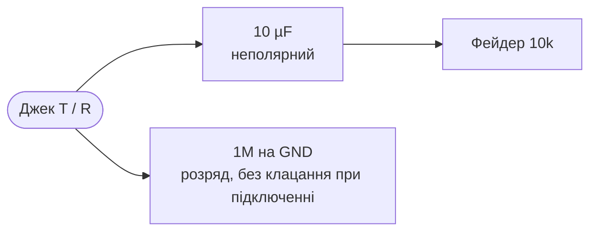

# C. Рівні по тракту (gain structure) — ітерація 0

> [!NOTE]
> **Статус:** розрахунок, 24.10.2026. Цифри генерує [calc/gain_structure.py](calc/gain_structure.py),
> параметри задані на початку файлу. Усе тут `ОЦІНКА` за datasheet і формулами. Вимірювань
> ще не було. Номінали — `ПРОПОЗИЦІЯ`.

## 1. Вихідні дані

| Що | Значення | Джерело |
|---|---|---|
| Шини | +11,9 V / −12,4 V | номінали LT1930/LT1931 з mixerli v1.0 ([04](04-mixerli-datasheets.md)) |
| Вихід NJM4580 | VOM ≥ ±12 V при ±15 V, RL ≥ 2k → **до шини гарантовано 3 V** | [datasheet](datasheets/NJM4580_E-218114.pdf) |
| Вихід OPA1678 | **(V−) + 0,8 … (V+) − 0,8 V** | [datasheet](datasheets/opa1678.pdf) |
| Фейдер | 10k B, макс. 10 V DC | Alps RS ([04](04-mixerli-datasheets.md)) |
| Pan | `RK14K124003H`, 10k лінійний, повзунок на GND (D17, D26) | |
| Мета | **unity:** вхід = MAIN OUT при фейдері каналу й Master на максимумі, pan у центрі | `ПРОПОЗИЦІЯ` |

## 2. Тракт і підсилення

### 2.1 Pan

Пасивний pan має «закон» (просідання в центрі відносно краю), який залежить від
співвідношення Rs, pan і Rsum. Перебір у скрипті:

| Rs | Rpan | Rsum | Закон pan | Rf для unity |
|---|---|---|---|---|
| 10k | 10k | 10k | −2,5 dB | 20k |
| **10k** | **10k** | **22k** | **−3,0 dB** | **38k** |
| 10k | 10k | 47k | −3,2 dB | 75k |

Обираю **Rs = 10k, Rsum = 22k**: −3 dB у центрі — це класичний «constant power» закон.
Pan на краю дає +3 dB відносно unity.

### 2.2 Номінали `ПРОПОЗИЦІЯ`

| Елемент | Розрахунок | Ряд E96 |
|---|---|---|
| Буфер каналу | +6 dB, як у mixerli | 10k / 10k |
| Rs (буфер → вузол pan) | | 10k |
| Rsum (вузол pan → суматор) | | 22k (E24) |
| Rf суматора | 38,0k | 38,3k |
| R входу RET (без pan) | 76,0k | 76,8k |
| Send: вхід / Rf | unity при send max | 20k / 10k |
| Master: буфер, інвертор | 0 dB | 10k / 10k (інвертор) |

## 3. Запас до кліпінгу

Межа виходу, гарантована від +11,9 V: **NJM4580 — 8,9 Vpk, OPA1678 — 11,1 Vpk.**

| Вузол | Рівень відносно входу | Макс. вхід, NJM4580 | Макс. вхід, OPA1678 |
|---|---|---|---|
| Вихід вхідного буфера (фейдер max) | +6,0 dB | 3,15 Vrms (+12,2 dBu) | 3,92 Vrms (+14,1 dBu) |
| Сума: 1 канал, pan у центрі | 0 dB | 6,29 Vrms (+18,2 dBu) | 7,85 Vrms (+20,1 dBu) |
| Сума: 1 канал, pan на краю | +3,0 dB | 4,47 Vrms (+15,2 dBu) | 5,58 Vrms (+17,1 dBu) |
| Сума: 5 однакових каналів у фазі | +14,0 dB | 1,26 Vrms (+4,2 dBu) | 1,57 Vrms (+6,1 dBu) |
| MAIN OUT, SEND OUT | 0 dB | 6,29 Vrms (+18,2 dBu) | 7,85 Vrms (+20,1 dBu) |

### 3.1 Типові джерела (OPA1678)

| Джерело | Vrms | dBu | Запас буфера | Запас суми, 5 каналів у фазі |
|---|---|---|---|---|
| Споживчий line −10 dBV | 0,32 | −7,8 | +21,9 dB ✅ | +13,9 dB ✅ |
| Pro line +4 dBu | 1,23 | +4,0 | +10,1 dB ✅ | +2,1 dB ✅ |
| CD / DAC 2 Vrms | 2,00 | +8,2 | +5,9 dB ✅ | −2,1 dB ⚠️ |
| Eurorack ±5 V | 3,54 | +13,2 | +0,9 dB ⚠️ | −7,1 dB ⚠️ |

Як це читати:

- **Сума 5 каналів у фазі** — найгірший випадок: усі джерела грають той самий сигнал
  на максимумі фейдерів. Реальні некорельовані джерела складаються як √N, а не N. Цей
  випадок ловить метр/CLIP Master (D33), а користувач прибирає фейдери.
- **Eurorack** на фейдері max майже впирається в буфер. Фейдер на 90 % ходу (−0,9 dB
  для лінійного) уже дає запас. Окремий режим не потрібен.
- **Буфер +6 dB лишаємо**, як у mixerli. Якщо прибрати підсилення в буфері, Rf і R входу RET виростуть удвічі, і шум суматора теж.

### 3.2 Шум

Шум на виході суматора з усіма п'ятьма входами (заглушені теж підключені до GND):
**≈ 11 µVrms, −97 dBu** у смузі 20 Hz–20 kHz (резистори + op-amp, noise gain 7,5).
Відносно 1 Vrms це ≈ 99 dB, до максимального виходу (+20 dBu) ≈ 117 dB. Шум
джерел і вхідних буферів сюди не входить.

## 4. Op-amp: NJM4580 → OPA1678 — прийнято (D37)

| | NJM4580 (mixerli) | **OPA1678** | TL062 / TL064 (детектори) |
|---|---|---|---|
| Струм | 6 mA тип. / 9 макс. на корпус | **2 / 2,5 mA на канал** → 4 / 5 на корпус | **0,2 / 0,25 mA** на підсилювач |
| Вихід до шини | 3 V гарант. | **0,8 V** | VOM ±10 V при ±15 V, RL 10k |
| Шум | ~3,3 nV/√Hz (графік) | 4,5 nV/√Hz | 30 nV/√Hz |
| Живлення | ±2…±18 V | ±2,25…±18 V | до ±18 V abs max |
| Корпус | SOP8 | SOIC-8 (dual) | SOIC-8 |
| Джерело | [datasheet](datasheets/NJM4580_E-218114.pdf) | [datasheet](datasheets/opa1678.pdf) | [datasheet](datasheets/tl062.pdf) |

Чому OPA1678 для тракту: на третину менший струм, на ~2 dB більший запас (вихід ближче до шин),
а більший власний шум (4,5 проти 3,3 nV/√Hz) на тлі шуму резисторів суматора не помітний.
Заміну компонента mixerli підтверджено (D37).

TL062 для детекторів: струм у 30 разів менший за NJM4580. Шум і точність детектору не
критичні. Вхідний діапазон TL062 біля шин обмежений, але сигнал на детектор однаково
спершу масштабується вниз під АЦП 0…2,5 V.

### 4.1 Бюджет ±12 V після заміни

| Вузол | Корпусів | Струм, тип. |
|---|---|---|
| Тракт: 5 буферів, сума, 2 Master, 2 send — OPA1678 | 10 | 40 mA |
| Навушники — OPA1678, корпус на канал (D39) | 2 | 8 mA + навантаження до ~30 mA |
| Детектори — 6 × TL064 (08) | 6 | 4,8 mA |
| **Разом на шину** | | **≈ 50–80 mA** (було 135–190) |

Наслідки для автономності (`ОЦІНКА`): аналог ≈ 2 × 12 V × 0,08 A ≈ 1,9 W, з цифрою 0,5 W
і ККД 80 % це ≈ 3 W з батареї. Від 2S 1500 mAh виходить **≈ 3,5 год** замість ~2 год. Запас LT1931 при 6,0 V
(~170 mA) стає дворазовим.

## 5. Навушники — окремий корпус на канал (D39)

Від суми до навушників: ротатор PHONES (50k A) → headphone amp з підсиленням 0 dB.
На кожен канал — **окремий OPA1678**, обидві його половини працюють паралельно, кожна
через 10 Ω. Струм удвічі більший (2 × ISC 50 mA за datasheet), а тепло кожного корпусу —
лише від одного каналу.

Канал R — так само, на другому корпусі. Тепло (OPA1678 SOIC-8, RθJA = 144 °C/W за
datasheet, синус, температура всередині корпусу 40 °C — `ПРИПУЩЕННЯ`):

| Навантаження | Рівень | Струм пік | Потужність у навушниках | Розсіювання корпусу | Tj |
|---|---|---|---|---|---|
| 16 Ω | 0,5 Vrms | 44 mA | 16 mW | 0,41 W | 99 °C ✅ |
| 16 Ω | 1,0 Vrms | 88 mA | 62 mW | 0,68 W | 138 °C ❌ |
| 32 Ω | 0,5 Vrms | 22 mA | 8 mW | 0,25 W | 77 °C ✅ |
| 32 Ω | 1,0 Vrms | 44 mA | 31 mW | 0,39 W | 97 °C ✅ |
| 32 Ω | 2,0 Vrms | 88 mA | 125 mW | 0,62 W | 129 °C ❌ |
| 64 Ω | 2,0 Vrms | 44 mA | 62 mW | 0,36 W | 92 °C ✅ |

Висновки:

- **32 Ω і вище — без обмежень** до 1 Vrms (31 mW). Це дуже гучно: типова чутливість
  ~100 dB/mW дає понад 110 dB SPL.
- **16 Ω — до ~0,5 Vrms (16 mW)** на синусі. На музиці середня потужність у ~10 разів менша
  за пікову, тож реальне прослуховування теж проходить. Небезпечний лише тестовий тон на максимумі.
- RθJA = 144 °C/W виміряно на стандартній платі JEDEC. Полігони міді під виводами
  живлення й виходу зменшують нагрів. Закласти це в розводку (крок E).
- Струм спокою: 2 корпуси × 4 mA = 8 mA на шину замість 6 mA в одного NJM4580.

## 6. Вхідний імпеданс

Вхід — це одразу фейдер 10k (як у mixerli): **10 kΩ** на кожен канал джека в режимі
стерео, **5 kΩ** у режимі моно (T навантажений обома секціями, D21). Для лінійних виходів,
телефонів і синтів цього вистачає. Пасивні джерела (гітара напряму) сюди не підходять.

**Розділовий конденсатор на вході — прийнято (D38).** Без нього постійна складова з
джерела йде через фейдер, і той шурхотить. У mixerli конденсатора немає.

- Зріз: 10 µF × 10k → **1,6 Hz** (стерео), 10 µF × 5k → **3,2 Hz** (моно). Нижня межа
  звуку 20 Hz не зачеплена.
- Тип: неполярний електроліт (bipolar). Керамику X7R/X5R в аудіотракт не ставити: ємність
  залежить від напруги, і це дає спотворення. Плівка на 10 µF занадто велика.
- Кількість: 5 входів × 2 = **10 шт.** Розмір і висота (SMD чи THT) — урахувати в механіці.

## 7. Що далі

- [x] OPA1678 для тракту й TL062 для детекторів (D37).
- [x] Навушники: окремий корпус на канал (D39).
- [x] Детектор метра — [08-meter-detector.md](08-meter-detector.md).
- [x] Розділовий конденсатор на вході (D38). Підібрати конкретну модель неполярного 10 µF.
- [ ] Перевірити, що вихідний каскад OPA1678 стабільний на кабелі (CL ≤ 100 pF за datasheet,
      тому послідовні 100 Ω на виході обов'язкові).
