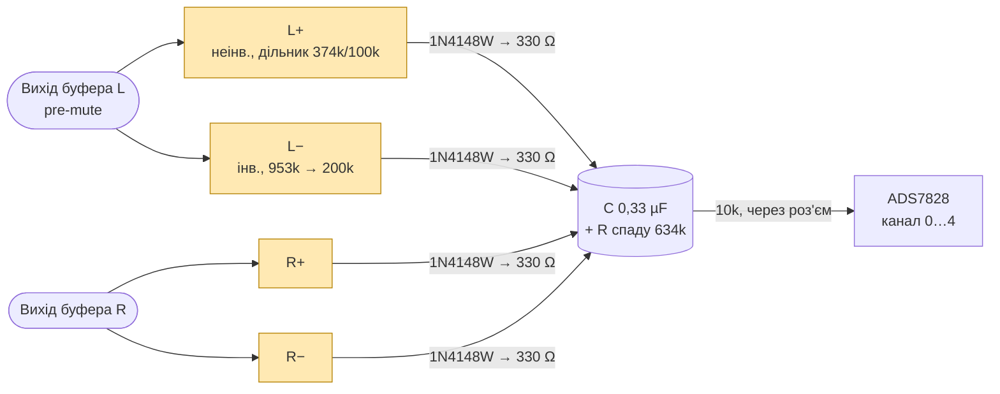
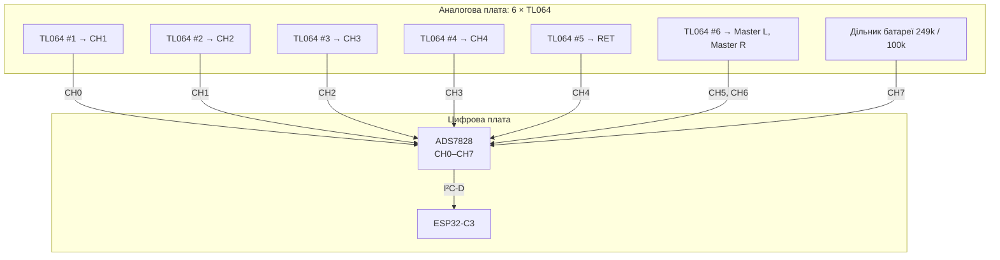
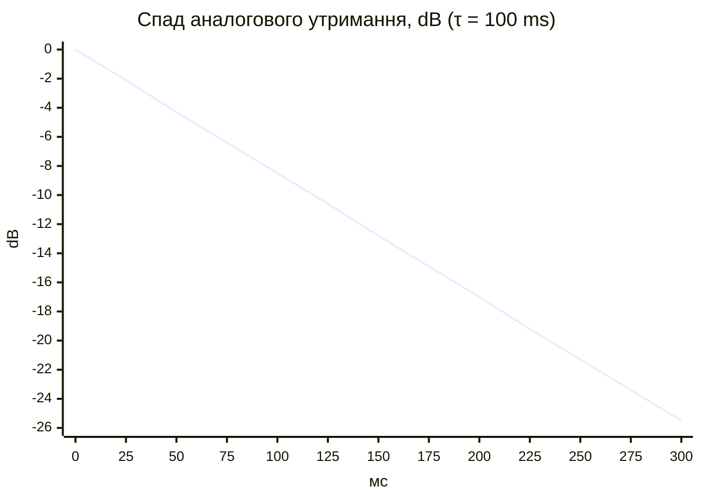
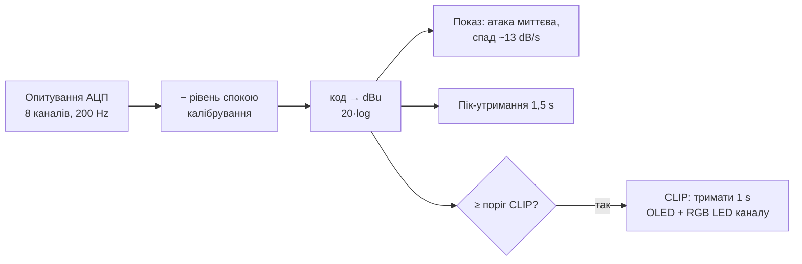
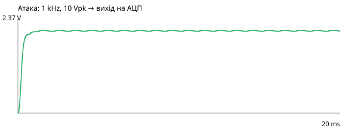
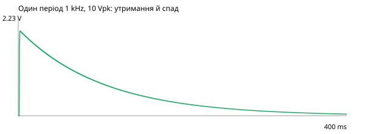

# C. Детектор метрів і CLIP — ітерація 0

> [!NOTE]
> **Статус:** розрахунок, 24.10.2026. Цифри генерує [calc/meter_detector.py](calc/meter_detector.py).
> Номінали — `ПРОПОЗИЦІЯ`, усе інше — `ОЦІНКА` за datasheet. Точки вимірювання задають
> D31 (канал pre-mute) і D33 (Master на сумі), op-amp — D37 (сімейство TL06x).

## 1. Вимоги

| Що | Вимога | Звідки |
|---|---|---|
| Метри | ch1–4 і RET: max(L, R); Master L і R окремо | ТЗ, розд. 5; D33 |
| Детектор | **двополуперіодний пік**: несиметричний сигнал може кліпнути лише в одну півхвилю | ТЗ: «реальний кліпінг» |
| CLIP | поріг у вузлі близько межі OPA1678 (11,1 Vpk гарант.) | [07-gain-structure.md](07-gain-structure.md) |
| АЦП | ADS7828: 0…2,5 V (внутрішня опора), abs max −0,2 … VDD + 0,2 V | [datasheet](datasheets/ads7828.pdf) |
| Живлення | мінімальний струм (KPI автономності, D34) | |

## 2. Схема: чотири детектори на одному конденсаторі

Кожен детектор — прецизійний пік-детектор: op-amp заряджає конденсатор утримання через
діод, а зворотний зв'язок береться з катода, тож падіння на діоді компенсується. Кілька
детекторів на одному конденсаторі дають «АБО»: конденсатор тримає найбільший пік з усіх.
Отже, **max(|L|, |R|) виходить сам собою**, без окремих діодних АБО.

Один TL064 (чотири підсилювачі) на канал. Master L і Master R — по два підсилювачі (+ і −)
на свій конденсатор, обидва в одному TL064.

## 3. Номінали `ПРОПОЗИЦІЯ`

| Елемент | Значення | Чому |
|---|---|---|
| Масштаб k | **0,211** | повна шкала АЦП 2,5 V = 11,86 Vpk у вузлі, трохи вище межі OPA1678 |
| Неінв. детектор: дільник | 374k / 100k (k = 0,2110) | |
| Інв. детектор: Rin / Rf | 953k / 200k (k = 0,2099) | розбіжність півхвиль 0,05 dB; великі номінали — малий витік з конденсатора |
| Діод | 1N4148W (SOD-123) | малий витік; Шотткі витікає сильніше і з'їдає утримання |
| Резистор атаки | **330 Ω** | τ атаки 0,11 ms, струм заряду ≤ 7,6 mA (ліміт моделі TI — 15 mA) |
| Конденсатор утримання | **0,33 µF** X7R 0805 | не аудіотракт, кераміка тут допустима |
| R спаду, канал / RET | 634k | разом з 2 × 1153k через інв. детектори → 302k |
| R спаду, Master | 412k | разом з 1 × 1153k → 304k |
| τ спаду | **≈ 100 ms** однаково для всіх метрів | |
| Вихід на роз'єм | 10k послідовно | захист входу АЦП і роз'єму |
| Дільник батареї | 249k / 100k | 8,4 V → 2,41 V; 24 µA |

Захист АЦП: найбільша можлива напруга на конденсаторі — вузол на шині −12,4 V × 0,211 =
**2,61 V**, а abs max входу ADS7828 при VDD = 3,3 V — 3,5 V. Додаткові обмежувальні діоди не потрібні.

## 4. Рівні → коди АЦП

| Сигнал у вузлі (синус) | Vpk | На АЦП | Код (з 4095) |
|---|---|---|---|
| Межа OPA1678 (гарант.) | 11,10 | 2,339 V | 3832 |
| **Поріг CLIP у прошивці** | **10,0** | 2,108 V | 3452 |
| +20 dBu | 10,96 | 2,310 V | 3784 |
| +4 dBu | 1,74 | 366 mV | 599 |
| 0 dBu | 1,10 | 231 mV | 378 |
| −10 dBu | 0,347 | 73 mV | 119 |
| −20 dBu | 0,110 | 23 mV | 37 |
| −30 dBu | 0,035 | 7,3 mV | 11 — нижче корисного |

**Корисний діапазон метра ≈ −20 … +20 dBu (40 dB).** Нижню межу задає зміщення TL064:

| Варіант | Зміщення макс. | У вузлі | Еквівалент |
|---|---|---|---|
| TL064C | 15 mV | 71 mV | ≈ −24 dBu |
| **TL064AC** | **6 mV** | 28 mV | ≈ −32 dBu |

Рекомендую групу **A** (TL064AC). Прошивка вимірює рівень спокою при старті й віднімає
його (калібрування нуля).

## 5. Балістика: аналог + прошивка

Аналогова частина лише ловить пік (атака 0,11 ms) і тримає його ~100 ms, щоб прошивка,
опитуючи АЦП з частотою 200 Hz, нічого не пропустила: за 5 ms утримання падає лише на 0,44 dB.
Показ на OLED формує прошивка.

Опитування 8 каналів ADS7828 по I²C 400 kHz займає ≈ 1 ms (`ОЦІНКА`: ~5 байт на канал),
тож 200 Hz лишають шині I²C-D багато часу для OLED.

## 6. Струм

24 підсилювачі = **6 × TL064** → ≈ **4,8 mA на шину** (0,2 mA на підсилювач, тип.).
Порівняно з NJM4580 (~36 mA на шину) це майже нічого. Бюджет у
[07-gain-structure.md](07-gain-structure.md), п. 4.1, змінюється на +2,4 mA.

## 7. Обмеження й ризики

- **Повільний вихід TL06x з насичення.** Коли діод закритий, op-amp іде в негативну шину. На
  наступному піку вихід має пройти ~14 V зі швидкістю 3,5 V/µs (datasheet), тобто ~4 µs. Для
  піків вище ~20 kHz показ трохи занижений. Для метра й CLIP це прийнятно.
- **Стабільність:** зворотний зв'язок береться з катода, тож конденсатор не входить у петлю.
  У симуляції на фронті заряду генерації немає (п. 7a), але макромодель 1989 року не гарантує
  поведінку реального кристала. Остаточна перевірка — на макеті.
- **Короткі піки** недочитуються: один період 1 kHz — на 0,75 dB. Поріг CLIP стоїть на ~1 dB
  нижче гарантованої межі, тобто з запасом.
- **Малі рівні на високих частотах** недочитуються (−1,7 dB на −20 dBu, 1 kHz). Причина —
  вихід op-amp з насичення (п. 7a). Для шкали метра це прийнятно; за потреби прошивка
  додає поправку.
- **Навантаження на вузол:** кожен детектор додає ~474k (неінв.) і 953k (інв.). Для виходу
  OPA1678 це несуттєво.

## 7a. Симуляція ngspice

Скрипт [sim/detector_sim.py](sim/detector_sim.py): повний детектор каналу (L+, L−, R+, R− на
одному конденсаторі), офіційна макромодель **TI TL064** ([sloj064](https://www.ti.com/lit/zip/sloj064),
скрипт качає її сам), загальновживана модель 1N4148, шини +11,9 / −12,4 V, вихід через 10k
на 10 nF біля АЦП.

| Тест | Очікувано на АЦП | Симуляція | Похибка |
|---|---|---|---|
| 1 kHz, 10 Vpk (поріг CLIP), L і R | 2,110 V | 2,065 V | −0,19 dB |
| 1 kHz, 0,11 Vpk (−20 dBu), лише L | 0,023 V | 0,019 V | −1,68 dB |
| 100 Hz, 0,11 Vpk (−20 dBu), лише L | 0,023 V | 0,023 V | −0,03 dB |
| 20 kHz, 10 Vpk, лише R | 2,110 V | 1,747 V | −1,64 dB |
| Лише від'ємні імпульси −8 V (інв. детектор) | 1,688 V | 1,676 V | −0,06 dB |
| Один період 1 kHz, 10 Vpk | 2,110 V | 1,935 V | −0,75 dB |

Спад за 100 ms після піку: −8,5 dB (розрахунок −8,7 dB). На виході op-amp під час заряду
розмах ВЧ-коливань 0,14 V — генерації немає.

Перший варіант номіналів (0,68 µF, 470 Ω, 475k/100k) давав −3,7 dB на −20 dBu і −2,7 dB на
одному періоді. Тому ємність зменшено вдвічі, резистор атаки — до 330 Ω, а інвертувальні
резистори збільшено вдвічі, щоб τ спаду лишилась 100 ms.

## 8. Що далі

- [ ] Наявність TL064AC (SOIC-14) і ADS7828 в Україні.
- [x] SPICE-перевірка детектора каналу (п. 7a).
- [ ] Шкала OLED-метра й балістика — під час прошивки.
