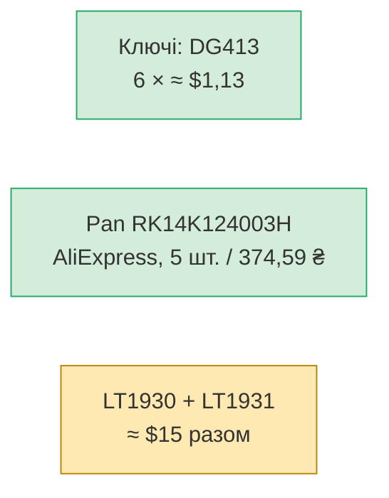

# C. Наявність і ціни ключових компонентів — зріз 24.10.2026

> [!WARNING]
> Це **знімки пошукової видачі й кешованих сторінок**, а не підтверджені пропозиції. Ціни й
> залишки змінюються. Перед замовленням перевіряти на сайті продавця. Доставку в Україну
> міжнародних дистриб'юторів (LCSC, Mouser, DigiKey) окремо не перевіряв.

## 1. Зведення

| Компонент | К-сть | Україна | Міжнародні | Статус |
|---|---|---|---|---|
| **OPA1678IDR** (D37) | 12 | [Wintex](https://wintexservice.kiev.ua/ua/p1457700398-mikroshema-opa1678idr.html): 71 ₴, є в наявності; [РКС](https://www.rcscomponents.kiev.ua/product/opa1678idr_155575.html), [Космодром](https://kosmodrom.ua/ru/operacionnyy-usilitel/opa1678idr.html): немає | [LCSC C192421](https://www.lcsc.com/product-detail/C192421.html): від $0,41, ~5000 шт. | ✅ |
| ~~ADG1436YRUZ~~ (замінено D41) | — | AliExpress: 980 ₴ / 5 шт. (дані користувача); [РКС](https://www.rcscomponents.kiev.ua/product/adg1436yruz_59919.html): **≈ 396 ₴/шт.**, під замовлення 21–31 день | [DigiKey](https://www.digikey.com/en/products/detail/analog-devices-inc/ADG1436YRUZ-REEL7/2261040) REEL7: ~2400 шт.; [Newark](https://www.newark.com/analog-devices/adg1436yruz/analogue-switch-dual-spdt-tssop/dp/73T8146): «No longer manufactured» — суперечить статусу Active на сайті AD | ⚠️ ціна |
| **DG413DY-T1-E3** (D41) | 6 | AliExpress — не перевіряв | [LCSC C141600](https://www.lcsc.com/product-detail/Analog-Switches_VISHAY_DG413DY-T1-E3_DG413DY-T1-E3_C141600.html): ~$1,13, ~9000 шт.; Newark DG413DY-E3: $1,86 | ✅ |
| TMUX6136PWR (альтернатива ADG1436) | — | — | [LCSC C2673380](https://www.lcsc.com/product-detail/C2673380.html): $5,0–6,4, 166 шт.; ±5…±16,5 V, dual SPDT | ⚠️ ціна |
| **RS451121400A** (D1, D23) | 7 | не знайдено | [Mouser](https://octopart.com/rs451121400a-alps-7850506): $4,64 / 1 шт., $1,80–3,84 / 10 шт., 500–1100 шт.; [LCSC C470706](https://www.lcsc.com/product-detail/Potentiometers-Variable-Resistors_ALPS-Electric-RS451121400A_C470706.html) (ціну не бачив) | ✅ |
| **RK14K124003H** (pan, D26) | 4 | AliExpress: 5 шт. / 374,59 ₴ (дані користувача) | [Mouser](https://www.mouser.com/ProductDetail/Alps-Alpine/RK14K124003H?qs=Znm5pLBrcAJfJ2o63%2F7bpQ%3D%3D): **non-stocked**, лише заводське замовлення (ціни від 1000 шт.); варіант `RK14K124003J` — 758 шт. у [Findchips](https://www.findchips.com/search/rk14k12), відмінність від H невідома | ✅ AliExpress |
| **LT1931ES5** (D18) | 1 | — | [DigiKey](https://www.digikey.com/en/products/detail/linear-technology-analog-devices/LT1931ES5-TRPBF/4694472): ~$7,14, ~6400 шт. | ✅ дорогий |
| **LT1930ES5** (D18) | 1 | — | DigiKey: ~$7,46 (залишок не бачив) | ✅ дорогий |
| **CH340N** (D40) | 1 | [Космодром](https://kosmodrom.ua/preobrazovatel-interfeysov/ch340n-type-c-to-ttl-4.html): лише готові модулі CH340N | чип не шукав | ⚠️ |
| **TL064ACDR** (08) | 6 | не знайдено | не шукав окремо | ⚠️ |
| **ADS7828** (08) | 1 | не знайдено | не шукав окремо | ⚠️ |

Не перевіряв: MCP23017, SPDT DIP-перемикач (D42), SK6812MINI-E, TPS62933O, SJ-43514-SMT, Cherry MX, модуль
IP2326, OLED, `RK14K12D0A18` (send, навушники), неполярні 10 µF.

## 2. Що з цього випливає

### Рішення 1: ціна аналогових ключів — закрито

Прийнято **DG413** (D41): після D42 потрібно 6 × ~$1,13 ≈ $7 замість ≈ 3600 ₴ за ADG1436.

### Рішення 2: pan-потенціометр — закрито

Користувач знайшов лот на AliExpress: «5 PCS / LOT New Japanese ALPS RK14K124003H», **374,59 ₴
за 5 шт.** (≈ 75 ₴/шт.), продано 100K+ схожих. Потрібно 4 шт., тож вистачає одного лоту.
Лишаємо `RK14K124003H` (D26).

Оригінальність перевірити не можна. При отриманні перевірити:

- [ ] опір кожної секції ≈ 10 kΩ (±20 %);
- [ ] лінійна характеристика: на 25 / 50 / 75 % ходу ≈ 2,5 / 5 / 7,5 kΩ;
- [ ] фіксація в центрі;
- [ ] розміри й виводи — за кресленням [RK14K12](datasheets/RK14K12-1370745.pdf).

## 3. Де купувати (попередньо)

| Джерело | Для чого |
|---|---|
| Україна (Wintex, РКС, Космодром) | OPA1678, дрібниця, швидко |
| LCSC | більшість мікросхем дешево; доставку в Україну перевірити |
| Mouser / DigiKey | Alps-фейдери, LT1930/LT1931, ADI |
