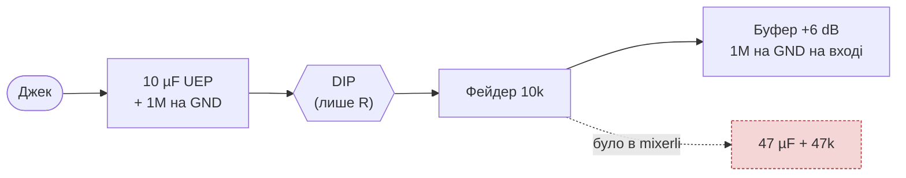
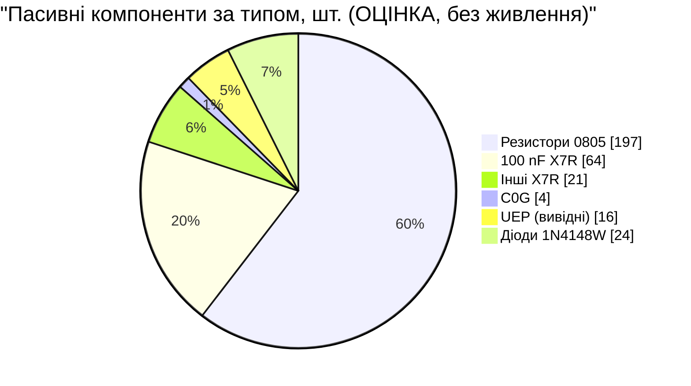

# C. Пасивні компоненти — ітерація 0

> [!NOTE]
> **Статус:** перелік за схемами з [06](06-signal-flow.md), [07](07-gain-structure.md) і
> [08](08-meter-detector.md), 24.10.2026. Кількості — `ОЦІНКА` до схеми в KiCad. Живлення
> (LT1930/LT1931, TPS62933O) окремо — у п. 5.

## 1. Правила вибору

| Що | Правило | Чому |
|---|---|---|
| Резистори | **0805, товстоплівкові, 1 %, ряд E96** | ручний монтаж (D12); у тракті немає постійного струму через резистори, тож струмовий шум товстоплівкових не грає ролі |
| Конденсатори ≤ 1 nF у тракті | **C0G (NP0)** 0805 | не змінюють ємність від напруги, не спотворюють |
| Розділові в тракті (10 / 47 µF) | **неполярний електроліт Nichicon UEP**, вивідний, лежачи (D44) | на розділовому конденсаторі майже немає постійної напруги, тож полярний не годиться; кераміка X7R дає спотворення |
| Розв'язка живлення, детектори, АЦП | **X7R** 0805 / 1206 | поза аудіотрактом |
| Діоди детекторів | **1N4148W** (SOD-123) | малий витік (08) |

## 2. Без 47 µF після фейдера — прийнято (D45)

У mixerli між повзунком фейдера й буфером стоїть 47 µF і 47k на GND. Після D38 постійна
складова відсікається вже на вході, а повзунок має шлях на GND через сам фейдер. Тому 47 µF
зайвий. Замість нього лишається лише **1M на GND на вході буфера** — на випадок, якщо
повзунок втратить контакт. Економія: **10 великих конденсаторів**.

## 3. Перелік за вузлами

### 3.1 Аудіотракт

| Вузол | Елемент | Номінал | Тип | К-сть |
|---|---|---|---|---|
| Вхід (×10 сторін) | розділовий | 10 µF 25 V | UEP1E100MDD, лежачи | 10 |
| | розряд з боку джека | 1M | 0805 | 10 |
| | зміщення входу буфера | 1M | 0805 | 10 |
| Буфер +6 dB (×10) | Rf / Rg | 10k / 10k | 0805 | 20 |
| Pan, ch1–4 (×8) | Rs | 10k | 0805 | 8 |
| | Rsum | 22k | 0805 | 8 |
| Send, ch1–4 (×8) | вхід send sum | 20k | 0805 | 8 |
| RET (×2) | вхід суми | 76,8k | 0805 | 2 |
| Main sum (L, R) | Rf | 38,3k | 0805 | 2 |
| | Cf (полюс ≈ 106 kHz) | 39 pF | C0G | 2 |
| Send sum (L, R) | Rf | 10k | 0805 | 2 |
| | Cf (полюс ≈ 106 kHz) | 150 pF | C0G | 2 |
| Send-інвертор (L, R) | Rin / Rf | 10k / 10k | 0805 | 4 |
| Master (L, R) | розділовий перед Mute (06, п. 2.3) | 10 µF 25 V | UEP1E100MDD | 2 |
| | зміщення | 1M | 0805 | 2 |
| Master-інвертор (L, R) | Rin / Rf | 10k / 10k | 0805 | 4 |
| Виходи MAIN, SEND (×4) | послідовний | 100 Ω | 0805 | 4 |
| | розділовий | 47 µF 25 V | UEP1E470MED (6,3 × 11 мм) | 4 |
| | розряд | 100k | 0805 | 4 |
| Навушники (×4 половини) | вихідний | 10 Ω | 0805 | 4 |

### 3.2 Детектори метрів (08)

| Елемент | Номінал | К-сть (5 стерео + 2 Master) |
|---|---|---|
| Дільник неінв. детектора | 374k / 100k | 12 / 12 |
| Інв. детектор Rin / Rf | 953k / 200k | 12 / 12 |
| Резистор атаки | 330 Ω | 24 |
| Діод | 1N4148W | 24 |
| Конденсатор утримання | 0,33 µF X7R | 7 |
| R спаду | 634k (канали, RET) / 412k (Master) | 5 / 2 |
| Вихід на роз'єм | 10k | 7 |
| Біля АЦП (цифрова плата) | 10 nF X7R | 8 |
| Дільник батареї | 249k / 100k | 1 / 1 |

### 3.3 Керування й цифра

| Елемент | Номінал | К-сть |
|---|---|---|
| Pull-down на IN DG413 (тихий старт) | 100k | 6 |
| Підтяжка I²C-A, I²C-D | 4,7k | 4 |
| RESET MCP23017 | 10k | 1 |
| Енкодер A/B/кнопка | 10k (+ RC за потреби) | 3 |
| USB-C CC1, CC2 | 5,1k | 2 |
| Дані LED (послідовний, ТЗ) | 330 Ω | 1 |

### 3.4 Розв'язка живлення

| Де | Номінал | К-сть |
|---|---|---|
| OPA1678 × 12, TL064 × 6 — V+ і V− | 100 nF X7R | 36 |
| DG413 × 6 — V+, V−, VL | 100 nF X7R | 18 |
| MCP23017, ADS7828, CH340N (VCC, V3), перетворювач рівня | 100 nF X7R | 5 |
| SK6812MINI-E × 5 | 100 nF X7R | 5 |
| Шини ±12 V на аналоговій платі (групами) | 10 µF 25 V X7R 1206 | 4–6 |
| RC-фільтр шин ±12 V (D46) | 2,2 Ω 0805 + 22 µF 25 V X7R 1206 | 2 + 2 |
| Шина LED 5 V (bulk) | 47–100 µF | 1 |

## 4. Зведення

Унікальних номіналів резисторів **18** у сигнальній частині: 10 Ω, 100 Ω, 330 Ω, 4,7k, 5,1k,
10k, 20k, 22k, 38,3k, 76,8k, 100k, 200k, 249k, 374k, 412k, 634k, 953k, 1M — і ще 113k, 13,3k,
84,5k у живленні. Найчастіші: **10k ≈ 49 шт., 330 Ω ≈ 25, 100k ≈ 23, 1M ≈ 22** — купувати набором.

**Великі вивідні UEP: 16 шт.** (12 × 10 µF + 4 × 47 µF). Лежачи 10 µF займає ≈ 15 × 5,5 мм
(корпус 11 + до 1,5 + вигин виводів), 47 µF — ≈ 15 × 7 мм. Біля задніх джеків під цифровою
платою (11 мм вільно) місця обмаль, тож частину доведеться ставити під нижньою панеллю. Для 47 µF
6,3 мм лежачи — це впритул до 7,5 мм, тому їх краще ставити під цифровою платою. Розстановка — крок E.

## 5. Живлення — окремо

| Вузол | Звідки номінали | Статус |
|---|---|---|
| LT1930 +12 V: дросель 10 µH (Sumida CR43), діод, FB 113k / 13,3k | mixerli v1.0 ([04](04-mixerli-datasheets.md)) | перерахувати під 6,0–8,4 V |
| LT1931 −12 V: спарений 10 µH (Sumida CLS62-100), діод, FB 84,5k / 10k | mixerli v1.0 | перерахувати під 6,0–8,4 V |
| TPS62933O 5 V: дросель, FB, конденсатори | [datasheet](datasheets/tps62933o.pdf) | розрахувати |
| IP2326: RISET (90 000 / ICHG), TIME_SET, NTC | [datasheet](datasheets/ip2326.pdf) | у складі модуля, перевірити номінали на модулі |

## 6. Що далі

- [x] Без 47 µF після фейдера (D45).
- [ ] Розрахунок живлення: LT1930/LT1931 від 6,0–8,4 V, TPS62933O.
- [ ] Конкретні P/N: перемикач SPDT DIP SMD, енкодер, OLED-модуль, перетворювач рівня.
