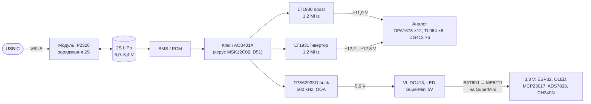
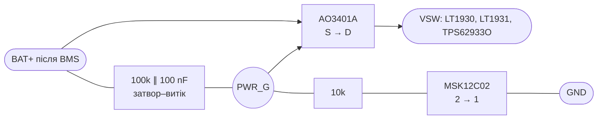
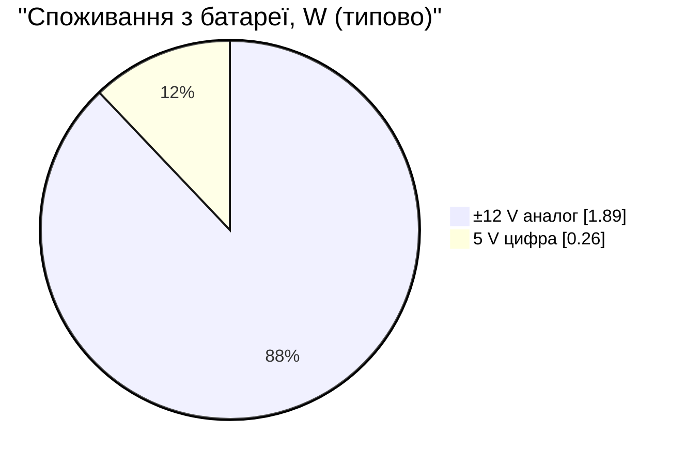

# C. Живлення — розрахунок, ітерація 0

> [!NOTE]
> **Статус:** розрахунок, 24.10.2026. Цифри генерує [calc/power.py](calc/power.py). Формули й
> межі — з datasheet [LT1930](datasheets/1930f.pdf), [LT1931](datasheets/1931fa.pdf),
> [TPS62933O](datasheets/tps62933o.pdf), [ESP32-C3](datasheets/esp32-c3_datasheet_en.pdf).
> ККД і частина навантажень — `ОЦІНКА`. Модель максимального струму LT1931 підігнано під
> цифру datasheet (−12 V / 150 mA від 5 V).

## 1. Структура

### 1.1 Вимикач (D51)

Батарея дає до **≈ 0,56 A** (3,35 W при 6,0 V, розділ 4). Малі слайд-перемикачі на такий струм
не розраховані: MSK12C02 — 50 mA, Sungmun SSI/NSI-10 — 0,5 A (12 V), Alps SSSS916400 з mixerli —
0,1 A. Тому перемикач лише керує затвором P-MOSFET, а струм іде через транзистор.

| Параметр | Значення | Звідки |
|---|---|---|
| Vgs увімкненого | −5,5 V (6,0 V) … −7,6 V (8,4 V) — дільник 10k / 100k; межа ±12 V | datasheet AO3401A |
| Rds(on) | < 60 mΩ при −4,5 V → втрати < 20 mW при 0,56 A | datasheet AO3401A |
| Струм через вимикач | < 0,85 mA (8,4 V / 10k) — у межах 50 mA MSK12C02 | datasheet MSK12C02 |
| Вимкнено | затвор = витік через 100k; витік стоку ≤ 1 µA (IDSS) | datasheet AO3401A |
| Плавне ввімкнення | τ ≈ (10k ∥ 100k) × 100 nF ≈ 0,9 мс — обмежує кидок струму у вхідні конденсатори | `ОЦІНКА` |

## 2. ±12 V: LT1930 і LT1931 (номінали mixerli v1.0)

| | +12 V, LT1930 | −12 V, LT1931 |
|---|---|---|
| Дільник | 113k / 13,3k | 84,5k / 10k |
| Вихід | 11,78 … **11,92** … 12,06 V (VFB 1,240–1,270 V) | −12,20 … −12,54 V (струм NFB 4–8 µA) |
| Дросель | 10 µH, Sumida CR43-100: 1,04 A, 0,182 Ω | 10 µH спарений, Sumida CLS62-100: 0,7 A, 0,2 Ω |
| Діод | Шотткі, ≥ 20 V | **Шотткі 30 V (MBR0530)** — див. нижче |
| Вхід / вихід | кераміка X5R/X7R: 1–4,7 µF на вході, 4,7–10 µF на виході (datasheet) | так само |

Навантаження на шину (після D37): **63 mA тип., 96 mA макс.**

| Vбат | LT1930: D | Iпік ключа | Iвих макс | LT1931: D | Iпік ключа | Iвих макс | Зворотна на діоді LT1931 |
|---|---|---|---|---|---|---|---|
| 6,0 V | 51 % | 367 mA | ~340 mA | 68 % | 509 mA | ~176 mA | 18,2 V |
| 7,4 V | 40 % | 316 mA | ~421 mA | 63 % | 488 mA | ~197 mA | 19,6 V |
| 8,4 V | 32 % | 282 mA | ~485 mA | 60 % | 480 mA | ~210 mA | **20,6 V** |

Висновки:

1. **Запас по струму є навіть при 6,0 V:** −12 V дає ~176 mA при потребі 96 mA, +12 V — ~340 mA.
2. **Скважність у межах:** LT1930/LT1931 мають макс. 84 % (мін. гарантоване), у нас ≤ 68 %.
3. **Діод LT1931:** на ньому Vбат + |Vвих| = до 20,6 V. Datasheet: «якщо різниця вхід–вихід
   перевищує 20 V, використовуйте MBR0530 (30 V)». Отже **MBR0530 (SOD-123)**. Для однакового
   BOM — він же і для LT1930.
4. **Піковий струм дроселів** нижчий за номінал: 367 mA проти 1,04 A (CR43), 509 mA проти 0,7 A (CLS62).
5. **Вимкнений boost пропускає батарею на вихід** (Vбат − діод на +12 V шині). Тому обидва
   перетворювачі стоять **після** вимикача, і в стані «вимкнено» вся схема знеструмлена.

## 3. 5 V: TPS62933O

| Параметр | Значення | Звідки |
|---|---|---|
| FB | **53,6k / 10,2k** → 5,00 V | datasheet, табл. 10-2 |
| Частота | **500 kHz** (RT не підключений); OOA тримає ≥ 30 kHz на малому навантаженні | datasheet 9.4 |
| Дросель | **4,7 µH, Bourns SRN4018-4R7M**: Isat 2,0 A, DCR 84 mΩ | рівняння 15–17 datasheet; [datasheet](datasheets/bourns-srn4018.pdf) |
| Вихід | 2 × 22 µF X7R 1206 `ОЦІНКА` | розділ 10.2.2.8, уточнити |
| Soft-start | **у TPS62933O виводу SS немає** (вивід 7 — PG, табл. 7-1), плавний старт внутрішній — конденсатор не потрібен | 7, 10.2.2.4 стосується версій із SS |
| BST | 100 nF X5R/X7R, ≥ 16 V | 10.2.2.5 |
| EN | дільник 100k / 100k → 3,0–4,2 V (поріг 1,21 V, abs max 6 V) | 8.5 |
| PG | open-drain, підтяжка до ≤ 5,5 V; можна на ESP — не обов'язково | 9.3 |

| Vбат | D | Пульсації струму дроселя | Iпік при 81 mA | ≥ 0,3 A (≥ 10 % від 3 A)? |
|---|---|---|---|---|
| 6,0 V | 83 % | 0,35 A | 0,26 A | ✅ |
| 7,4 V | 68 % | 0,69 A | 0,43 A | ✅ |
| 8,4 V | 60 % | 0,86 A | 0,51 A | ✅ |

Мінімальні пульсації 0,3 A datasheet вимагає для стабільності пікового керування за струмом
(розділ 10.2.2.7). Через це дросель **4,7 µH, а не більший**: 6,8 µH при 6,0 V дав би лише 0,25 A.
Datasheet радить брати дросель з Isat не нижче за струмове обмеження ключа (до ~5,8 A) на
випадок КЗ. Для нашого струму це надмірно, але Isat ≥ 2 A — розумний мінімум.

Навантаження 5 V (`ОЦІНКА`):

| Споживач | тип. | макс. | Джерело |
|---|---|---|---|
| ESP32-C3, 80 MHz, без радіо, + flash | 22 mA | 32 mA | datasheet ESP32-C3, табл. 5-8: 17–22 mA, flash +10 mA |
| OLED 128×64 SSD1306 | 12 mA | 20 mA | datasheet модуля ([12](12-parts.md)) |
| RGB LED × 5 (спокій 1 mA + низька яскравість) | 10 mA | 25 mA | datasheet SK6812MINI-E |
| MCP23017, ADS7828, рівень, CH340N (сон) | 2 mA | 4 mA | datasheet |
| **Разом** | **46 mA** | **81 mA** | |

### 3.1 3,3 V — LDO на SuperMini

За схемою з [datasheet SuperMini](datasheets/esp32-c3-supermini.pdf): пін 5V → діод Шотткі BAT60J →
LDO **ME6211** (SOT-23-5) → 3,3 V. Навантаження 3,3 V: ESP32 ~30 mA, OLED 12–20 mA, CH340N до 12 mA,
MCP23017 і ADS7828 — одиниці mA, разом **≈ 50–65 mA**. Для LDO в SOT-23-5 це помірно: розсіювання
≈ (4,6 − 3,3) V × 65 mA ≈ 0,08 W. Номінальний струм ME6211 за його datasheet не звіряв (`НЕ ПЕРЕВІРЕНО`).

## 4. Час роботи

| Режим | ±12 V | 5 V | З батареї | 2S 1500 mAh (90 % ємності) |
|---|---|---|---|---|
| Типовий | 1,89 W | 0,26 W | **2,15 W** | **≈ 4,6 год** |
| Максимальний (гучні навушники, LED) | 2,89 W | 0,46 W | **3,35 W** | **≈ 3,0 год** |

Порівняно з початковою оцінкою (~2 год з NJM4580 скрізь) автономність зросла більш ніж удвічі
завдяки D34, D37 і D39.

## 5. Шум перетворювачів і аудіо

- Частоти перемикання **1,2 MHz** (±12 V) і **500 kHz** (5 V) далеко за звуковим діапазоном.
  OOA у TPS62933O не дає частоті впасти нижче 30 kHz на малому навантаженні (D22).
- Пульсації LT1931 за datasheet ~1 mVp-p на виході. Op-amp на таких частотах погано
  придушує пульсації живлення, тому на кожну шину ±12 V при вході в аудіозону — **RC-фільтр
  2,2 Ω + 22 µF** (D46, [12](12-parts.md)) і 100 nF біля кожного корпусу ([10](10-passives.md)).
- Перетворювачі — в окремому куті аналогової плати, подалі від входів і суматора. Розміщення — крок E.
- **Перевірити на прототипі:** шум на виходах при USB-заряджанні (бустер IP2326 на 500 kHz) і
  при яскравих LED (PWM 1,2 kHz).

## 6. Компоненти живлення

| Вузол | Компонент | Статус |
|---|---|---|
| Вимикач (D51) | MSK12C02 (SMD, повзунок убік) → затвор P-MOSFET AO3401A (SOT-23); 100k + 100 nF затвор–витік, 10k до вимикача | обрано |
| LT1930 | LT1930ES5 (SOT-23-5), SRN4018-100M (D49), MBR0530, 113k / 13,3k, 2,2 µF вхід, 10 µF вихід X7R 25 V | номінали з mixerli v1.0 + цей розрахунок |
| LT1931 | LT1931ES5, CLS62-100, MBR0530, 84,5k / 10k, конденсатори за datasheet (схема з двома дроселями) | так само |
| TPS62933O | SOT-583, 4,7 µH Bourns SRN4018-4R7M, 53,6k / 10,2k, 100 nF BST, 100k / 100k EN, 2 × 22 µF (SS немає) | розраховано |
| Фільтри шин ±12 V | RC: 2,2 Ω + 22 µF X7R 25 V 1206 (D46) | обрано |

## 7. Що далі

- [x] Дросель 4,7 µH: Bourns SRN4018-4R7M ([12](12-parts.md)).
- [ ] Звірити з datasheet схему LT1931 (розстановка конденсаторів між дроселями) і повторити схему v1.0 з mixerli.
- [x] Замість фериту — RC-фільтр (D46).
