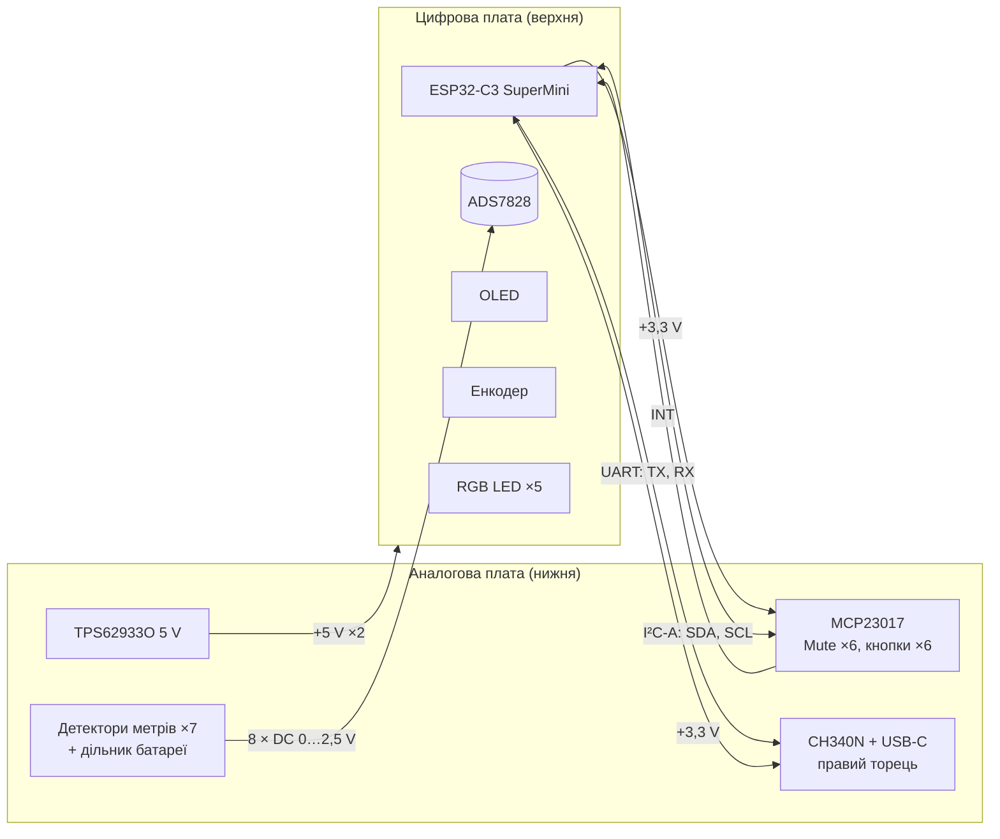
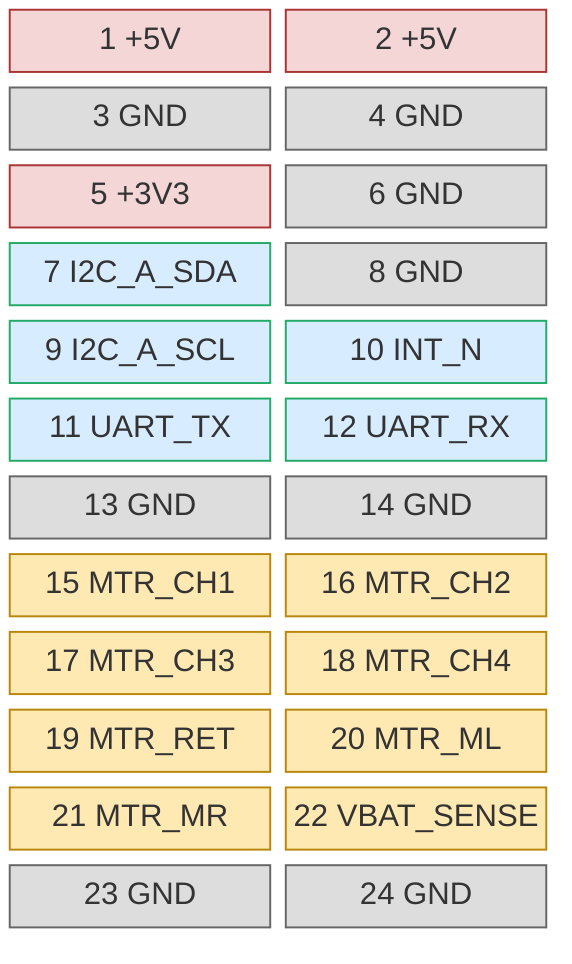

# D. Роз'єм між платами — ітерація 0

> [!NOTE]
> **Статус:** pinout `ПРОПОЗИЦІЯ`, 24.10.2026. Висота стека PLS + PBS ≈ 11 мм — `ОРІЄНТИР`
> ([05](05-mechanics.md)), конкретні P/N роз'ємів ще не обрані.

## 1. Що йде між платами

Головне правило: **через роз'єм не йде жоден аудіосигнал.** Аудіо повністю на аналоговій
платі. Між платами — живлення, повільні постійні напруги метрів і цифрові лінії, які
працюють лише за подіями.

| Група | Лінії | Напрям | Характер |
|---|---|---|---|
| Живлення | +5 V ×2, +3,3 V ×1 | 5 V — вгору; 3,3 V — вниз (LDO ME6211 на SuperMini) | постійне |
| Метри | CH1–CH4, RET, ML, MR, VBAT — 8 | вгору | повільна DC, τ спаду 100 ms |
| I²C-A | SDA, SCL | обидва | лише за подіями (кнопка, Mute) |
| Переривання | INT (MCP23017, відкритий стік або push-pull) | вгору | за подіями |
| UART | TX (ESP → CH340N RXD), RX (CH340N TXD → ESP) | обидва | лише прошивка й налагодження |
| GND | 8 | — | розділяють групи |

**Чому CH340N на аналоговій платі:** USB-C стоїть на правому торці аналогової плати, поруч із
модулем заряджання (VBUS). Якщо поставити міст біля роз'єму, D+/D− лишаються короткими, а через
роз'єм між платами йде повільний UART.

**Статус заряджання (`ПРОПОЗИЦІЯ`):** сигнал з модуля IP2326 (BAT_STAT / LED) завести на
вільний вхід MCP23017 (GPB6), а не на ESP — тоді не потрібна лінія через роз'єм. Рівень і схему
виходу на конкретному модулі перевірити.

## 2. Pinout: 2 × 12, крок 2,54 мм

| Пін | Сигнал | Пін | Сигнал | Примітка |
|---|---|---|---|---|
| 1 | +5V | 2 | +5V | до ~81 mA; два піни — запас і менший опір |
| 3 | GND | 4 | GND | повернення струму 5 V |
| 5 | +3V3 | 6 | GND | MCP23017, CH340N — кілька mA |
| 7 | I2C_A_SDA | 8 | GND | підтяжки 4,7k — на цифровій платі |
| 9 | I2C_A_SCL | 10 | INT_N | INTA/INTB MCP23017 віддзеркалені |
| 11 | UART_TX | 12 | UART_RX | GPIO21 → CH340N RXD; CH340N TXD → GPIO20 |
| 13 | GND | 14 | GND | **екранний ряд** між цифрою й метрами |
| 15 | MTR_CH1 | 16 | MTR_CH2 | 10k послідовно на аналоговій, 10 nF біля АЦП |
| 17 | MTR_CH3 | 18 | MTR_CH4 | |
| 19 | MTR_RET | 20 | MTR_ML | |
| 21 | MTR_MR | 22 | VBAT_SENSE | дільник 249k / 100k на аналоговій |
| 23 | GND | 24 | GND | |

Логіка розстановки:

- **Живлення — з одного краю**, щоб струм 5 V і його повернення не проходили повз метри.
- **Цифрові лінії згруповані** (7–12) і відокремлені від метрів суцільним рядом GND (13–14).
- **8 GND з 24** — кожна група має своє повернення поруч (вимога ТЗ, розд. 3).
- Аналогова й цифрова земля **не розділені** на острови: одна суцільна земля, а шляхи струмів
  розводяться розміщенням (ТЗ).

## 3. Механіка з'єднання

| Що | Пропозиція | Статус |
|---|---|---|
| На аналоговій платі (зверху) | гніздо **PBS-24** (2 × 12, 2,54 мм) | `ОРІЄНТИР` висота ~8,5 мм |
| На цифровій платі (знизу) | штир **PLS-24** (2 × 12) | пластик ~2,5 мм |
| Висота стека | ≈ 11 мм — збігається з розрахунком [05](05-mechanics.md) | звірити з конкретними P/N |
| Фіксація | стійка M2 11 мм в отворі H1 (лівий кінець задньої смуги) + роз'єм; біля енкодера H2 — стійка до верхньої панелі | D57; стійка друкована, Ø ≤ 4,8 мм, висота під фактичний стек роз'єму |
| Місце | задня смуга, ближче до центру: між джеками IN4 і MAIN | крок E |

Цифрова плата має форму «Г» (задня смуга + зона над Master і RET, [05](05-mechanics.md)), тому
стійки ставимо на кінцях «Г», а роз'єм — у куті між ними.

## 4. Що далі (крок E)

- [ ] Обрати конкретні PLS/PBS 2 × 12, виміряти висоту стека й надрукувати стійку H1 під неї (D57).
- [ ] Точне місце роз'єму на обох платах.
- [ ] Почати схему в KiCad: аркуші «Вхід ×5», «Сума/Master», «Send», «Навушники»,
      «Метри», «Керування», «Живлення», «Цифрова плата».
