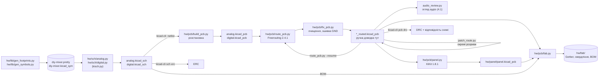
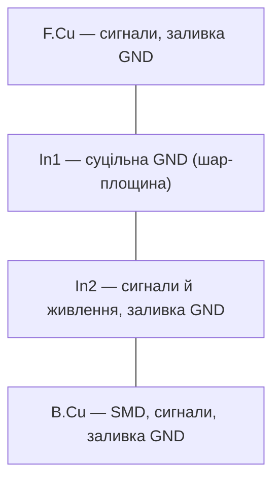
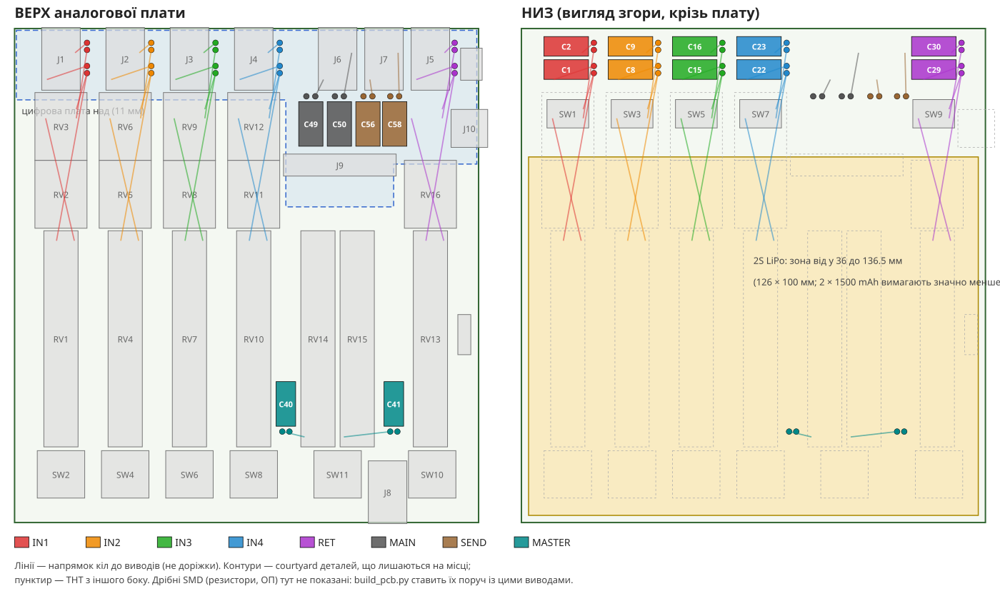
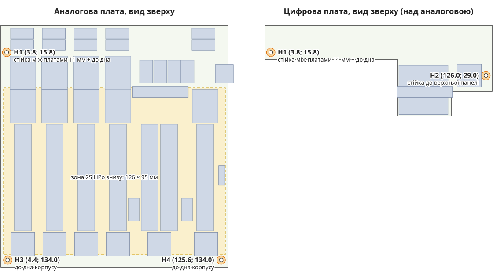
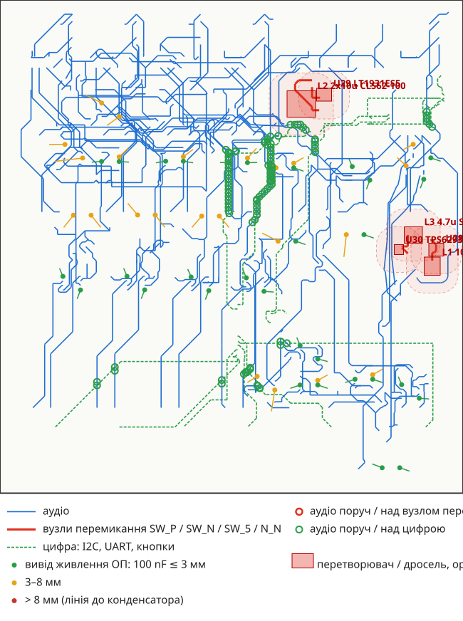

# E. KiCad — ітерація 1 (автороутер)

> [!NOTE]
> **Статус:** 26.10.2026, ітерація 8. Схеми обох плат проходять ERC **без помилок і попереджень**.
> Плати — 4 шари: блокування біля своїх мікросхем і компактні блоки перетворювачів (D58),
> SuperMini згори з USB-C на краї (D59), отвори M2 (D57, п. 3.4). Розведено автороутером і
> доведено скриптами: розривів 0 на обох, порушень міді немає (п. 4). Панель збирається скриптом
> (D53). Gerber, свердління й BOM — `hw/fab/`, генерує `hw/pcb/fab.py` (п. 6).

## 1. Як усе згенеровано

Усе в `hw/` генерують скрипти, тож зміна номіналу чи кола — це правка коду й перезапуск.



```sh
PY=/Applications/KiCad/KiCad.app/Contents/Frameworks/Python.framework/Versions/3.9/bin/python3
python3 hw/lib/gen_footprints.py && python3 hw/lib/gen_symbols.py
python3 hw/sch/analog.py && python3 hw/sch/digital.py
$PY hw/pcb/build_pcb.py                          # розстановка -> analog.kicad_pcb, digital.kicad_pcb
$PY hw/pcb/route_pcb.py analog --passes 40       # ~30 хв -> analog_routed.kicad_pcb
$PY hw/pcb/route_pcb.py digital --passes 25      # ~1 хв  -> digital_routed.kicad_pcb
$PY hw/pcb/route_pcb.py analog --resume --passes 10   # дотрасувати лише відкриті з'єднання
$PY hw/pcb/fix_pcb.py analog                     # окремо: очищення й зшивка без трасування
$PY hw/pcb/add_holes.py analog                   # отвори M2 (D57) на розведеній платі, доріжки не чіпає
(cd hw/pcb && $PY add_silk.py analog)            # адреса джерел на шовкографії (D9), лише текст
$PY hw/pcb/audio_review.py --svg docs/mech/audio-review.svg   # огляд аудіотракту (п. 4.1), плату не змінює
$PY hw/pcb/patch_route.py hw/analog/analog_routed.kicad_pcb NET xa ya xb yb   # закрити один розрив
$PY hw/pcb/panel.py                              # -> hw/panel/panel.kicad_pcb
python3 hw/pcb/fab.py                            # -> hw/fab/: Gerber + свердління (zip) і BOM
kicad-cli sch erc hw/analog/analog.kicad_sch
kicad-cli pcb drc --schematic-parity hw/analog/analog_routed.kicad_pcb
```

Інструменти: Java 25 (`brew install openjdk@25`), Freerouting 2.4.1 у `hw/pcb/tools/` (у git не
кладемо, 64 МБ: [реліз](https://github.com/freerouting/freerouting/releases/tag/v2.4.1)),
KiKit 1.8.1 (`$PY -m pip install --user kikit==1.8.1`).

> [!WARNING]
> Ручна доводка робиться в `*_routed.kicad_pcb`. `route_pcb.py` без `--resume` **перезаписує**
> цей файл з нуля, тож після початку ручної правки його так не запускати. `--resume` зберігає
> доріжки, але Freerouting може їх переоптимізувати, а заливки й зшивальні переходи будуються
> заново. `build_pcb.py` пише лише
> нерозведені `analog.kicad_pcb` / `digital.kicad_pcb`. Панель — похідний файл, її не правимо.

## 2. Схеми

Схема — «мітками»: кожен вивід підписано назвою кола, проводів немає. Читається як netlist,
блоки підписані заголовками. Аналогова: 402 символи (з частинами), 251 коло. Цифрова: 43 / 29.

| Аналогова плата | Цифрова плата |
|---|---|
| вхід ×5: джек, 10 µF BP, DIP моно/стерео, фейдер, буфер +6 dB, Mute DG413 | ESP32-C3 SuperMini, підтяжки I²C |
| pan, send (ch1–4), сума, Master + DC-блок + Mute, буфер, інвертор, MAIN | ADS7828 + 8 × 10 nF |
| send-шина, навушники (OPA1678 на канал) | OLED, енкодер EC12D (кнопка = GPIO9) |
| метри: 6 × TL064, детектори, дільник батареї | 5 × SK6812MINI-E, 74AHCT1G125 |
| MCP23017, кнопки MX ×6, роз'єм 2 × 12 | роз'єм 2 × 12 |
| USB-C → USBLC6 → CH340N; LT1930, LT1931, TPS62933O, RC-фільтри | |

Рішення, внесені під час кроку E:

- **D49:** дросель +12 V — SRN4018-100M (CR43 з mixerli неекранований).
- **D50:** ряди pan / Mute / фейдерів зсунуто на 1,5–2 мм через реальну геометрію RK14K; джек —
  футпринт SJ-43514 без площадок 5/6.
- **TPS62933O не має виводу SS** (вивід 7 — PG). Плавний старт вбудований, конденсатор SS
  з [11-power.md](11-power.md) не потрібен.
- **D51:** вимикач живлення MSK12C02 керує P-MOSFET AO3401A; стоїть на правому торці між
  джеком RET і USB-C, повзунок на 1,2 мм за краєм плати.
- **LT1931:** фазування спареного дроселя (точки на VIN і на −12 V) — за розрахунком для
  топології Ćuk; звірити з рис. 1 datasheet.

## 3. Плати

| | Аналогова | Цифрова |
|---|---|---|
| Контур | 129 × 137,5 мм (лінія контуру на 0,5 мм від краю сітки) | «Г»: задня смуга 129 × 19,5 + зона над Master/RET, 49,5 мм |
| Футпринтів | 392 | 41 |
| Шари | **4** (D52) | **4** (на одній панелі) |
| Механіка на місцях | джеки, фейдери ×7, RK14K ×9, MX ×6, USB-C, вимикач MSK12C02 (правий торець, D51), роз'єм, DIP (знизу) | LED ×5 (знизу, виріз), OLED, енкодер, SuperMini (згори, плоско, USB-C на краї, D59), роз'єм (знизу) |
| Решта | SMD **знизу**, розстановка за зв'язками; UEP 10/47 µF лежачи — у проміжках між фейдерами | те саме |

Роз'єм між платами розставлено так, що всі 24 виводи збігаються по XY (скрипт перевіряє).

### 3.1 Шари й правила (D52)



| Клас | Кола | Доріжка | Зазор | Перехід |
|---|---|---|---|---|
| Default | решта | 0,2 мм | 0,15 мм | 0,6 / 0,3 мм |
| Power | BAT+, VSW, VBUS, вузли SW перетворювачів, ±12 V, +5V, +3V3 | 0,5 мм | 0,15 мм | 0,8 / 0,4 мм |

Мідь ≥ 0,5 мм від зовнішнього контуру (під V-cut панелі), ≥ 0,2 мм від вирізів під LED.

Власне правило DRC (`*.kicad_dru`, пише `hw/sch/kisch.py`): тепловому бар'єру площадки досить
**однієї спиці** замість двох за замовчуванням. Де вміщається лише одна (GND-виводи SOIC/TSSOP між
сусідніми, виводи джеків і USB-C), площадка має ще й відвід з переходом або площину In1, а з
однією спицею її легше паяти паяльником (D12).

### 3.2 Розстановка й трасування

- **Розстановка SMD — за зв'язками** (`build_pcb.py`, `place_near`): кожну деталь ставимо у вільне
  місце, найближче до виводів, з якими вона з'єднана; розв'язувальні конденсатори — до виводів
  живлення своїх мікросхем. Зона — низ плати, оминаючи виводи THT.
- **Трасування** (`route_pcb.py`): експорт DSN → Freerouting з fanout (короткі відводи з переходом від
  SMD-виводів, зокрема до площини GND) → імпорт SES → заливки GND на F, In2, B. Freerouting не знає
  правила відступу від краю, тому на час трасування вздовж країв стоять тимчасові заборони.
- **Доводка** (`fix_pcb.py`, викликається з `route_pcb.py`): прибирає дублікати сегментів і
  переходи, що нікуди не ведуть, розширює доріжки тонші за 0,15 мм. Потім ставить зшивальні
  переходи GND: у кожен острівець заливки, не з'єднаний з In1, і сіткою 5 мм там, де на всіх
  чотирьох шарах є заливка GND. Перехід ставиться лише туди, де він уміщається в заливку з запасом,
  тож зазори до чужої міді — не менші, ніж у заливки (0,3 мм).
- Аналогова: 868 з'єднань, 19 проходів, ~30 хв → **11 розривів**. Без fanout лишалось 91.

### 3.3 Топологія v4: короткі вхідні кола (D54–D56)



В ітерації 1 UEP стояли в проміжках між фейдерами без прив'язки до каналу, а моно/стерео був один
DIP на 5 каналів під OLED. Сигнал ішов від джека (ззаду) до конденсатора (спереду) і назад до
DIP: **74–151 мм** до кожного вхідного конденсатора. Картинку й перевірку перетинів робить
`docs/mech/topology_v4.py` з розставленої плати; план конденсаторів — `uep_plan()` у
`hw/pcb/build_pcb.py`.

| Ділянка (кожен канал) | Ітерація 1 | v4 |
|---|---|---|
| джек → 10 µF | 74–151 мм (по доріжках) | 4–12 мм: конденсатори знизу під своїм джеком (D54) |
| 10 µF → DIP моно/стерео | 27–65 мм | 11–20 мм: окремий CTS 204-121ST під ротатором send (D55) |
| 10 µF → верх фейдера (L) | ~63 мм | ~48 мм: Mute під фейдерами, фейдери ближче до заду (D56) |
| DIP → верх фейдера (R) | — | ~35 мм |
| MAIN / SEND 47 µF → джек | — | 5–12 мм, згори під цифровою платою |
| майстер 10 µF → повзунок | 36–46 мм | 6–13 мм, у проміжках між фейдерами спереду |

Відстані — прямі між виводами (оцінка знизу); реальні доріжки довші.

- **Батарея не під задньою смугою:** зона 2S LiPo знизу — від y 36 мм, 126 × 100 мм. Для 2S 1500
  mAh це з запасом (`ОЦІНКА`: конкретну pouch ще не обрано). Під джеками знизу 9 мм, UEP лежачи — 5,5.
- **Крок ротаторів не змінюємо:** конденсатори лягли під джеки, ширина лишається 130 мм.
- **DIP знизу між виводами ротатора send і його лапками:** 7,26 мм корпусу в проміжку 8,2 мм
  (від площадок виводів до площадок лапок, повернутий на 90°) — щільно, але без перетину.
- **Фіксатори джека під конденсаторами:** DRC позначає отвори Ø1,7 фіксаторів джека під
  конденсаторами знизу (`npth_inside_courtyard`). За кресленням CUI фіксатор виступає на 0,8 мм при
  товщині плати 1,6, тобто знизу не виходить — `НЕ ПЕРЕВІРЕНО` на деталі.

### 3.4 Кріплення (D57)



Отвори M2 металізовані й підключені до GND (Ø2,2, площадка 4,4). Courtyard r 2,45 стоїть з обох
боків: зверху й знизу може бути стійка, гайка або головка гвинта. Тому DRC перевіряє і бік, де
кріпіж не очевидний.

| Отвір | Де | Для чого |
|---|---|---|
| H1 | обидві плати, (3,8; 15,8) | друкована стійка між платами (11 мм `ОРІЄНТИР`) + стійка до дна корпусу |
| H2 | лише цифрова, (126,0; 29,0) | коротка стійка до верхньої панелі біля енкодера (~3,4 мм `ОЦІНКА`) |
| H3, H4 | аналогова, (4,4; 134,0) і (125,6; 134,0) | стійки до дна корпусу |

- **Як шукали місце.** Вільне місце рахували по відстані до міді інших кіл, до courtyard з обох
  боків і до краю (≥ 3,2 мм з урахуванням V-cut). Під M3 на аналоговій вільні лише передні кути.
  Під M2 H1, H3 і H4 стали без жодної зміни доріжок: прибрано лише 7 зшивальних переходів GND, що
  впиралися в отвори.
- **Правий задній кут аналогової зайнятий** ключем живлення (Q1, R191, C84), USB-C і RET_TC між
  лапками J10. Стійка між платами там вимагала б перекласти BAT+, тож H2 стоїть лише на цифровій.
- **Зона 2S LiPo тепер до y 131:** 126 × 95 мм замість 126 × 100.
- Повторна генерація: `build_pcb.py` ставить ті самі отвори (`MOUNT_HOLES`) і не ставить деталі на
  їхнє місце. `add_holes.py` додає їх на вже розведену плату. Карту малює `docs/mech/mounting.py`.

## 4. DRC зараз (розведені плати, топологія v4)

| Плата | Порушення | Що з цим робити |
|---|---|---|
| обидві | розривів, порушень міді й зазорів — 0; відповідність схемі — 0 розбіжностей | ітерація 7 (D58, D59), 26.10.2026: після автороутера аналогова — 4 розриви й 1 зазор, цифрова — 0; закрито `patch_route.py` і вручну (п. 4.2) |
| аналогова | `npth_inside_courtyard` ×10 | фіксатори джека над вхідними конденсаторами знизу (п. 3.3), звірити на деталі |
| цифрова | `pth_inside_courtyard` DS1 | виводи роз'єму 2 × 12 під модулем OLED: хвости штирів підрізати врівень після пайки |
| обидві | `silk_*`, `text_height` | косметика шовкографії |

Прибрано скриптами: переходи, що нікуди не ведуть, і дублікати сегментів (`fix_pcb.py`), тонкі
доріжки GND, теплові бар'єри з однією спицею (правило в `*.kicad_dru`), зшивальні переходи в смузі
V-cut (тепер ≥ 1 мм від контуру). Панель: порушень міді, зазорів і заборонених зон немає.

### 4.1 Огляд аудіотракту (26.10.2026)

> [!NOTE]
> Таблиця нижче — перший огляд (ітерація з ручною доводкою). Після D58 (ітерація 8):
> блокування ≤ 3 мм — 31 з 54 виводів, ≤ 5 мм — 50, найдальше 7,8 мм; аудіо ближче 1 мм (край
> до краю) до вузлів перемикання — 0; аудіо ближче 2 мм до перетворювачів — 3: PH_RB/PH_RA на
> F.Cu над краєм U30 (під ними In1, заборона F.Cu дотримана) і PH_LB на B.Cu за 1,2 мм від корпусу
> LT1930 (коридор між блоками 5 V і +12 V не дає більше); щілини In1 — до 3,8 мм. Лишилось біля цифри: IN4_RB
> уздовж I2C_A (SDA 17 мм, SCL 11 мм) і INT_N на F.Cu, IN4_LW уздовж BTN_IN4 15 мм — I2C_A
> перемикається лише за подіями (кнопки, Mute через INT_N), виходи буферів низькоомні. Карта
> нижче — вже для ітерації 7.

DRC не перевіряє, як аудіо сусідить із шумними колами. Тому окремий скрипт
`hw/pcb/audio_review.py` читає `analog_routed.kicad_pcb` (плату не змінює) і малює карту:



| Що перевіряли | Результат | Оцінка |
|---|---|---|
| **100 nF біля виводів живлення ОП і DG413** (54 виводи) | ≤ 3 мм — 6; 3–8 мм — 13; **> 8 мм — 35** (до 23 мм) | **виправити.** Конденсатор на своїй мікросхемі в схемі є (`decouple()`), але авторозставляч ставив його до будь-якого виводу шини. Шини ±12VA — доріжки, не полігони |
| Аудіо поруч із вузлами перемикання | RET_RTOP: 15,5 мм уздовж SW_P (LT1930) на In2, зазор 0,66 мм, і 6 мм над ним через B.Cu; SEND_L_O / SEND_R_O перетинають SW_N і N_N | **виправити** RET_RTOP; перетини — бажано |
| Аудіо під дроселями й перетворювачами (≤ 5 мм) | під L2 (CLS62): SEND_R_O на In2 19,5 мм, MR_O на F.Cu 17,6 мм; під L1: RET_TC на F.Cu 11,7 мм; RET_RTOP біля L1 і U28 | **виправити:** поле дроселя наводиться просто в доріжку |
| Аудіо поруч із цифрою | MR_OUT уздовж I2C SCL 11 мм (In2); SUM_L і SUM_L_IN (віртуальна земля суматора) уздовж SCL та INT_N на F.Cu; IN4_LW (повзунок) уздовж BTN_IN3 11,5 мм | бажано розвести далі: SCL працює весь час, поки опитуються метри й OLED |
| Щілини в In1 під аудіо | найдовша — 3,6 мм (злиті вирізи навколо ряду виводів ротаторів) | прийнятно |
| Довжина шин суматора | SUM_L_IN / SUM_R_IN — по 99 мм | властиво топології: шина йде через усі канали, як у mixerli |

Між In2 і B.Cu землі немає, і вони близько: у типовому 4-шаровому стеку 1,6 мм препрег між ними
~0,2 мм (`ОРІЄНТИР`, стек виробника не обрано). Тому накладання доріжок на цих двох шарах
рахується окремо від сусідства на одному шарі.

### 4.2 Що закрито після автороутера (ітерації 7–8)

Ітерація 8 (блоки перетворювачів з GND-цілями, п. 7.5 закрито): після автороутера 8 розривів —
5 острівців GND (окремі SMD-виводи U15, U14, R134, U10, R188 із шматком заливки) закрито
переходом на In1 за 0,95–1,34 мм від виводу; IN1_TC, PH_RB, PH_LA — `patch_route.py`. Аудіо, яке
автороутер провів на B.Cu впритул до дроселів (PH_LB біля L1, IN4_RP і SUM_R_IN біля L2), знято й
прокладено заново з `--avoid` (≥ 2 мм від L1/L2/L3). Контури перетворювачів на розведеній платі:
5 V — 100 nF на VIN 1,8 / GND 2,2 мм, C93 BST 2,2 / SW 1,8; +12 V — дросель 2,2, діод 3,5 мм до SW;
−12 V — катод D1 → GND вихідного C91 2,8 мм (до GND мікросхеми 5,4 — як розріз землі LT1931 рис. 10).

Ітерація 7:

- `hw/pcb/patch_route.py` (локальний A* по сітці 0,05 мм у вікні навколо розриву, зазори з
  `.kicad_pro`, заборонні зони враховано): IN1_RC 19,2 мм, IN4_RP 2,2 мм, PH_LB 45 мм (5 переходів,
  вихід ОП навушників — низькоомний), EN_5 26,8 мм (постійний рівень).
- **Вхід TPS62933:** гілка EN_5 проходила між виводом VIN і вхідним C94 — її прибрано, VIN → C94
  тепер пряма доріжка 1,75 мм (0,3 мм біля площадки SOT-583, далі 0,5).
- **Земля TPS62933:** вивід GND (U30.4), земля C95 і шматок заливки були острівцем — додано
  перехід на In1 за 0,55 мм від виводу.
- Зазор IN4_RP біля R55 (двічі однаковий після автороутера): сегменти прибрано й прокладено заново.
- У кожного GND виводу й площадки блоків перетворювачів перехід на In1 — у межах 0,6–3,9 мм.

## 5. Панель для замовлення (D53)

`hw/pcb/panel.py` (KiKit) збирає обидві розведені плати в **одну 4-шарову панель 129 × 187 мм**:
цифрова повернута на 180° і стоїть задньою стороною до задньої сторони аналогової, розділ —
**один V-cut** через усю ширину.

- Вимоги JLCPCB до V-cut виконано: лінія пряма й проходить через усю панель, плати стикуються без
  зазору; мідь від лінії ≥ 0,5 мм (найближче — площадки джеків, 0,6 мм; вимога 0,4).
- DRC панелі: порушень міді, зазорів і краю немає; лишаються ті самі розриви плат і косметика.
- Позначення деталей цифрової плати в панелі — з префіксом `D_` (на шовкографії — старі), кола —
  `AN-…` і `DIG-…`.
- **Лінія V-cut у Gerber — у шарі контуру.** JLCPCB бере V-cut лише з шару контуру плати, лінію
  в іншому шарі пропускає ([JLCPCB, відповідь 871](https://jlcpcb.com/help/answers/detail/871-V-Cut-Which-Layer)).
  У KiCad лінія на Edge.Cuts розриває контур (заливки зон не рахуються), тому в проєкті панелі
  вона лежить на `User.1`, а `fab.py` домішує `User.1` у файл контуру `panel-Edge_Cuts.gm1`.
  Лінія — від краю до краю, підпис `V-CUT 51.55 mm` — за правим краєм.
- **Джеки паяти після розламування**: носики виходять за задній край аналогової плати на 0,5 мм.
- JLCPCB бере доплату за кілька різних плат в одному файлі (суму показує калькулятор) —
  `НЕ ПЕРЕВІРЕНО`, що панель дешевша за два окремі замовлення. Порівняти перед замовленням.

## 6. Виробничі файли

`python3 hw/pcb/fab.py` (лише kicad-cli) пише в `hw/fab/`:

| Файл | Вміст |
|---|---|
| `analog-gerber.zip`, `digital-gerber.zip` | дві плати окремо: 11 шарів Gerber (Protel-розширення, маска віднята від шовкографії), свердління Excellon у мм, PTH і NPTH окремо, `.gbrjob`. Карт свердління немає навмисно: у них другий повний контур без V-cut, а JLCPCB хоче один шар контуру |
| `panel-gerber.zip` | панель (п. 5), V-cut у контурі |
| `bom-analog.csv`, `bom-digital.csv`, `bom.csv` | BOM зі схем, групи за номіналом і footprint; `bom.csv` — обидві плати разом |

Перевірено: Gerber панелі відрендерено незалежним парсером (gerbonara 1.6.3). Контур із лінією
V-cut, суцільна In1, мідь і шовкографія — на місці. Свердління панелі = сума плат:
PTH 1271 + 257 = 1528, пазів 22 + 2 = 24, NPTH 36 + 4 = 40.

**Для форми замовлення** (з плат, не з вимог заводу):

| Параметр | Аналогова | Цифрова | Панель |
|---|---|---|---|
| Розмір, мм | 129,1 × 137,6 | 129,1 × 51,6 | 129,1 × 189,2 |
| Шари / товщина | 4 / 1,6 мм | 4 / 1,6 мм | 4 / 1,6 мм |
| Мін. доріжка / зазор | 0,15 / 0,15 | 0,15 / 0,15 | 0,15 / 0,15 |
| Переходи (свердло / діаметр) | 0,3 / 0,6; 0,4 / 0,6; 0,4 / 0,8 | ті самі | ті самі |
| Свердло виводів мін. / макс. | 0,4 / 4,0 | 1,0 / 2,2 | 0,4 / 4,0 |

Панель — «Panel by Customer», V-cut 1 лінія. Чи пройдуть ці параметри за стандартним тарифом
4 шарів — `НЕ ПЕРЕВІРЕНО`, звірити в калькуляторі разом із ціною (п. 7.3).

**BOM:** 397 деталей на аналоговій (64 позиції) і 42 на цифровій (16). Колонка «Тип»:

- резистори — 0805, товстоплівкові 1 %, E96 ([10](10-passives.md), п. 1);
- конденсатори з `C0G` у номіналі — C0G, решта кераміки — X7R ([10](10-passives.md));
- напругу кераміки без неї в номіналі задано правилом: **≥ 25 V на аналоговій** (найвища шина
  ±12 V), **≥ 10 V на цифровій** (≤ 5 V). Це запас під просідання ємності X7R від постійної напруги
  (`ПРИПУЩЕННЯ`, не з datasheet);
- UEP — UEP1E100MDD / UEP1E470MED, 25 V (D44).

**Адреса джерел на шовкографії (D9, CERN-OHL-S-2.0 розд. 4)** — три рядки висотою 1 мм:
назва й ліцензія, `github.com/heartpolik/hardware-pocket-mixer`, `based on github.com/stahlnow/mixerli`.
Аналогова — знизу біля переднього краю (центр 61,45; 131,9), цифрова — згори біля лівого краю
(32,7; 13,15). Місця знайдено скриптом: без площадок, courtyard і чужої шовкографії; перехідні
закриті маскою. Позиції — `build_pcb.ATTRIB`, на розведені плати ставить `add_silk.py`. DRC: нових
зауважень немає; у Gerber панелі текст перевірено рендером.

Номери для замовлення мікросхем і механіки — у [09](09-sourcing.md) і [12](12-parts.md);
у BOM їх немає. **Не в BOM:** сам модуль IP2326 (на платі лише гребінка J11), акумулятор 2S,
гвинти й стійки M2, ручки, корпус.

## 7. Відкриті питання

1. **Перед замовленням** — завантажити `panel-gerber.zip` у переглядач JLCPCB і переконатися, що
   V-cut розпізнано як лінію розрізу. Переглядач — лише довідковий, файли перевіряє інженер; у
   примітці до замовлення вказати: «V-cut: 1 line in GM1 (Edge_Cuts) at Y = 51.55 mm, full width».
2. Звірити на деталях: CTS 204 (продзвонка), EC12D (зсув рядів A/B/C ±4,15 виведено), OLED,
   фазування CLS62, MSK12C02 (спільний вивід 2 — за схемою контактів у кресленні).
3. Ціна: панель з двома платами проти двох замовлень (калькулятор JLCPCB).
4. **Кріпіж (D57):** стійки друковані. Діаметр ≤ 4,8 мм (courtyard r 2,45), отвір Ø2,4 під гвинт M2.
   Висоту H1 підігнати під виміряний стек роз'єму, висоти до дна й до верхньої панелі — разом із корпусом.
5. **Перетворювачі:** зроблено в ітерації 8 (п. 4.2). Вхідні конденсатори LT1930 / LT1931 за GND
   не підтягнуто (6–7 мм) свідомо: вхідний струм цих схем іде через дросель, без різких фронтів.
   Розріз землі LT1931 замінено розставлянням (C91 — землею до катода D1), бо під усією платою
   суцільна In1.
6. **USB модуля при вимкненому мікшері:** діод D59 відрізає нашу +5V, але +3V3 (LDO модуля)
   живить CH340N і MCP23017 на аналоговій, а виходи MCP — входи DG413 без живлення (струм через
   захисні діоди, `ОЦІНКА` — невеликий). Для прошивки через USB модуля краще вмикати мікшер.
