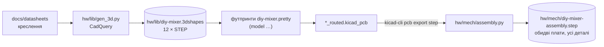

# 3D-модель пристрою для корпусу

> [!NOTE]
> **Статус:** 25.10.2026. Моделі всіх деталей є. Збірка обох плат лежить в одному STEP:
> `hw/mech/diy-mixer-assembly.step`. Розміри з креслень виробників відтворено точно. Розміри з
> позначкою `ОРІЄНТИР` на кресленнях не задані: перед фінальним корпусом їх треба виміряти на
> отриманих деталях. Отвори кріплення M2 (D57) у збірці є: H1, H3, H4 на аналоговій, H1, H2 на
> цифровій ([карта](mech/mounting.svg)).

## 1. Що де лежить



```sh
python3.12 -m venv .venv-cq && .venv-cq/bin/pip install cadquery   # перевірено з 2.8.0
.venv-cq/bin/python hw/lib/gen_3d.py          # моделі деталей (хелпери — common/cq3d.py)
python3 hw/lib/gen_footprints.py              # футпринти з посиланням на моделі
$PY hw/pcb/set_models.py hw/analog/analog_routed.kicad_pcb hw/digital/digital_routed.kicad_pcb
.venv-cq/bin/python hw/mech/assembly.py       # збірка -> hw/mech/diy-mixer-assembly.step
```

`set_models.py` оновлює лише посилання на 3D-моделі. Розстановку й доріжки він не чіпає, тож його
можна запускати й після ручної доводки.

## 2. Система координат збірки

- **X, Y:** координати аркуша KiCad. Y у STEP — це мінус Y аркуша. Обидві плати в одній системі:
  роз'єм між ними вирівняно по XY.
- **Z = 0:** низ аналогової плати. Верх аналогової — 1,6; низ цифрової — **12,6** (гніздо 8,5 +
  пластик штирів 2,5, [05](05-mechanics.md)); верх цифрової — 14,2.

Контрольні висоти над верхом аналогової плати:

| Що | Висота, мм | Джерело |
|---|---|---|
| важіль фейдера | 27,0 | Alps 2026, кресл. 20 (L1 = 20) |
| вал RK14K | 22,5 | Alps RK14K, кресл. 1 |
| верх Cherry MX без ковпачка | 15,2 | MX2A: 18,5 загалом − 3,3 виводи `ОРІЄНТИР` |
| вал енкодера (на цифровій) | 12,6 + 17,5 = 30,1 | Alps EC12D, кресл. 5 |
| скло OLED (на цифровій) | 12,6 + 4,9 = 17,5 | Rajguru + гребінка 2,5 `ОРІЄНТИР` |
| DIP CTS 204 (знизу) | −9,12 від низу плати | CTS rev. D, рис. 2 |

## 3. Моделі деталей

| Модель | Габарит, мм | З креслення | `ОРІЄНТИР` |
|---|---|---|---|
| Фейдер Alps RS451121400A | корпус 60 × 9 × 7, важіль тип 4 до 27, 2 × M2 через 56 | [Alps](datasheets/RS__1-1370683.pdf) с. 354, 356; кресл. 20 ([каталог 2026](datasheets/alps-rsxx1-series.pdf)) | форма виводів; важіль — у середині ходу |
| Ротатор Alps RK14K (12D і 124) | корпус 14 × 16,4 × 7,5; втулка M9 × 5; вал Ø6 до 22,5, лиска 4,5 на 7 мм | [Alps](datasheets/RK14K12-1370745.pdf) с. 326, 328 | висота колодки виводів (4) |
| Енкодер Alps EC12D | 12,5 × 11,7, лапки 14,1; вал Ø5,975 до 17,5, лиска 4,475 | [Alps](datasheets/alps-ec12d.pdf) с. 289, кресл. 5 | висота корпусу 5 / буртик Ø6,8 до 6 (з «5 (6)»); довжина лиски |
| Cherry MX, PCB | 15,63 × 15,63, загалом 18,5 | [MX2A](datasheets/MX2A_RED-Datasheet-EN_US.pdf) (лише габарит) | рівень пластини 5,0, верх корпусу 11,6, шток до 15,2: креслення MX у docs немає |
| Джек CUI SJ-43514-SMT | 15,5 × 6,0 × 5,0, носик Ø5 × 1,5, вісь штекера на 2,5 | [CUI](datasheets/sj-4351x-smt-series.pdf) с. 2 | форма контактів |
| DIP CTS 204-121ST (× 5, D55) | 7,26 довжина, 9,12 над платою (важільці 0,89) | [CTS](datasheets/cts-204.pdf) с. 3, рис. 2 | ширина корпусу 7,62, розмір важільців |
| Дросель Sumida CLS62 | 6,6 × 6,8 × 2,5 | [Sumida](datasheets/sumida_CLS62-334945.pdf) | — |
| Вимикач MSK12C02 | 6,75 × 2,8 × 1,4, повзунок 1,3 × 1,45 | [SHOU HAN](datasheets/shouhan-msk12c02.pdf) | висота повзунка 0,3…1,1 |
| ESP32-C3 SuperMini (D59) | 18,00 × 22,52, плоско на верхньому боці цифрової | [datasheet](datasheets/esp32-c3-supermini.pdf) | товщина плати 1,0; USB-C 9 × 7,4 × 3,2, виступ за край 1,4; перший вивід 1,5 від краю USB |
| OLED 0,96″ | плата 27,3 × 27,3, плата + скло 2,37, скло 26,7 × 19,26, активна зона 21,74 × 10,86 | [Rajguru](datasheets/oled-0.96-128x64-4pin.pdf) с. 2, 4 | товщина плати 1,0; **положення скла по Y** (центр активної зони — як у футпринті, y +1,0) |
| UEP 10 / 47 µF лежачи | Ø5 × 11 і Ø6,3 × 11 | [Nichicon](datasheets/nichicon-uep.pdf) | — |

Решта деталей (0805, SOIC, SOT-23, USB-C GCT USB4085, гніздо й штирі 2 × 12, SK6812MINI-E) — це
стандартні моделі з бібліотеки KiCad 10. У бібліотеці KiCad немає моделі Cherry MX, тому
`build_pcb.py` підставляє нашу.

## 4. Що виміряти на деталях перед корпусом

1. **OLED:** положення скла й активної зони відносно отворів Ø2,5 і висоту від цифрової плати
   до скла. Від цього залежить вікно у верхній панелі.
2. **Енкодер з вашого лота** (EC11 thin, вал 15 мм проти 17,5 у Alps): висота вала й буртика.
3. **Cherry MX:** висота верху корпусу над платою. Від неї залежить виріз у панелі
   ([05](05-mechanics.md)).
4. **SuperMini:** висота USB-C над платою модуля, виступ USB-C і положення першого виводу від краю
   (D59: від цього залежить, чи USB-C стане на край плати, і виїмка у верхній панелі).
