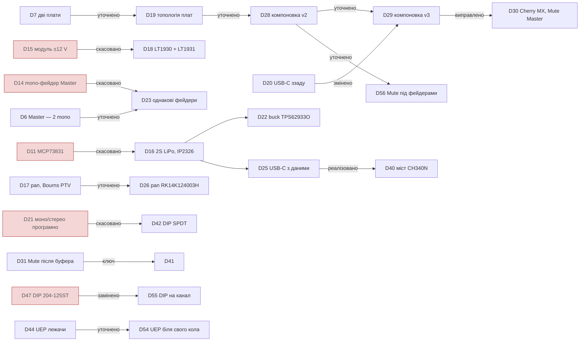

# Журнал рішень

Рішення, які змінюють ТЗ (`spec-rev-a.md`). Нові записи додаються знизу.

## Карта рішень

Скасовані й уточнені рішення (стрілка — «замінено» або «уточнено»):

Рішення за розділами:

| Розділ | Рішення |
|---|---|
| Архітектура, монтаж, ліцензія | D3, D7, D9, D12, D13, D19 |
| Фейдери й органи керування | D1, D6, D10, D17, D23, D26, D30 |
| Механіка й компоновка | D2, D8, D20, D24, D28, D29, D54, D56, D57, D59 |
| Аудіотракт | D4, D21, D31, D32, D33, D37, D38, D39, D41, D42, D43, D44, D45, D47, D55 |
| Живлення й автономність | D5, D16, D18, D22, D34, D35, D46, D58 |
| Цифра й індикація | D25, D27, D36, D40, D48 |

## Журнал

| # | Дата | Рішення | Наслідки |
|---|------|---------|----------|
| D1 | 2026-10-24 | Канальні фейдери — Alps `RS451121400A` (dual 10k B, хід 45 мм, довжина 60 мм) | Вимога ходу 20–30 мм знята. Див. [01-faders.md](01-faders.md) |
| D2 | 2026-10-24 | Фіксованого габариту корпусу немає. KPI — мінімальний розмір під елементну базу | Габарит визначається в кроці B |
| D3 | 2026-10-24 | Базова архітектура — mixerli v2.0.1 з модифікаціями | Див. [02-mixerli-analysis.md](02-mixerli-analysis.md). Ліцензія — див. D9 |
| D4 | 2026-10-24 | **Лишаємо FX-петлю**: 4 send-ротатори (post-fader, стерео) → SEND OUT; вхід 5 = стерео return з фейдером, без send | Входів 4 + return. Кнопки й LED каналів потребують іншого місця, ніж ряд send-потів |
| D5 | 2026-10-24 | **Аналог живиться від ±12 V** (як у mixerli), цифра — від окремого 5 V (ESP32-C3, OLED, RGB LED) | Дві шини від LiPo. Ключі Mute/Solo і детектори метрів мають працювати з сигналом ±12 V. Детектори масштабувати під ADC 3,3 V |
| D6 | 2026-10-24 | **Master — 2 mono-фейдери** (L і R окремо) замість одного dual. Фейдер — див. D23 | Main sum L → fader L → buffer L; те саме для R |
| D7 | 2026-10-24 | **Дві плати** (верхня + нижня). Топологію/розподіл обговоримо окремо, у користувача є ідеї | Потрібна таблиця pinout між платами (крок D) |
| D8 | 2026-10-24 | **Джеки входів/виходів — на задньому торці, навушники — на передньому** | Потрібні горизонтальні (side-mount) 3,5 мм джеки. Вертикальні PJ366ST з mixerli тут не підходять |
| D9 | 2026-10-24 | **Проєкт — похідний від mixerli, ліцензія CERN-OHL-S-2.0+.** Максимально перевикористовувати компоненти, footprints і корпуси з mixerli | `LICENSE`, атрибуція в `README.md`, source location на PCB silk. Відхилення від компонентів mixerli обґрунтовувати |
| D10 | 2026-10-24 | **Гучність навушників — окремий стерео-ротатор** | Кандидат — `RK14K12D0A18` (той самий, що send), номінал перевірити під headphone amp |
| D11 | 2026-10-24 | ~~**Заряджання — MCP73831**~~ *(скасовано D16)* (SOT-23-5) + load sharing (BAT20J + ZXMP6A13F) як у mixerli, замість BQ24074 | Менше компонентів, паяється вручну. Немає повноцінного power-path і контролю струму навантаження — перевірити в power budget |
| D12 | 2026-10-24 | **Монтаж — SMD під ручне паяння паяльником.** Reflow/фен — лише в крайньому випадку | QFN/DFN/BGA виключаються за замовчуванням: TPA6130A2 (QFN) відпадає; TPS61023 перевірити за корпусом |
| D13 | 2026-10-24 | **Дозволені готові типові модулі** (живлення та подібне), як ±12 V DC-DC у mixerli | Вимоги до модуля: відомі габарит і розпиновка, кілька продавців, монтаж на pin header (знімний), шум і EMI перевіряються на прототипі. Модуль фіксується конкретним оголошенням з фото/кресленням |
| D14 | 2026-10-24 | ~~**Master — Alps `RS451111B010`**~~ *(скасовано D23)* (mono 10k B, 45 мм) попри інший важіль (ізольований B, L1 = 10 мм проти металевого 20 мм у каналів) | Master-ручки нижчі й іншого типу. Footprint окремий: 3 × Ø1,5, ряди через 50 мм. Див. [04-mixerli-datasheets.md](04-mixerli-datasheets.md) |
| D15 | 2026-10-24 | ~~**±12 V — готовий модуль, як у mixerli v2.0.1.**~~ *(скасовано D18)* Ідентифіковано як **DD1718PA ±12V** (eletechsup): 25 × 16,3 мм збігається з footprint mixerli 25 × 16,7 мм | Vin 3,3–11 V (підходить для 2S), +Vo до 700 mA, **−Vo до 150 mA** — запас на −12 V малий, рахувати бюджет. Пульсації не вказані. LT1930/LT1931 (v1.0) — запасний варіант |
| D16 | 2026-10-24 | **Живлення — 2S LiPo.** Заряджання + балансування — модуль USB-C 2S на IP2326 (кандидат). 5 V для цифри — buck-модуль | **Скасовує D11** (MCP73831 + load sharing). Відкрито: робота під час заряджання, захист по банках (2S BMS або pouch з PCM). Див. [03-power-2s.md](03-power-2s.md) |
| D17 | 2026-10-24 | **Pan/balance на каналах 1–4.** Пасивна схема: лінійний потенціометр між L/R гілками перед сумувальними резисторами main, повзунок на GND. Send — pre-pan. Return (вхід 5) без pan | +4 ротатори, +8 резисторів, 0 mA. Для стереоджерела це баланс, для моно (JP замкнено) — справжня панорама. Кандидат потенціометра — Bourns PTV з центральною фіксацією (`НЕ ПЕРЕВІРЕНО`). Ще один ряд ротаторів на панелі — врахувати в кроці B |
| D18 | 2026-10-24 | **±12 V — дискретно на LT1930 (+12 V) + LT1931 (−12 V)** за схемою mixerli v1.0 | **Скасовує D15** (модуль DD1718PA). ThinSOT-5, паяється вручну. Vin до 16 V — працює від 2S. Струмовий бюджет і номінали перерахувати під 2S у кроці C |
| D19 | 2026-10-24 | **Топологія плат:** аналогова плата знизу (фейдери, ротатори, джеки, аудіо, живлення), цифрова — зверху, лише над зоною задніх аудіоджеків. З'єднання PLS/PBS. На цифровій: ESP32-C3, кнопки й RGB LED у колонках відповідних каналів, OLED у правій колонці (над ротатором і джеком навушників) | Уточнює D7 і змінює розділ 3 ТЗ: фейдери тепер на нижній (аналоговій) платі. Висоту стека (PLS/PBS + плата + кнопки/OLED) треба узгодити з висотою фейдерів і ротаторів під однією верхньою панеллю (крок B). Цифрова плата над джеками: суцільна земля знизу як екран |
| D20 | 2026-10-24 | **USB-C — на задньому торці** поруч з аудіоджеками | Порядок колонок і LED Master L/R — як у схемі з обговорення D19 (підтверджено) |
| D21 | 2026-10-24 | ~~**Моно/стерео-перемички JP1–JP5 замінюються програмними ключами~~ *(частково скасовано D42: перемикач механічний)* — на всіх 5 входах (ch1–4 + return)**: на кожен вхід SPDT-ключ, що подає на R-секцію фейдера або R джека (стерео), або T джека (моно). Керування з ESP32 (меню енкодера), стан зберігається в NVS | Ключ має працювати з ±12 V і 3,3 V логікою. Ключ — **DG413** (D41); ADG1436 відкинуто через ціну. DG419L: варіант Vishay живиться лише до ±6 V і не підходить, а варіант Maxim (±4,5…±20 V, 35 Ω) — запасний. Ключ саме SPDT, а не перемичка T↔R: моно-штекер замикає R на GND. Разом із Mute/Solo це багато ліній керування, потрібен розширювач GPIO (крок C/D) |
| D22 | 2026-10-24 | **5 V для цифри — buck TPS62933O** (TI; out-of-audio mode, Vin 3,8–30 V, до 3 A, 200 kHz–2,2 MHz, spread spectrum, PG-вивід; SOT-583 1,6 × 2,1 мм, крок 0,5 мм). TPS63802 відхилено (Vin макс. 5,5 V, VSON); AP63205 — запасний | Виняток із D12: SOT-583 має бічні виводи, паяти паяльником можна, але з тонким жалом і флюсом. Out-of-audio звірено з [datasheet](datasheets/tps62933o.pdf): частота комутації завжди вище 30 kHz, навіть без навантаження, ціною нижчого ККД на малому струмі. Номінали — крок C |
| D23 | 2026-10-24 | **Усі 7 фейдерів однакові — `RS451121400A`** (dual). На Master L і Master R використовується одна секція, друга вільна | **Скасовує D14.** Одна позиція в BOM, один footprint, однакові важелі (20 мм) і ручки. Вільну секцію не залишати плаваючою: виводи на GND або паралельно робочій (вирішити в кроці C) |
| D24 | 2026-10-24 | **Корпус ступінчастий:** зона фейдерів і ротаторів нижча, зона цифрової плати (задня смуга + права колонка з OLED і енкодером) вища. Корпус малює користувач; від нас потрібна компоновка й висоти | Цифрова плата більше не мусить стояти впритул під нижньою панеллю: стандартна пара PLS/PBS, під платою вистачає місця для джеків і SuperMini. Див. [05-mechanics.md](05-mechanics.md) |
| D25 | 2026-10-24 | *(реалізація — D40: GPIO18/19 на піни SuperMini не виведено)* **USB-C — живлення/заряджання + дані**: D+/D− ESP32-C3 (вбудований USB Serial/JTAG) виведено на задній роз'єм для прошивки без розбирання | Замість power-only UJC-HP-3 — USB-C 2.0 з D+/D− (P/N підібрати). CC 5,1k на GND, ESD на D+/D− (SOT-23-6, напр. USBLC6-2SC6 — `НЕ ПЕРЕВІРЕНО`). Перевірити: (1) чи SuperMini виводить GPIO18/19 (USB) на піни — `НЕ ПІДТВЕРДЖЕНО`, інакше ESP32-C3 без модуля або донорський роз'єм; (2) модуль IP2326 може узгоджувати QC через D+/D− — конфлікт з даними, тоді живити модуль лише від VBUS/GND і не з'єднувати його D+/D−. Розглянуто й відхилено (24.10): власний USB-C SuperMini назовні як другий порт |
| D26 | 2026-10-24 | **Pan — Alps `RK14K124003H`** (dual 10k 1B, центральна фіксація, footprint як у send-ротаторів) | Уточнює D17 (замість Bourns PTV). Використовується одна секція; номінал 10k перевірити в кроці C |
| D27 | 2026-10-24 | **MCU — ESP32-C3 SuperMini (у користувача є екземпляри від Tenstar Robot), радіо не використовується**: Wi-Fi і BLE у прошивці вимкнені. Розглянуто й відхилено: Nano 33 BLE (лише BLE, дорожчий, удвічі більший, оригінал EOL), Bluetooth-аудіо | Немає радіо-імпульсів струму поруч з аналоговим трактом. Розташування модуля не залежить від антени, вирізи в панелі під антену не потрібні. Прошивка й налаштування лише через USB-C (D25) і енкодер |
| D28 | 2026-10-24 | **Компоновка v2:** (1) кнопки Mute — над фейдерами на всіх 7 колонках (ch1–4, RET, Master L/R), на аналоговій платі, через розширювач GPIO; (2) індикація (RGB LED) лишається на цифровій платі в задній смузі, над ротаторами; (3) OLED — над RET і Master L; (4) над Master R — енкодер, під ним ротатор навушників; (5) окрему праву колонку прибрано. Штоки кнопок і ручки друкуються, тож висота кнопки не обмежує | Уточнює D19: кнопки тепер на аналоговій платі. Габарит ≈ 136 × 130 мм (було 166 × 123). Розширювач на аналоговій платі з виходом INT на ESP. Mute на Master — ще 2 ключі (крок C). Джек навушників — на передньому торці, праворуч від фейдера Master R (`ПРИПУЩЕННЯ`, залежить від ширини джека). Див. [05-mechanics.md](05-mechanics.md) |
| D29 | 2026-10-24 | **Компоновка v3:** (1) порядок колонок: ch1–4, Master L, Master R, RET (ефекти — крайні праворуч); (2) Master L/R зсунуті впритул: крок 11 мм (корпус 9 + 2 мм), ручку користувач робить «як одну, але розділену»; (3) Mute і кліпінг Master — лише на OLED, без кнопок і LED; Mute-кнопки й LED — ch1–4 + RET; (4) OLED над парою Master, енкодер над RET, під ним ротатор навушників; (5) вхідні джеки — під своїми колонками, MAIN під парою Master, SEND між MAIN і RET; (6) USB-C — на правому бічному торці, у задньому куті під цифровою платою; (7) джек навушників — передній торець, між Master R і RET | Уточнює D19/D20/D28. **D20 змінено:** USB-C більше не на задньому торці. Габарит ≈ 127 × 130 мм (після креслення джеків — 130 × 137, крок M-R → RET 20,5 мм). Крок 11 мм: pad Ø2 на ±3,75 дають ~2 мм між міддю сусідніх фейдерів; кріпильної пластини в `RS451121400A` немає (кресл. 20 Alps 2026) |
| D30 | 2026-10-24 | **Кнопки Mute — Cherry MX (або сумісні, PCB-mount), 6 шт.:** ch1–4, **одна спільна на пару Master** (по центру пари), RET. Стан Mute Master і кліпінг Master показує OLED. Ковпачки друкуються (~15 мм, не стандартні 18 мм, бо крок колонок 18) | Виправляє D29, де Mute Master помилково прибрано. Корпус MX 15,63 × 15,63 мм, загальна висота 18,5 мм (datasheet MX2A). Панель тут не тримає світч: її верх на 9,5 мм, а MX розрахований на пластину з верхом на 5 мм над PCB (`ОРІЄНТИР`, не з datasheet Cherry). Тому монтаж лише на PCB (5-pin, з пластиковими штирями), у панелі — виріз ≥ 16 мм. Глибина корпусу зростає на ~7 мм |
| D31 | 2026-10-24 | **Mute каналу — ключ SPDT одразу після вхідного буфера** (сигнал ↔ GND), перед send, pan і сумою. Mute глушить і main, і send. Метр каналу — до ключа (pre-mute). Solo — лише в прошивці, тими самими ключами | Див. [06-signal-flow.md](06-signal-flow.md), п. 2 |
| D32 | 2026-10-24 | **Навушники грають і при заглушеному Master.** Відгалуження на навушники — на виході суматора, до Master-фейдера й Master Mute (`ПРОПОЗИЦІЯ` щодо точки: навушники тоді не залежать і від Master-фейдера) | Навушники чують те саме, що показує метр Master (D33). Гучність — лише ротатор PHONES |
| D33 | 2026-10-24 | **Метр і CLIP Master — на виході суматора, до Master-фейдера** | Видно перевантаження суми незалежно від положення фейдера |
| D34 | 2026-10-24 | **Автономність — один з KPI.** Детектори метрів — на економних op-amp, не на NJM4580 | Бюджет −12 V при 6,0 V укладається із запасом. Енергоспоживання враховується при виборі кожного компонента. Кандидатів на економніший op-amp для аудіотракту оцінити разом з розрахунком шуму (крок C) |
| D35 | 2026-10-24 | **Розряд батареї — програмне попередження на OLED** замість окремої апаратної відсічки на 6,4 V | Апаратний захист банок від глибокого розряду (2S BMS або PCM у pouch) лишається для безпеки. Поріг попередження — у прошивці, від виміру АЦП (канал «батарея») |
| D36 | 2026-10-24 | **Адресні RGB LED — у невеликих корпусах, але з бічними виводами під ручне паяння (D12).** Кандидат — OPSCO **SK6812MINI-E** (3,2 × 2,8 × 1,78 мм, 4 бічні виводи, монтаж «знизу» через виріз у платі) | 1515/2020 (SK6805 тощо) мають pad під корпусом — лише reflow, відкинуто. VDD 3,7–5,5 V, VIH 0,7·VDD → потрібен перетворювач рівня 3,3 → 5 V. PWM LED 1,2 kHz — у звуковому діапазоні, див. [06-signal-flow.md](06-signal-flow.md) |
| D37 | 2026-10-24 | **Op-amp: OPA1678 в аудіотракті замість NJM4580 (mixerli), сімейство TL06x — у детекторах метрів** (уточнено в 08: 6 × TL064AC, двополуперіодний детектор) | OPA1678: 2 mA на канал, вихід до 0,8 V від шини (+2 dB запасу), 4,5 nV/√Hz. TL062: 0,2 mA на підсилювач. Струм ±12 V ≈ 50–80 mA на шину замість 135–190, час роботи від 2S 1500 mAh ≈ 3,5 год (`ОЦІНКА`). Див. [07-gain-structure.md](07-gain-structure.md) |
| D38 | 2026-10-24 | **Розділовий конденсатор на кожному вході:** 10 µF неполярний перед фейдером + 1M на GND з боку джека | 10 шт. Зріз 1,6 Hz (стерео) / 3,2 Hz (моно). Кераміку в тракт не ставити |
| D39 | 2026-10-24 | **Навушники: окремий OPA1678 на кожен канал**, обидві половини паралельно через 10 Ω | 32 Ω і вище — без обмежень до 1 Vrms; 16 Ω — до ~0,5 Vrms на синусі за теплом (Tj ≈ 99 °C при 40 °C). Мідні полігони під корпусом |
| D40 | 2026-10-24 | **USB-C на корпусі → міст USB-UART CH340N (SOP-8) → UART0 ESP32 (GPIO20/21).** Живлення мосту — від 3V3 SuperMini. Кнопка енкодера — на GPIO9 (BOOT) для аварійного входу в завантажувач; дані RGB LED переїжджають на GPIO10 | Реалізує D25: GPIO18/19 на піни SuperMini не виведено (розпиновка продавця). Прошивка — з увімкненим мікшером; у сні USB міст бере ~40 µA. Автоматичного скидання немає (EN не виведено). Див. [06-signal-flow.md](06-signal-flow.md), п. 4.3 |
| D41 | 2026-10-24 | **Аналогові ключі — Vishay DG413** (SOIC-16, 2 NO + 2 NC) замість ADG1436. Mute стереоканалу — один корпус на одній лінії (послідовні NO + NC на GND) | 6 корпусів ≈ $7 (після D42; спершу рахували 9 ≈ $10) (LCSC ~$1,13) замість ≈ $45–90. 35 Ω макс., charge injection 5 pC, break-before-make. Потрібне VL = 5 V. `DG413DY` без суфікса знятий, `-E3`/`-T1-E3` у продажу. Див. [06-signal-flow.md](06-signal-flow.md), п. 3.0 |
| D42 | 2026-10-24 | **Моно/стерео — механічний SPDT-перемикач** (DIP-блок або 5 мініатюрних слайдів) на кожен із 5 входів, після розділових конденсаторів. Змінюється рідко | Скасовує програмну частину D21: −3 × DG413, −5 ліній керування, без пункту меню й NVS. Розширювачів тепер один — MCP23017 (6 виходів Mute + 6 кнопок + INT); MCP23008 прибрано. Перемикач має бути доступний без розбирання — місце `ВІДКРИТО` |
| D43 | 2026-10-24 | **Перемикачі моно/стерео — SMD, на нижньому боці аналогової плати**; доступ через вікно в дні корпусу | Зону під вікном не можна закривати батареєю: 2S pouch розміщується поза нею. Місце — біля задніх джеків (короткі сигнальні доріжки), уточнити в KiCad (крок E) |
| D44 | 2026-10-24 | **Вхідні 10 µF — вивідні неполярні Nichicon UEP1E100MDD** (25 V, 5 × 11 мм, крок виводів 2 мм), **монтаж лежачи** | Висота лежачи ~5,5 мм — вміщується і під нижньою панеллю (7,5 мм), і під цифровою платою (11 мм). Виняток із переваги SMD (D12): SMD-неполярних з потрібною висотою не підтвердив |
| D45 | 2026-10-24 | **Прибрати 47 µF + 47k між фейдером і буфером** (з mixerli). На вході буфера лише 1M на GND | Постійну складову вже відсікає вхідний конденсатор (D38), а шлях на GND для повзунка дає сам фейдер. 1M лишається на випадок втрати контакту повзунком. Мінус 10 великих конденсаторів. Див. [10-passives.md](10-passives.md) |
| D46 | 2026-10-24 | **Дроселі перетворювачів — дискретні, не доріжками плати; замість фериту на шинах ±12 V — RC-фільтр 2,2 Ω + 22 µF.** Дросель 5 V — Bourns SRN4018-4R7M | Друкована спіраль 20 × 20 мм дає лише ~4,3 µH при ~2 Ω, без осердя й з полем біля аудіо. Ферит на 1,2 MHz малоефективний, RC дає ≈ −51 dB (розрахунок). Див. [12-parts.md](12-parts.md) |
| D47 | 2026-10-24 | **Моно/стерео — CTS 204-125ST** (SPDT DIP, рівно 5 позицій, SMD, 27,58 мм, висота 9,12 ± 0,35 мм); стоїть знизу, важільці у вікні в дні корпусу | Уточнює D42/D43. Звірено з datasheet CTS rev. D ([12-parts.md](12-parts.md)) |
| D48 | 2026-10-24 | **Роз'єм між платами — PLS/PBS 2 × 12, крок 2,54 мм**, pinout з [13-interboard.md](13-interboard.md): живлення з краю, цифра (I²C-A, INT, UART) окремо від 8 ліній метрів, 8 GND. Аудіо через роз'єм не йде. CH340N — на аналоговій платі біля USB-C | Крок D. Конкретні P/N роз'ємів і місце — крок E |
| D49 | 2026-10-24 | **Дросель +12 V (LT1930) — Bourns SRN4018-100M** (10 µH, Isat 1,4 A, напівекранований) замість Sumida CR43-100 з mixerli v1.0 | CR43 неекранований (datasheet Sumida) — поле біля аудіотракту. Піковий струм 367 mA ([11](11-power.md)). Той самий корпус, що й дросель 5 V |
| D50 | 2026-10-24 | **Компоновка уточнена під реальні футпринти:** ряд pan y 47 → 49, Mute 62,5 → 64, фейдери від 72,5; глибина 138 мм. Виводи RK14K обох рядів — назад (до задньої стінки). Джек — варіант футпринта SJ-43514 без площадок 5/6 | У RK14K ряд виводів на 11 мм від вала: при кроці рядів 17 мм виводи pan потрапляли під корпус send, а площадка 5 джека — на виводи send. Див. hw/lib, docs/mech/layout_v3.py |
| D51 | 2026-10-25 | **Вимикач живлення — SHOU HAN MSK12C02** (SPDT, SMD, повзунок убік, 8 × 2,8 × 1,4 мм) **на правому торці аналогової плати**, між джеком RET і USB-C, повзунок виступає за край плати на 1,2 мм. **Комутує не батарею, а затвор P-MOSFET AO3401A** (SOT-23, −30 V, Rds(on) < 60 mΩ при −4,5 V): 100k + 100 nF між затвором і витоком, 10k до вимикача | Струм з батареї до ~0,56 A (3,35 W при 6,0 V, [11](11-power.md)), а MSK12C02 розрахований на 50 mA, BSI-10H/SSI-10H і NSI-10HS (Sungmun) — на 0,5 A при 12 V. Навіть Alps SSSS916400 з mixerli — лише 0,1 A, і він теж вивідний. BSI-10H вивідний; його SMD-версія NSI-10HS має повзунок угору, для бічної стінки не годиться. Через ключ тече < 1 mA, а 100 nF дає плавне ввімкнення (~1 мс, `ОЦІНКА`). У вимкненому стані витік ≤ 1 µA (IDSS, datasheet) |
| D52 | 2026-10-25 | **Плати — 4 шари:** F.Cu сигнали / In1 суцільна GND / In2 сигнали й живлення / B.Cu сигнали (бік SMD). **Розводка — автороутер Freerouting 2.4.1 з подальшою ручною корекцією.** Шини живлення — 0,5 мм, решта — 0,2 мм; мідь ≥ 0,5 мм від зовнішнього контуру | Суцільна земля під аудіотрактом поруч з перетворювачами ±12 V (1,2 MHz). Цифрова плата теж 4-шарова: вона на одній панелі з аналоговою (D53). Розстановка SMD — за зв'язками (hw/pcb/build_pcb.py), трасування — hw/pcb/route_pcb.py |
| D53 | 2026-10-25 | **Одне замовлення — одна панель** 129 × 187 мм: цифрова плата (повернута на 180°) задньою стороною до задньої сторони аналогової, розділ — **один V-cut** через усю ширину. Збирає hw/pcb/panel.py (KiKit 1.8.1) з двох окремих проєктів | V-cut можливий: лінія пряма й перетинає всю панель, плати стикуються без зазору (вимоги JLCPCB). Мідь ≥ 0,4 мм від лінії V-cut (JLCPCB), у нас 0,5. Носики джеків виходять за задній край аналогової плати на 0,5 мм (контур на y 0,5, торець носика на y 0), тобто на цифрову: **джеки паяти після розламування**. JLCPCB бере доплату за кілька плат у файлі (сума — у калькуляторі, `НЕ ПЕРЕВІРЕНО`) — порівняти з двома окремими замовленнями |
| D54 | 2026-10-25 | **Великі неполярні UEP — біля свого кола, не в проміжках між фейдерами.** Вхідні 10 µF (IN1–IN4, RET) — **знизу під своїм джеком**, лежачи; MAIN/SEND 47 µF — згори під цифровою платою за своїм джеком; майстер 10 µF — у проміжках між фейдерами біля повзунка (переднього кінця). **2S LiPo — знизу від y 36 мм** (126 × 100 мм), задня смуга під джеками вільна (9 мм) | Від джека до вхідного конденсатора 4–12 мм замість 74–151 мм по доріжках ітерації 1. Крок ротаторів не змінюється (ширина 130 мм). Розміщення — `uep_plan()` у `hw/pcb/build_pcb.py`, перевірка — [mech/topology-v4.svg](mech/topology-v4.svg) ([14](14-kicad.md), п. 3.3) |
| D55 | 2026-10-25 | **Моно/стерео — окремий CTS 204-121ST (SPDT, 1 позиція) на кожен канал**, знизу під ротатором send свого каналу, між його виводами й лапками; 5 вікон у дні | **Замінює D47** (один 204-125ST під OLED: від конденсатора до DIP було 27–65 мм, тепер 11–20). Та сама серія й [datasheet](datasheets/cts-204.pdf): 1 позиція є лише в SPDT/DPST, A = 7,26 мм. Наявність — DigiKey Active `НЕ ПЕРЕВІРЕНО` для України. Призначення виводів — як у одного каналу 204-125ST, звірити продзвонкою |
| D56 | 2026-10-25 | **Ряд Mute — під фейдерами** (y 125), фейдери зсунуто до ряду pan (центр y 87). Mute RET — на 0,5 мм правіше колонки, phones-джек — x 104,5, між Mute Master і RET | **Уточнює D28** (Mute над фейдерами). Задній кінець фейдера (верхні виводи 3/6) на 15,5 мм ближче до джеків і DIP: від DIP до фейдера ~35 мм. Глибина плати та сама (138,5 мм) |
| D57 | 2026-10-26 | **Кріплення — отвори M2, металізовані на GND** (Ø2,2, площадка 4,4; courtyard r 2,45 з обох боків під стійку, гайку чи головку гвинта; футпринт `MountingHole_2.2mm_M2_Pad_Standoff_2Side`). **H1** (3,8; 15,8) — на обох платах: стійка між платами 11 мм і стійка до дна корпусу. **H3, H4** (4,4 і 125,6; 134,0) — передні кути аналогової до дна. **H2** (126,0; 29,0) — лише на цифровій, біля енкодера: коротка стійка до верхньої панелі (~3,4 мм `ОЦІНКА`). Третя опора цифрової плати — роз'єм 2 × 12. Зона 2S LiPo — до y 131 (126 × 95 мм) | Уточнює пропозицію з [13](13-interboard.md) (2–3 стійки M2,5 / M3 на кінцях «Г»). M3 (як у mixerli) на аналоговій вільно лягає лише в передні кути; під M2 H1, H3, H4 стали без жодної зміни розводки, кріпіж — той самий M2, що й на фейдерах. Правий задній кут аналогової зайнятий ключем живлення й USB-C: стійка між платами там вимагала б перекласти BAT+ і RET_TC, тому H2 кріпиться до панелі — зусилля натискання енкодера йде прямо в панель. Аналогову плату й так тримають на нижній панелі фейдери (2 × M2) і втулки RK14K з гайками. Карта — [mech/mounting.svg](mech/mounting.svg). **Стійки друковані** (26.10.2026): діаметр ≤ 4,8 мм (courtyard), отвір Ø2,4 під гвинт M2 наскрізь, висота міжплатної — під фактичну пару PBS/PLS (11 мм `ОРІЄНТИР`); до корпусу — бобишки корпусу з різьбовою вставкою M2 `ПРОПОЗИЦІЯ` |
| D58 | 2026-10-26 | **Блокування й перетворювачі — за правилами, а не авторозставлянням.** Кожен 100 nF у схемі прив'язаний до своєї мікросхеми (поле `Decouples`) і стоїть біля її виводу живлення. Кожен перетворювач — компактний блок (поле `Group`): мікросхема на фіксованому місці знизу, дросель, діод і вхідний конденсатор — площадкою до виводу, далі вихід, дільник ЗЗ, RC-фільтр. Над блоками — заборона доріжок на In2 (між In2 і B.Cu землі немає), над дроселями — на F.Cu. **TPS62933: додано 100 nF на VIN** | Огляд аудіотракту ([14](14-kicad.md), п. 4.1): 35 з 54 блокувальних конденсаторів стояли далі 8 мм від виводу (до 23); вхідний конденсатор TPS62933 — за 36 мм від VIN; аудіо йшло під дроселями й уздовж SW_P. Правила розведення — TI SLUSEA4D розд. 12.1–12.2 (у т. ч. 0,1 µF біля VIN), LT1930 рис. 6, LT1931 рис. 10 ([datasheets](datasheets/README.md)). Після виправлення: блокування ≤ 3 мм у 31 з 54 виводів, ≤ 5 мм у 51; аудіо поруч із вузлами перемикання — 0 збігів |
| D59 | 2026-10-26 | **ESP32-C3 SuperMini — на верхньому боці цифрової плати, плоско, пайкою на SMD-площадки** (припій згори в отвори модуля), без прорізу; **USB-C модуля — на задньому краї плати** (край модуля = край плати, корпус USB-C виступає ~1,4 мм). Модуль між вікнами LED IN4 і RET, по центру над OLED (x 90,5). **OLED зсунуто вперед на 2,55 мм** (центр y 37,2), нижній край цифрової плати — y 52 замість 50 | Запит користувача: доступ до USB-C модуля в майбутньому, суцільна земля під модулем (проріз не потрібен). Радіо не використовується (D27), тож мідь під антеною не заважає. Положення виводів уздовж модуля й виступ USB-C — з масштабного малюнка розпиновки (`ОРІЄНТИР`, виміряти). Лапки USB-C модуля знизу підрізати врівень, щоб модуль лежав рівно. Верх USB-C ≈ 18,45 мм над низом аналогової проти низу верхньої панелі ~17,6 (`ОЦІНКА`): у панелі потрібна виїмка ~1 мм над модулем |
