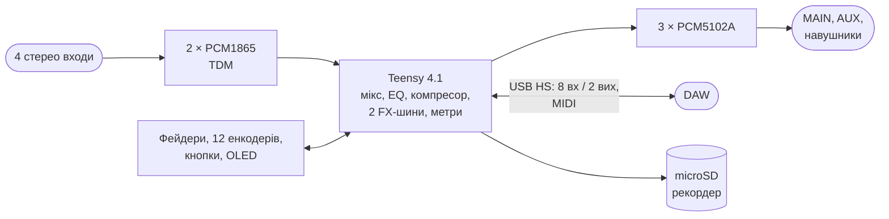

# digital-mixer

Портативний цифровий стереомікшер з USB-аудіоінтерфейсом. Від teenage engineering TX-6 беремо
формфактор і функції (EQ, компресор, ефекти, cue, сцени, MIDI, рекордер), але не схемотехніку.

> [!NOTE]
> Стан: дослідження ([docs/00-research.md](docs/00-research.md)). Наступний крок — макет на готових
> платах: Teensy 4.1 + PCM1865 + PCM5102A, перевірка USB-аудіо 8 каналів у Windows, macOS та iOS.

| Документ | Зміст |
|---|---|
| [docs/00-research.md](docs/00-research.md) | TX-6, варіанти архітектури, канали й USB, живлення, функції, ризики |
| [docs/decisions.md](docs/decisions.md) | Журнал рішень цифрового підпроєкту (DM1…) |
| [docs/datasheets/](docs/datasheets/README.md) | Datasheets цього підпроєкту |

З аналогового [Rev A](../analog-mixer/README.md) переносимо деталі там, де вони підходять:
джеки, вимикач, USB-C, модуль заряджання, TPS62933O (5 V), OLED, SK6812, енкодер EC12D.

Ліцензія — [CERN-OHL-S-2.0+](../LICENSE), як і весь репозиторій.
