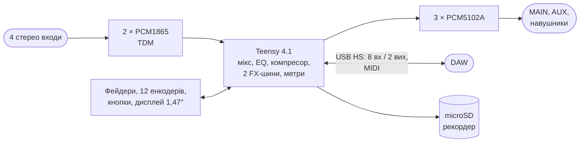

# digital-mixer

Портативний цифровий стереомікшер з USB-аудіоінтерфейсом. Від teenage engineering TX-6 беремо
формфактор і функції (EQ, компресор, ефекти, cue, сцени, MIDI, рекордер), але не схемотехніку.

> [!NOTE]
> Стан: плата розведена ([docs/04-pcb.md](docs/04-pcb.md)), прошивка 0.1 з емулятором ([docs/06-firmware.md](docs/06-firmware.md)), схема — [docs/03-schematic.md](docs/03-schematic.md); ТЗ — [docs/01-spec.md](docs/01-spec.md), дослідження — [docs/00-research.md](docs/00-research.md). Наступний крок — макет на готових
> платах: Teensy 4.1 + PCM1865 + PCM5102A, перевірка USB-аудіо 8 каналів у Windows, macOS та iOS.

| Документ | Зміст |
|---|---|
| [docs/00-research.md](docs/00-research.md) | TX-6, варіанти архітектури, канали й USB, живлення, функції, ризики |
| [docs/01-spec.md](docs/01-spec.md) | **ТЗ Rev 1:** функціонал, керування, роз'єми, ТТХ |
| [docs/02-components.md](docs/02-components.md) | Фейдери, енкодери, живлення 1S, монтаж Teensy, AliExpress чи JLCPCB |
| [docs/03-schematic.md](docs/03-schematic.md) | **Принципова схема** (KiCad, [PDF](hw/main/main.pdf)), виводи Teensy, макет розташування |
| [docs/04-pcb.md](docs/04-pcb.md) | **Плата:** чотиришарова 104,5 × 136,5 мм (компоновка C), розведена, DRC 0 порушень, 0 розривів |
| [docs/05-fab.md](docs/05-fab.md) | **Виготовлення:** Gerber, BOM, файли PCBA для NextPCB, [інтерактивний BOM](docs/ibom/ibom.html), порядок ручного монтажу |
| [docs/06-firmware.md](docs/06-firmware.md) | **Прошивка й емулятор:** ядро C++ ([firmware/](firmware/README.md)), емулятор на SDL2, керування, ефекти, MIDI CC, що перевірити на макеті |
| [docs/calc/](docs/calc/power.py) | Розрахунок живлення |
| [docs/decisions.md](docs/decisions.md) | Журнал рішень цифрового підпроєкту (DM1…) |
| [docs/datasheets/](docs/datasheets/README.md) | Datasheets цього підпроєкту |

З аналогового [Rev A](../analog-mixer/README.md) переносимо деталі там, де вони підходять:
джеки CUI SJ-43514, USB-C GCT USB4085, захист USBLC6-2SC6, MBR0530 і AO3401A (load sharing).

Ліцензія — [CERN-OHL-S-2.0+](../LICENSE), як і весь репозиторій.
