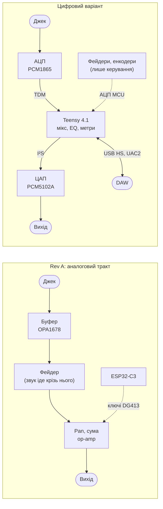
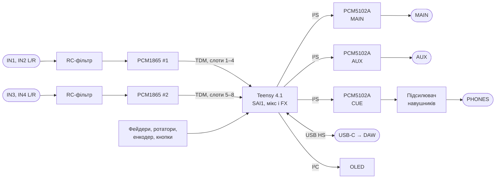
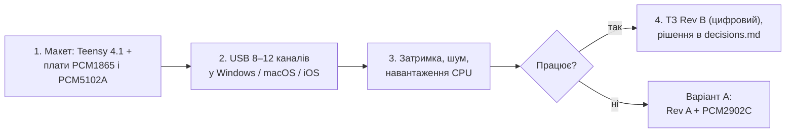

# 00. Дослідження: цифровий мікшер з аудіоінтерфейсом (на зразок TX-6)

> [!NOTE]
> **Статус:** дослідження, 26.10.2026. Аналоговий Rev A — окремий підпроєкт [analog-mixer](../../analog-mixer/README.md), не змінюється. Обрано конфігурацію «4 стерео входи,
> ефекти всередині» (п. 8); решта — варіанти. Мета — з'ясувати,
> чи можна зробити мікшер, де звук іде через АЦП → процесор → ЦАП, з USB-аудіоінтерфейсом для DAW і
> цифровим керуванням, за тими самими правилами: ручний монтаж (D12), модулі дозволені (D13), KPI —
> габарит і автономність (D34).

**Коротко:** так, можна. Найреальніший шлях — модуль **Teensy 4.1** (USB High Speed, два порти
I²S/TDM) + АЦП **TI PCM1865** (TSSOP-30, 4 канали) + ЦАП **TI PCM5102A** (TSSOP-20, стерео). Усе
паяється паяльником. Схема й плата стають простішими за Rev A, споживання — нижчим (`ОЦІНКА`
~5–6 год проти 4,6 год). Основна робота і ризик переходять у прошивку: багатоканальний USB-аудіо
на Teensy — бібліотека сторонніх авторів, обмежена 8 каналами без доробки.

## 1. TX-6 як орієнтир

Дані — зі сторінки виробника ([teenage.engineering/products/tx-6](https://teenage.engineering/products/tx-6)).

| Параметр | TX-6 |
|---|---|
| Входи | 6 стерео (кожен стерео або моно), 10 kΩ, підсилення 0–42 dB, макс. +13 dBu (3,5 Vrms) |
| АЦП | TI TLV320ADC3140, SNR ≈ 102 dBA |
| Виходи | main і aux (+8 dBu, 2 Vrms, ЦАП Cirrus CS43131, SNR > 120 dBA); cue / навушники (+2 dBu, ЦАП Cirrus CS47L35) |
| USB | USB-C, аудіо + MIDI, 24 біт / 48 kHz, **12 каналів у DAW** |
| Обробка | 3-смуговий EQ і компресор на канал, 8 ефектів (reverb, chorus, delay, …), синт, тюнер |
| Живлення | вбудований акумулятор, ≈ 8 год |
| Габарит / маса | 90 × 62 × 23 мм, 160 г |
| Керування | енкодери, фейдери, кнопки aux / cue, дисплей 48 × 64 |

Усі три аудіочипи TX-6 — у корпусах без виводів збоку, тож за D12 їх не беремо; нижче —
замінники в TSSOP.

## 2. Що змінюється порівняно з Rev A

- **Фейдери й ротатори стають датчиками положення.** Звук крізь них не йде, тож достатньо однієї
  лінійної секції, а не здвоєної логарифмічної. Їх читає АЦП процесора.
- **Зникають цілі вузли Rev A:** перетворювачі ±12 V (LT1930, LT1931 з дроселями — головне джерело
  завад біля аудіо), 12 × OPA1678, 6 × TL064 детекторів метрів, 6 × DG413, ADS7828, MCP23017,
  CH340N. Мьют, соло, панорама, метри — у прошивці.
- **З'являється** багатоканальний USB-аудіоінтерфейс, EQ і ефекти без нових деталей.
- **Ціна** — затримка АЦП + обробка + ЦАП (одиниці мс, `ОЦІНКА`; для живого моніторингу
  прийнятно) і великий обсяг прошивки.

## 3. Канали й смуга USB

Rev A: 4 стерео входи + повернення (RET) = **10 входів**; виходи main, send, навушники = **6**. Обраний цифровий варіант (п. 8): **8 входів** (ефекти всередині), виходи main, aux, навушники = **6**.
TX-6 віддає в DAW 12 каналів.

Смуга ізохронного USB при 48 kHz і 24 біт: 48 відліків/мс × 3 байти = 144 байти/мс на канал
(асинхронний режим потребує запасу на 49-й відлік: 147 байтів).

| Швидкість USB | Макс. пакет | Скільки каналів 24 біт | 16 біт |
|---|---|---|---|
| Full Speed (12 Mbit/s): ESP32-S3, RP2350, PCM2902C | 1023 байти на кадр 1 мс | **6** | 10 |
| High Speed (480 Mbit/s): Teensy 4.1 | 1024 байти на мікрокадр 125 µs | десятки — 12 каналів займають ~220 байтів | — |

Висновок: 10–12 каналів 24 біт можливі лише з **USB High Speed**.

## 4. Варіанти

| | A. Rev A + USB-кодек | B. Teensy 4.1 (рекомендовано) | C. ESP32-S3 | D. XMOS XU316 |
|---|---|---|---|---|
| Що це | Аналоговий Rev A + TI **PCM2902C** (SSOP-28): запис main, відтворення в RET | Повністю цифровий: модуль Teensy + PCM1865 × 2 (× 3 із зовнішньою петлею FX) + PCM5102A × 3 | Як B, але ESP32-S3 і USB FS | Спеціалізований USB-аудіо процесор |
| Каналів у DAW | 2 вх / 2 вих, 16 біт | 8 з бібліотеки, 12 — після доробки дескрипторів | ≤ 6 (24 біт) | 8+ в еталонному дизайні |
| Драйвер | не потрібен (USB-IF certified) | UAC2 class-compliant | UAC2 | UAC2 |
| Монтаж | SSOP — паяльником | модуль + TSSOP | модуль + TSSOP | QFN-60, TQFP-128 або BGA ([XMOS](https://www.xmos.com/documentation/XM-008854-UG/html/doc/rst/hw.html)) |
| Прошивка | не потрібна для аудіо | велика: мікс, USB, UI | велика + обмеження FS | окремий тулчейн XMOS, lib_xua |
| Проти | не «як TX-6»: SNR 89 / 96 dB, лише стерео | бібліотека USB стороння, див. п. 7 | мало каналів; у Windows 8-канальний UAC на ESP32-P4 не запрацював ([форум](https://esp32.com/viewtopic.php?p=154060)) | корпуси проти D12, складність |

**A** — найдешевше доповнення до вже розведеного Rev A, але це не цифровий мікшер. **D** відкинуто
через корпуси й тулчейн. **C** не дає потрібної кількості каналів. Далі — **B**.

### 4.1 Схожі відкриті проєкти

- **AudioToy** ([GitHub](https://github.com/palmerr23/AudioToy)) — мікшер 8 × 8 на Teensy 4.0 і
  CS42448, CERN-OHL-W. Автор сам пише, що його витіснила плата 8 × 8 від PJRC. CS42448 у
  дистриб'юторів значиться як Obsolete ([findchips](https://origin-www.findchips.com/detail/cs42448-cqz/Cirrus-Logic)).
- **PJRC «Audio Board with 8 Inputs and 8 Outputs»** ([pjrc.com](https://www.pjrc.com/audio-board-with-8-inputs-and-8-outputs/)) —
  4 × TI TLV320AIC3104, складається до 16 × 16. Корпус AIC3104 тут не перевіряв.
- **Mixolydian 4×4** ([blog.brixit.nl](https://blog.brixit.nl/digital-audio-mixer-pt-2/)) —
  Teensy 4.1 + 2 × SGTL5000 для FOSDEM. Корисні уроки: генератор ±9 V перегрівався, помилки
  номіналів після копіювання, power-save виводи не на тій шині.

## 5. Архітектура B

| Вузол | Деталь | Дані з джерела |
|---|---|---|
| Процесор | **Teensy 4.1** (i.MX RT1062, Cortex-M7 600 MHz) | USB device 480 Mbit/s; 2 порти I²S/TDM, до 16 каналів по TDM; ≈ 100 mA при 600 MHz (на сторінці 4.1 фраза названа для Teensy 4.0), менше при ≤ 528 MHz ([PJRC](https://www.pjrc.com/store/teensy41.html)) |
| АЦП | **TI PCM1865**, TSSOP-30 | 4 одночасні канали, 8 входів через мультиплексор, PGA −12…+32 dB, SE повна шкала 2,1 Vrms, SNR 110 dB, 3,3 V, **135 mW** у режимі 4 каналів; TDM: кадр 256 BCK, вихід у Hi-Z поза своїми слотами, зсув `TX_TDM_OFFSET` — два чипи на одній лінії ([datasheet](datasheets/pcm1865.pdf), с. 7, 14, 58–59, 96) |
| ЦАП | **TI PCM5102A**, TSSOP-20 | стерео, SNR 112 dB, 2,1 Vrms з центром на землі (вбудована помпа — без розділових конденсаторів), 3,3 V, 60–99 mW при DVDD 3,3 V, лише I²S / LJ ([datasheet](datasheets/pcm5102a.pdf), с. 10) |
| Навушники | `ВІДКРИТО` | PCM5102A розрахований на лінійне навантаження; потрібен підсилювач у корпусі з виводами |

Розподіл ліній SAI1 Teensy (5 ліній даних: 1 вихід, 1 вхід, 3 на вибір — PJRC): 1 вхід (TDM з
обох PCM1865, 8 слотів) і 3 виходи (три PCM5102A), одна лінія вільна. Спільне тактування TDM для
АЦП (256 fs) і I²S для ЦАП — `ПЕРЕВІРИТИ` за reference manual i.MX RT1062 і бібліотекою Teensy Audio.
Гарнітурного мікрофона, як у TX-6, тут немає: усі 8 одночасних каналів двох PCM1865 зайняті.

Рівні: PCM1865 приймає 2,1 Vrms (+8,6 dBu) на несиметричному вході. TX-6 тримає до +13 dBu, тож
для гарячих джерел потрібен резистивний дільник на вході (−6 dB) — без op-amp.

## 6. Живлення й автономність (`ОЦІНКА`)

| Споживач | Потужність | Джерело |
|---|---|---|
| Teensy 4.1 при 600 MHz | ≈ 0,50 W (100 mA × 5 V) | PJRC |
| 2 × PCM1865 | 0,27 W | datasheet, с. 14 |
| 3 × PCM5102A | 0,18–0,30 W | datasheet, с. 10 |
| OLED, LED, підсилювач навушників, решта | ≈ 0,2 W | `ОЦІНКА` |
| **Разом на навантаженні** | **≈ 1,15–1,3 W** | |
| З батареї (перетворювач ~85 %, LDO 3,3 V для аналогу кодеків) | **≈ 1,45–1,75 W** | `ОЦІНКА` |

Rev A — 2,15 W тип. і 4,6 год на 2S 1500 mAh ([11](../../analog-mixer/docs/11-power.md)); ця ж батарея дасть **≈ 5,5–6,5 год**.
Перетворювачі ±12 V не потрібні: лишається TPS62933O (5 V) з Rev A і малошумний LDO 3,3 V.
Зниження частоти Teensy дасть ще трохи.

## 7. Ризики

1. **USB-аудіо на Teensy.** Штатна бібліотека — лише стерео. Стороння
   [alex6679/teensy-4-usbAudio](https://github.com/alex6679/teensy-4-usbAudio) (MIT, UAC2) дає 2/4/6/8
   каналів, 16/24 біт, 44,1–96 kHz; понад 8 каналів — правка дескрипторів. Не злита в Teensyduino,
   встановлюється заміною файлів ядра. Розбіжність тактів USB і кодеків закриває **дублюванням або
   пропуском відліку** — автор сам називає це неідеальним. Лабораторія MDW повідомляє, що 8 × 8 при
   48 kHz «працює бездоганно» ([mdw.ac.at](https://www.mdw.ac.at/aesr-lab/docs/A-System/Single-Board-Computers/Teensy41/)) —
   одне джерело. **Перевірити першим ділом на макеті** (Windows, macOS, iOS).
2. **USB-C на корпусі.** USB device Teensy 4.1 виведено на micro-B; про контактні площадки D+/D− знизу
   плати є лише неофіційний опис — `НЕ ПЕРЕВІРЕНО`, звірити з pinout PJRC.
3. **Тактування SAI1:** TDM для АЦП (256 fs) і I²S для ЦАП на одному порту — `ПЕРЕВІРИТИ`.
4. **Підсилювач навушників** у корпусі з виводами — не обрано.
5. **Обсяг прошивки:** мікс 12 → 6, EQ, метри, UI, USB, збереження сцен. У Rev A прошивка лише
   керувала ключами.
6. **Доставка в Україну** Teensy 4.1 і PCM1865 — `НЕ ПЕРЕВІРЕНО` ([09](../../analog-mixer/docs/09-sourcing.md)).

## 8. Конфігурація «4 + FX» (26.10.2026)

Від TX-6 беремо лише формфактор і функції; каналів — **4 стерео входи + 1 канал ефектів**.
**Обрано: ефекти всередині Teensy** (26.10.2026) — окремого каналу й джеків send/return немає.
Схема в п. 5 і бюджет у п. 6 — уже для цього варіанта.

| | FX усередині (як у TX-6) | FX як зовнішня петля (як RET у Rev A) |
|---|---|---|
| Каналів АЦП | 8 → **2 × PCM1865 на одній лінії TDM** | 10 → 3 × PCM1865, дві лінії |
| USB у DAW | 8 (4 стерео входи) — **рівно межа бібліотеки** без доробки | 8 або 10 (з поверненням) — 10 потребує доробки дескрипторів |
| Джеки | 4 входи + main, aux, навушники | + send і return |

**Обчислення** (`ОЦІНКА`, 48 kHz, float): на кожен моно-потік трим + 3-смуговий EQ (3 біквади),
компресор, мікс, метр — ≈ 60 операцій на відлік; ефекти (reverb типу Freeverb стерео, delay,
chorus) — ≈ 150; EQ і лімітер на main. Разом **34–40 млн операцій/с**. При 2–3 тактах на операцію
(доступ до пам'яті, накладні бібліотеки) це **11–20 % від 600 MHz** Cortex-M7 з FPU. Виміряних
даних PJRC для Freeverb чи біквадів на Teensy 4 не знайшов; бібліотека дає
`AudioProcessorUsageMax()` ([PJRC](https://pjrc.com/teensy/td_libs_AudioProcessorUsage.html)) —
виміряти на макеті.

**Пам'ять:** у Teensy 4.1 1 МБ RAM; delay 1 с стерео — 375 КБ у float або 188 КБ у int16. Для
довших затримок чи freeze — PSRAM 8 МБ на площадки знизу модуля (`EXTMEM`,
[protosupplies](https://protosupplies.com/product/8mb-psram-for-teensy-4-1/)).

**Відповідь: так, з великим запасом** — і за обчисленнями, і за кількістю каналів. Вузьке місце
не процесор, а USB-бібліотека (п. 7.1) і частота дискретизації: Teensy Audio за замовчуванням
працює на 44,1 kHz, для DAW потрібні 48 kHz — бібліотека alex6679 дозволяє вибрати 48 kHz.

## 9. Функції TX-6, які можна перенести

Перелік функцій TX-6 — з його посібника ([teenage.engineering/guides/tx-6](https://teenage.engineering/guides/tx-6)):
більшість розділів там лише названо, тож поведінку описано за назвами й таблицею MIDI CC.

| Функція TX-6 | У нас | Ціна |
|---|---|---|
| Гучність, **панорама / баланс**, підсилення на канал (CC 7–9) | панорама для моно, баланс і ширина для стерео; **моно / стерео — програмно** (замість DIP-перемикачів Rev A, D42); підсилення — аналоговий PGA PCM1865 −12…+32 dB | прошивка |
| 3-смуговий EQ (CC 85–87) + фільтр одним регулятором (CC 74) | біквади | прошивка |
| Компресор однією ручкою (CC 93) | на канал | прошивка |
| Mute, solo, **cue** (прослуховування в навушниках) | окремий мікс на ЦАП навушників — він уже є (п. 5) | прошивка |
| **Дві FX-шини** (FX I, FX II: двигун + 3 параметри) і посили aux / aux II | reverb, delay, chorus; «креативні» freeze, tape, distortion, filter | прошивка, PSRAM для довгих буферів |
| Aux-вихід, split aux, cue-вихід | MAIN, AUX, навушники — є | — |
| Лімітер на виході, VU-метри | лімітер на main; метри на LED / OLED | прошивка |
| **Сцени** (program change) | збереження й виклик налаштувань | прошивка, флеш Teensy |
| **USB MIDI**: режим контролера, керування з DAW | Teensy підтримує MIDI і Audio як типи USB; разом — `ПЕРЕВІРИТИ` ([PJRC](https://www.pjrc.com/store/teensy41.html)) | прошивка |
| Темп, тап, clock, синхро-вихід | delay у такт, MIDI clock; синхро-вихід — окремий джек | прошивка (+ джек) |
| **Disk recorder** | **слот microSD уже на Teensy 4.1** (4-бітний SDIO, PJRC): багатодоріжковий запис без комп'ютера, 8 каналів × 24 біт = 1,15 МБ/с — `ПЕРЕВІРИТИ` швидкість запису карти | прошивка + карта |
| Тюнер | визначення висоти тону | прошивка |
| DJ-режим (кросфейдер між каналами) | фейдер каналу 1 як кросфейдер | прошивка |
| Синт, семпли, лупи, секвенсор | бібліотека Teensy Audio має синтез і відтворення | прошивка, PSRAM / SD |
| Гарнітурний мікрофон | потрібен 9-й канал АЦП: обидва PCM1865 зайняті, а на одній лінії TDM більше 8 слотів по 32 біт не вміститься (кадр 256 BCK) | +1 АЦП |
| Bluetooth LE (MIDI) | у Teensy радіо немає; ESP32-C3 SuperMini з Rev A (BLE) як співпроцесор | +модуль |
| Розв'язка землі USB | ізолювати USB High Speed складно | не переносимо |
| Під'єднання до iPhone через Lightning (MFi) | потрібна сертифікація Apple; USB-C пристрої class-compliant без неї (`ОЦІНКА`) | не переносимо |

**Наслідок для «заліза»: регулятори мають бути енкодерами.** У TX-6 ручки перемикаються шарами
(EQ, панорама, посили — через shift), а в потенціометра положення абсолютне: після зміни шару
значення стрибне. Енкодери (як у TX-6) це знімають. 4 канали × 3 енкодери = 12 енкодерів, 24 лінії;
у Teensy 4.1 55 ліній вводу-виводу і 18 аналогових входів (PJRC) — вистачить і на енкодери, і
на фейдери (лишаються потенціометрами — їхнє положення завжди однозначне). Індикація значень —
OLED або LED-кільця.

## 10. Простіше й дешевше за Rev A?

| | Rev A (аналоговий) | Цифровий «4 + FX усередині» (`ОЦІНКА`) |
|---|---|---|
| Деталей на платах | **439** (BOM, [14](../../analog-mixer/docs/14-kicad.md) п. 6) | ≈ 150–200: Teensy, 2 АЦП, 3 ЦАП, підсилювач навушників, RC на входах, розв'язка, 5 V + LDO 3,3 V, енкодери, фейдери, джеки |
| Активних мікросхем аудіо | 12 × OPA1678, 6 × TL064, 6 × DG413 | 2 × PCM1865, 3 × PCM5102A, підсилювач навушників |
| Живлення | 5 V + **±12 V** (2 перетворювачі, 3 дроселі, CLS62) | 5 V + LDO 3,3 V |
| Друкованих плат | 2 (аналогова 129 × 138, цифрова 129 × 52) | ймовірно 1, менша |
| Найдорожче | LT1930 + LT1931 ≈ $15, 6 × DG413 ≈ $7, 12 × OPA1678 ≈ $5, 7 фейдерів RS45 ([09](../../analog-mixer/docs/09-sourcing.md)) | Teensy 4.1 ≈ €32–39 ([elecena](https://elecena.pl/product/28026935/rss)), 2 × PCM1865 ≈ $4–7.5 / шт., 3 × PCM5102A ≈ $1,1–1,3 / шт. ([LCSC](https://www.lcsc.com/product-image/C107671.html)), 12 енкодерів |
| Прошивка | керування ключами й метрами | **весь звук**: мікс, EQ, FX, USB-аудіо, MIDI, рекордер, UI |

- **Залізо — помітно простіше:** у 2–3 рази менше деталей, немає ±12 V і перемикань аналогового
  сигналу, менше ризиків розведення (завади перетворювачів біля аудіо — головна тема ітерацій 5–8
  Rev A).
- **Гроші — приблизно порівну:** Teensy сам коштує як усі зниклі дорогі мікросхеми Rev A разом;
  виграш дає менша кількість деталей, плат і монтажу, а 12 енкодерів частково його з'їдають.
  Точно — після BOM.
- **Час — переходить у прошивку,** і це найбільша частина роботи.
- **PCM1865DBTR** LCSC позначає як «not recommended for new designs»
  ([LCSC C181312](https://fat.lcsc.com/product-detail/Analog-Front-End-AFEs_Texas-Instruments-PCM1865DBTR_C181312.html));
  автомобільний **PCM1865QDBTRQ1** у тому самому корпусі TSSOP-30 ([LCSC C2667266](https://www.lcsc.com/product-detail/C2667266.html)) —
  ціну й статус `ПЕРЕВІРИТИ`.

## 11. Що далі

Перед будь-якою платою — макет на готових платах, бо головний ризик (п. 7.1) програмний і
перевіряється без пайки нового.
