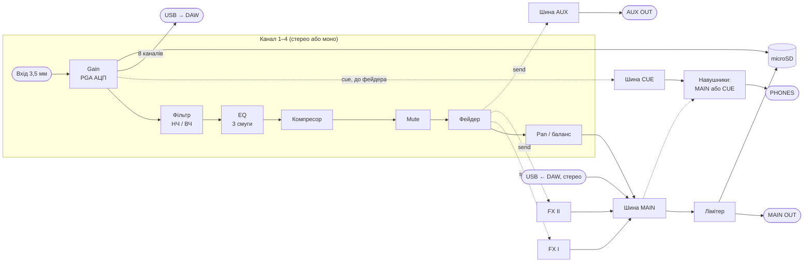

# 01. Функціонал і ТТХ — цифровий мікшер, Rev 1

> [!NOTE]
> **Статус:** чернетка ТЗ, 26.10.2026. Ґрунтується на [00-research](00-research.md) і рішеннях
> [DM1–DM6](decisions.md). Цифри з datasheet позначено джерелом; цільові значення, які ще треба
> підтвердити розрахунком чи макетом, — `ЦІЛЬ`; вибори, які ще за вами, — `ВІДКРИТО`.

## 1. Призначення

Кишеньковий 4-канальний стереомікшер для синтезаторів, драм-машин, грувбоксів і телефона: живий
мікс із ефектами без комп'ютера, а з комп'ютером — USB-аудіоінтерфейс на 8 каналів запису.
Формфактор і набір функцій — на зразок TX-6 (DM2), схемотехніка — своя: усе паяється паяльником
(D12), KPI — габарит і автономність (D34).

## 2. Сигнальний тракт

## 3. Функції

### 3.1 Канал (× 4)

| Функція | Опис |
|---|---|
| Gain | аналоговий PGA АЦП −12…+32 dB ([PCM1865](datasheets/pcm1865.pdf)) |
| Моно / стерео | програмно, на канал (замість DIP-перемикачів Rev A) |
| Pan / баланс / ширина | моно — панорама з законом −3 dB; стерео — баланс і ширина |
| Фільтр | один регулятор: ліворуч НЧ-фільтр, праворуч ВЧ-фільтр, по центру вимкнено |
| EQ | 3 смуги: низ, середина, верх (полиці й пік) |
| Компресор | однією ручкою: поріг і співвідношення разом, автоматичне підсилення |
| Посили | FX I, FX II, AUX — після фейдера |
| Mute, Cue | Cue — прослуховування каналу в навушниках до фейдера |
| Метр | пік і рівень на LED каналу |

### 3.2 Ефекти (2 шини)

FX I і FX II однакові: двигун + 3 параметри + рівень повернення. Двигуни:
**reverb, delay** (синхронізується з темпом), **chorus**, **filter**, **distortion**, **tape**,
**freeze**. Довгі буфери — у PSRAM Teensy 4.1.

### 3.3 Майстер і моніторинг

- MAIN: гучність, лімітер, метр L/R.
- AUX: гучність (окремий мікс для монітора або зовнішнього ефекту).
- Навушники: гучність (SHIFT + MASTER); джерело — CUE, якщо хоч один канал у Cue, інакше MAIN (DM28); примусово — у меню.
- Темп: tap, BPM, MIDI clock (вхід і вихід по USB).
- Тюнер на вибраний канал.

### 3.4 USB

| | |
|---|---|
| Клас | USB Audio Class 2, High Speed, class-compliant (без драйвера) + USB MIDI |
| У DAW | **8 каналів**: 4 стерео входи після gain, до обробки (DM10) |
| З DAW | **2 канали**: стерео в шину MAIN зі своєю гучністю |
| Формат | 24 біт, 48 kHz |
| MIDI | керування всіма параметрами через CC; режим контролера (ручки й фейдери шлють CC у DAW) |
| Живлення | заряджання від того самого USB-C |

### 3.5 Рекордер

Запис на microSD (слот Teensy 4.1) без комп'ютера: 8 доріжок входів + MAIN, WAV 24 біт / 48 kHz.
Потік ≈ 1,44 МБ/с — швидкість запису карти `ПЕРЕВІРИТИ` на макеті.

### 3.6 Сцени й налаштування

8 сцен (усі параметри мікшера) у флеші; яскравість дисплея, джерело навушників, MIDI-канал, режим USB.

### 3.7 Не в Rev 1

Синт, драм-семпли, секвенсор, DJ-кросфейдер — пізніше прошивкою. Гарнітурний мікрофон,
Bluetooth MIDI, синхро-вихід — потребують заліза, лише якщо вирішимо окремо ([00](00-research.md), п. 9).

## 4. Керування

| Елемент | К-сть | Що робить |
|---|---|---|
| Фейдер каналу | 4 | рівень каналу (у режимі контролера — MIDI CC) |
| Енкодер каналу | 4 × 3 = 12 | EC12SY SMD з кнопкою (DM26). Без кнопок — EQ: 1-й ряд верх, 2-й середина, 3-й низ; натискання енкодера — скидання значення; на ряду фільтра натискання перемикає фільтр / компресор (DM28) |
| Кнопка каналу | 4 | Mute; SHIFT + Mute — Cue (фіксується); моно / стерео — у меню (TSF-1266, DM16, DM28); стан і метри — на дисплеї |
| Кнопки шарів | 4 | **AUX** (біля 1-го ряду енкодерів): натиснути — 1-й ряд = посил у AUX, утримувати + MASTER — гучність виходу AUX. **FX I** / **FX II** (біля 2-го / 3-го ряду): натиснути — свій ряд = посил у FX; утримувати — редагування ефекту: MASTER — двигун, енкодери ряду каналів 1–3 — три параметри, каналу 4 — рівень повернення. **SHIFT** (на ряду Mute): утримувати — шар «канал»: gain / pan / фільтр (компресор — натисканням енкодера фільтра); SHIFT + Mute — Cue; SHIFT + MASTER — гучність навушників (DM28) |
| Головний енкодер з кнопкою | 1 | гучність MAIN; натискання — меню (сцени, моно / стерео каналів, темп і tap, джерело навушників) (DM21, DM28) |
| Дисплей | 1 | GMT147SPI 1,47″ 172 × 320, колір (DM18) — значення параметрів, меню, метри |
| Вимикач живлення | 1 | кнопка з фіксацією 5,8 мм SMD у лівому задньому куті, на осі дисплея й MASTER (DM25, DM27) |

Фейдери — одноканальні 35 мм з ходом 20 мм, Alps RS201111J011 (DM8, DM39), енкодери — EC12SY SMD з кнопкою, без LED-кілець (DM9, DM26);
див. [02](02-components.md).

## 5. Роз'єми

| Роз'єм | К-сть | Тип |
|---|---|---|
| Входи IN 1–4 | 4 | 3,5 мм, PJ-327A SMT (DM38), задній торець, на осях каналів (DM25); моно / стерео — у меню |
| MAIN OUT | 1 | 3,5 мм TRS, правий торець (DM25) |
| AUX OUT | 1 | 3,5 мм TRS, правий торець |
| PHONES | 1 | 3,5 мм TRS, правий торець (DM25) |
| MIDI OUT | 1 | 3,5 мм TRS Type A, правий торець (DM20, DM25): clock і ноти / CC без комп'ютера |
| USB-C | 1 | GCT USB4110 SMD (DM30), задній торець під MASTER: аудіо, MIDI, заряджання |
| microSD | 1 | слот на модулі Teensy 4.1, модуль у передньому правому куті — проріз у передній стінці (DM12, DM25) |

## 6. ТТХ

| Параметр | Значення | Джерело / статус |
|---|---|---|
| Частота / розрядність | 48 kHz, 24 біт (обробка — 32 біт float) | DM5 |
| Вхідний опір | 10 kΩ на вивід | [PCM1865](datasheets/pcm1865.pdf), с. 13 |
| Макс. вхідний рівень | 2,1 Vrms (+8,6 dBu) при gain 0 dB; +14,6 dBu з дільником −6 dB (у TX-6 +13 dBu) | с. 13; дільник — `ЦІЛЬ` |
| Gain входу | −12…+32 dB аналоговий + цифровий | с. 7 |
| АЦП: SNR / THD+N (несиметричний вхід) | 106 dB / −87 dB тип. | с. 13 |
| ЦАП: динамічний діапазон / THD+N | 112 dB / −93 dB тип., A-зважування | [PCM5102A](datasheets/pcm5102a.pdf), с. 8 |
| Макс. вихід MAIN / AUX | 2,1 Vrms (+8,6 dBu), центр на землі; навантаження ≥ 10 kΩ | с. 8 |
| Навушники | 22 mW на 32 Ω, ≈ 1 Vrms (−6 dB) | TPA6132A2 (DM14), [datasheet](datasheets/tpa6132a2.pdf) |
| Шум системи (вхід → MAIN) | ≥ 100 dB A | `ЦІЛЬ` |
| Затримка аналог → аналог | ≤ 5 ms | `ЦІЛЬ`: блок бібліотеки Teensy 128 відліків = 2,7 ms; менший блок — `ПЕРЕВІРИТИ` |
| Завантаження процесора | ≤ 50 % | оцінка 11–17 % ([00](00-research.md), п. 8) |
| USB | UAC2 HS 8 × 2, MIDI | [00](00-research.md), п. 3, 7 |
| Живлення | **1S LiPo 3000 mAh**, заряд від USB-C 0,5 A, buck-boost 4,2 V + LDO 3,3 V | DM11, [02](02-components.md), п. 4 |
| Споживання | ≈ 1,48 W з акумулятора | [calc/power.py](calc/power.py) |
| Автономність | ≥ 6 год | `ЦІЛЬ`; розрахунок 6,8 год на 3000 mAh 1S |
| Габарит | ≈ 104,5 × 136,5 × 25 мм | компоновка C ([мех. макет](mech/layout.svg), DM25; TX-6: 90 × 62 × 23 на 6 каналів) |
| Маса | ≤ 200 г | `ЦІЛЬ` (TX-6: 160 г) |
| Робоча температура | 0–40 °C | `ЦІЛЬ` |

## 7. Відкрите — потрібні ваші рішення

> Відповіді 26.10.2026 → DM7–DM12, розбір — [02-components](02-components.md).

1. **Фейдери:** короткий хід (менший габарит) чи довший (точність) — визначає ширину корпусу.
2. **Енкодери:** звичайні з показом на OLED чи з LED-кільцями (дорожче, більше ліній, але видно
   значення без дисплея).
3. **Що йде в DAW:** 4 стерео входи (8 каналів) чи 3 входи + MAIN.
4. **Батарея:** лишити 2S 1500 mAh з Rev A чи шукати 1S (простіше заряджання, інше живлення).
5. **microSD:** чи виводити слот на корпус (Teensy стоїть усередині).
