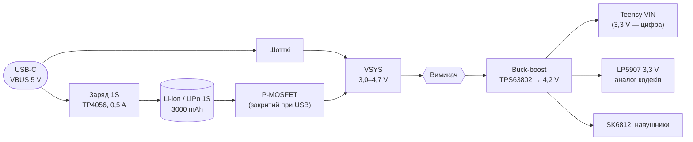

# 02. Вибір компонентів: керування, живлення 1S, монтаж Teensy, де замовляти

> [!NOTE]
> **Статус:** 26.10.2026, відповідь на ваші рішення щодо п. 7 [ТЗ](01-spec.md). Пріоритет:
> **доступність (Україна, AliExpress) → компактність**. Для кожного вузла — два шляхи:
> **А** — усе з AliExpress / українських магазинів, паяння вручну; **J** — плата з передзбиранням на
> JLCPCB (деталі з LCSC), руками — лише модулі й механіка.

## 1. Як рахувати «легше / дешевше»

| | А: AliExpress + паяльник | J: JLCPCB PCBA (Economic) |
|---|---|---|
| Фіксовано за замовлення | — | налаштування й трафарет ≈ $9,7; **$3,07 за кожну унікальну extended-деталь**, basic — без доплати ([JLCPCB blog, 2026](https://jlcpcb.com/blog/reduce-pcb-assembly-cost-prototype)) |
| THT (фейдери, енкодери, джеки) | своїми руками | ручне паяння на заводі: ≈ $3,5 + ≈ $0,017 за точку ([JLCPCB FAQ](https://jlcpcb.com/help/article/pcb-assembly-faqs)) — або самому |
| Корпуси | лише з виводами збоку (D12) | будь-які, зокрема QFN / VSON — **D12 не обмежує** |
| Ризик | підробки мікросхем у продавців AliExpress | деталі LCSC — від дистриб'ютора |
| Обмеження | час пайки ~150–200 деталей | Economic — один бік плати, до 50 шт. |

Висновок наперед: **гібрид J + А**. SMD (кодеки, живлення, пасив) — передзбирання JLCPCB; Teensy,
фейдери, енкодери, джеки, акумулятор — з AliExpress / України, паяю сам. Доплата за extended
(~10 унікальних позицій ≈ $31 + $9,7) окуповується часом і відсутністю підробок. Остаточно — після
BOM, коли буде видно, які деталі в LCSC basic.

## 2. Фейдери

Звук крізь фейдер не йде (DM6), тож потрібен **одноканальний лінійний B10K** будь-якої серії.

| Варіант | Хід / корпус | Де | Статус |
|---|---|---|---|
| **35 мм, single B10K** | 20 мм / 35 × 9 × 6,5 мм (Bourns PTA2043 — [DigiKey](https://www.digikey.fi/en/products/filter/slide-potentiometers/78), [Farnell](https://cz.farnell.com/en-CZ/bourns/pta2043-2015cpb103/pot-slide-10kohm-0-1w/dp/2519588)) | AliExpress: «35mm sliding potentiometer single B10K» ([пошук](https://www.aliexpress.com/w/wholesale-slide-potentiometers-35mm.html), ≈ $0,4–1); Bourns PTA2043 — DigiKey, Farnell, RS (≈ $1,2–1,6) | **рекомендовано** |
| 45 мм, single B10K | 30 мм / 45 × 9 × 6,5 мм (Bourns PTA3043) | AliExpress SC3021N «Sliding Stroke 30mm» ([пошук](https://www.aliexpress.com/w/wholesale-slide-b10k-potentiometer.html)); PTA3043 — DigiKey | запасний: точніше, але +10 мм |
| RS45 з Rev A | 45 мм / 60+ мм, dual | LCSC | завеликий |
| Україна | — | на prom.ua / rozetka — переважно dual 75 мм ([prom.ua](https://prom.ua/ua/Potentsiometr-b10k.html)) | не підходить |

Вибір — **35 мм / хід 20 мм**: доступні й на AliExpress, і в дистриб'юторів, найкомпактніші з
доступних. Footprint — за кресленням Bourns PTA (завантажити на кроці footprint), зразок з
AliExpress звірити штангенциркулем до замовлення плат: у назвах «35mm» буває і корпус, і загальна
довжина.

## 3. Енкодери

| Варіант | Корпус / вал | Де | Висновок |
|---|---|---|---|
| **EC11** | 11 мм, вал 6 мм (D або шліци), 15 / 20 мм | Україна: arduino.ua від 35 ₴, radiodetali, 1wire, prom.ua від 22 ₴ ([prom.ua](https://prom.ua/ua/Enkoder-ec11.html), [arduino.ua](https://arduino.ua/prod8134-enkoder-ec11-z-knopkou-15mm)); AliExpress; LCSC | **рекомендовано** — 13 шт. (12 каналів + головний з кнопкою) |
| Bourns PEC09 / Alps EC09E | 9,7 × 12,05 мм, **вал теж 6 мм**, різьба M7 | лише Mouser / Farnell, ≈ $3,6 ([Mouser](https://www.mouser.in/new/bourns/bourns-pec09-encoders); [datasheet](datasheets/bourns-pec09.pdf)) | компактніше на ~2 мм, але не з України / AliExpress |
| Alps EC10E | 10 мм, порожнистий вал Ø3,6 мм, висота 7 мм ([Farnell](https://uk.farnell.com/alps/ec10e1220505/encoder-horiz-10mm-24det-12ppr/dp/2064974)) | лише дистриб'ютори | тонший вал є лише тут; ручку треба робити під отвір — не варте |

Тоншого вала серед доступних енкодерів немає: 9-мм серії мають той самий вал 6 мм. Тому **EC11,
вал 15 мм** (уточнимо з висотою панелі); на 12 канальних — без кнопки, якщо знайдеться, інакше з
кнопкою (не використовуємо).

## 4. Живлення від 1S

- **Load sharing** (діод + P-MOSFET, деталі вже є в Rev A: MBR0530, AO3401A): при USB система
  живиться від VBUS, а TP4056 заряджає лише акумулятор. Без цього під навантаженням струм заряду не
  спадає до C/10 і заряд не завершується ([TP4056](datasheets/tp4056.pdf): закінчення при 1/10 струму).
- **Шина 4,2 V** — найнижча, що задовольняє всіх: Teensy VIN 3,6–5,5 V (сторонні таблиці
  специфікацій — [protosupplies](https://protosupplies.com/product/teensy-4-1-for-agopengps/));
  SK6812MINI-E ≥ 3,7 V ([datasheet Rev A](../../analog-mixer/docs/datasheets/SK6812MINI-E.pdf), с. 5);
  LP5907 — падіння ≤ 250 mV при 250 mA ([datasheet](datasheets/lp5907.pdf)). Модулі TPS63802
  продаються саме на 3,3 / 4,2 / 5,0 V.
- **Чому не одразу 3,3 V від buck-boost:** аналогові входи кодеків на імпульсній шині — шум; LP5907
  дає < 6,5 µVrms і PSRR 82 dB на 1 kHz.

### 4.1 Розрахунок ([calc/power.py](calc/power.py))

| Споживач | mA на шині 4,2 V | Джерело |
|---|---|---|
| Teensy 4.1 @ 600 MHz | 100 | PJRC |
| Цифрові 3,3 V через Teensy (IOVDD, DVDD, дисплей) | 69 (з 250 допустимих) | datasheets PCM1865 с. 14, PCM5102A с. 10 |
| Аналог кодеків через LP5907 | 128 (з 250) | ті самі |
| Навушники | 20 | `ОЦІНКА` |
| **Разом** | **317 mA = 1,33 W** → з акумулятора **1,48 W** (ККД 90 %, `ОЦІНКА`) | |

> Після DM18 (дисплей ≈ 25 mA замість OLED 15 mA, без 8 × SK6812): таблиця нижче — з `calc/power.py`.

| Акумулятор 1S | Енергія | Час роботи |
|---|---|---|
| 2000 mAh | 7,4 Wh | 4,5 год |
| 2500 mAh | 9,2 Wh | 5,6 год |
| **3000 mAh** | **11,1 Wh** | **6,8 год** |
| 4000 mAh | 14,8 Wh | 9,0 год |

Ціль ≥ 6 год ([ТЗ](01-spec.md)) → **≥ 2670 mAh, беремо 3000 mAh** плаский LiPo із платою захисту.
Розмір (типово ~8–10 × 50 × 60 мм для такої ємності, `НЕ ПЕРЕВІРЕНО`) обираємо разом із корпусом.
Те саме дає 2S 1500 mAh з Rev A, але 1S знімає балансування й дозволяє дешевий заряд.

### 4.2 Заряд і USB

| R_PROG | Заряд | + система від VBUS | Разом з USB | 3000 mAh за |
|---|---|---|---|---|
| **2,4 kΩ** | 500 mA ([TP4056](datasheets/tp4056.pdf)) | 345 mA | **845 mA** | ~7 год |
| 1,2 kΩ | 1000 mA | 345 mA | 1345 mA | ~3,6 год |

Порт ПК USB 2.0 за замовчуванням дає 500 mA, USB-C — 1,5 / 3 A, якщо джерело це оголошує.
Тому **0,5 A** за замовчуванням. У варіанті J (TP4056 на нашій платі) Teensy може читати рівень
лінії CC і вмикати 1 A лише від зарядки на 1,5 / 3 A (вивід CE) — `ПРОПОЗИЦІЯ`.

### 4.3 Порівняння А / J

| Вузол | А: AliExpress / Україна | J: JLCPCB + LCSC |
|---|---|---|
| Заряд | модуль TP4056 Type-C (40–49 ₴, [beegreen](https://beegreen.com.ua/modul-zaryadu-rozryadu-li-ion-1s-tp4056-type-c-18570), [myproject](https://myproject.com.ua/tp-4056-modul-dlja-zarjadzhannja-li-ion-type-c-5v-1a-ua.html)); живимо його з нашого USB-C через площадки IN+/IN−; R_PROG перепаяти на 2,4 k | TP4056 (SOP-8) на платі + керування CE; наявність у LCSC `ПЕРЕВІРИТИ` |
| Buck-boost | модуль TPS63802 4,2 V (≈ $2, [AliExpress](https://www.aliexpress.com/item/1005008914857619.html)); **часто клон XL63802** — перевіряти маркування | TPS63802DLAR (VSON-10 2 × 3 мм, [datasheet](datasheets/tps63802.pdf)) + дросель 0,47 µH; у LCSC не знайшов — є в DigiKey ([DigiKey](https://www.digikey.com/en/products/detail/texas-instruments/TPS63802DLAR/10715525)), `ПЕРЕВІРИТИ` LCSC або аналог |
| LDO | LP5907 SOT-23-5 — паяльником | те саме з LCSC |
| Load sharing | AO3401A + MBR0530 (SOT-23, SOD-123) | ті самі, basic / extended |

## 5. Teensy 4.1 на основній платі, слот microSD назовні

- **Площадки знизу Teensy** під PSRAM / flash — **під гніздом microSD** (між виводами 31–32 і 33–34)
  ([Little Bird](https://littlebirdelectronics.com.au/products/8mb-psram-chip-for-teensy-4-1)). Отже
  гніздо — згори, на дальньому від USB кінці модуля.
- **Розташування:** модуль на краю основної плати, кінцем із microSD — до стінки корпусу; у стінці —
  проріз під карту.
- **Монтаж — два варіанти (обидва можливі):**
  1. **Поверхневий** (як SuperMini у Rev A, D59): модуль лежить на платі, виводи пропаяні на SMD-площадки
     під отворами модуля. Під PSRAM (SOIC-8, якщо ставимо) — **вікно в основній платі**.
  2. **Врізний:** модуль у вирізі основної плати, виводи — на площадки по краях вирізу; нижче профіль
     на товщину плати.
- **USB:** роз'єм micro-B модуля не використовуємо; USB-C корпусу з'єднуємо з D+/D− модуля через
  площадки знизу — їх підтверджено лише неофіційно ([00](00-research.md), п. 7.2). **Перед footprint —
  креслення PJRC і прозвонка на справжньому модулі.**

## 6. Що далі

1. Ваше «так» на рішення DM7–DM11 ([decisions](decisions.md)).
2. Замовити для макета: Teensy 4.1, плати PCM1865 і PCM5102A (готові), 2–3 фейдери 35 мм і EC11 з
   AliExpress, модулі TP4056 і TPS63802 — щоб виміряти фейдери, перевірити USB-аудіо й шум живлення.
3. Схема в KiCad.
