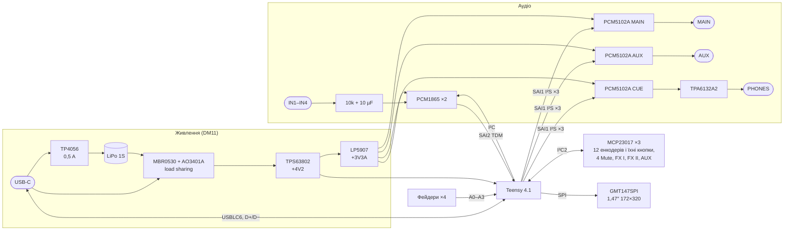

# 03. Принципова схема і макет розташування

> [!NOTE]
> **Статус:** 27.10.2026. Схема — `hw/main/main.kicad_sch` (PDF: [hw/main/main.pdf](../hw/main/main.pdf)),
> генерує `python3 hw/sch/main.py` (з теки `digital-mixer/`; запис — [common/kisch.py](../../common/kisch.py)).
> **ERC: 0 порушень**, 194 символи. Оновлено за DM25–DM30: енкодери EC12SY SMD з кнопками, третій
> MCP23017 для них, без кнопки CUE, кнопка живлення 5,8 мм SMD, USB-C USB4110, резистори 33 Ω на тактах.

## 1. Структура

## 2. Виводи Teensy 4.1

Номери — за символом [XenGi/teensy_library](https://github.com/XenGi/teensy_library) (MIT, копія в
`hw/lib/third_party/`). Звірити з карткою PJRC перед footprint.

| Функція | Виводи Teensy | Куди |
|---|---|---|
| SAI1, I²S → ЦАП | 21 BCLK1, 20 LRCLK1, 7 OUT1A, 32 OUT1B, 9 OUT1C | PCM5102A MAIN, AUX, CUE (`AudioOutputI2SHex`); BCLK1, LRCLK1 — через 33 Ω біля Teensy (DM29) |
| SAI2, TDM ← АЦП | 4 BCLK2, 3 LRCLK2, 5 IN2, 33 MCLK2 | 2 × PCM1865, слоти 1–4 і 5–8; BCLK2, LRCLK2, MCLK2 — через 33 Ω біля Teensy (DM29) |
| I²C (Wire) | 18 SDA, 19 SCL | PCM1865 0x94 / 0x96 |
| I²C2 (Wire2) | 25 SDA2, 24 SCL2 | MCP23017 0x20 / 0x21 |
| INT розширювачів | 30, 31, 22 | MCP23017 #1, #2, #3 (кнопки енкодерів, DM28) |
| Фейдери | 14–17 (A0–A3) | PTA2043, 100 nF на повзунку |
| Батарея | 38 (A14) | VSYS / 2 |
| Майстер-енкодер | 0 A, 1 B, 2 кнопка | EC12SY з кнопкою (DM26) |
| Дисплей (SPI) | 13 SCK, 11 MOSI, 10 CS, 40 DC, 41 RES, 28 BLK (ШІМ — `ПЕРЕВІРИТИ`) | GMT147SPI |
| Кнопки | 29 SHIFT; AUX, FX I, FX II — на GPA6, GPA7, GPB6 MCP23017 #3 (він найближчий до правої колонки); GPx7 #1, #2 і GPB7 #3 вільні (DM28) | TSF-1266 |
| MIDI OUT | 35 (Serial8 TX) | джек TRS Type A |
| Керування | 36 XSMT (м'ют ЦАП), 37 EN навушників | 10k на GND — тиша до старту прошивки |
| Живлення | VIN = +4V2, VUSB = VBUS, 3V3 — вихід на цифру | **перемичку VIN–VUSB розрізати** |
| USB | площадки D+ / D− знизу (66 / 67 символу) | USB-C через USBLC6 |

`ПЕРЕВІРИТИ` на макеті: SAI1 (I²S, 64 fs) і SAI2 (TDM, 256 fs) одночасно в бібліотеці Teensy Audio;
обидва порти тактуються від одного аудіо-PLL.

## 3. Вузли — звідки значення

| Вузол | Що на схемі | Джерело |
|---|---|---|
| PCM1865 | I²C (MD0 = GND), адреса MS/AD; VREF 1 µF; AVDD, DVDD, LDO — 0,1 + 10 µF; XI на GND, SCKI = MCLK2; DOUT обох через 33 Ω на одну лінію (поза своїми слотами Hi-Z) | [datasheet](datasheets/pcm1865.pdf), табл. виводів с. 11, TDM с. 58–59, рис. 66 |
| Вхід | джек → 100k на GND → 10k послідовно (з 10 kΩ входу — −6 dB, вхід до +14,6 dBu) → 10 µF електроліт (+ до мікросхеми) | с. 13 (вхідний опір 10 kΩ), [ТЗ](01-spec.md) |
| PCM5102A | SCK = GND (PLL від BCK), FMT / FLT / DEMP = GND; CAPP–CAPM і VNEG 2,2 µF; LDOO 0,1 + 10 µF; вихід 470 Ω + 2,2 nF | [datasheet](datasheets/pcm5102a.pdf), рис. 33 |
| TPA6132A2 | несиметричний вхід 1 µF на IN−, IN+ на GND; G0 = G1 = GND → −6 dB (2,1 Vrms ЦАП → ≈ 1 Vrms); VDD і HPVDD 2,2 µF, HPVSS і накачка 1 µF | [datasheet](datasheets/tpa6132a2.pdf), рис. 27, табл. підсилення |
| TPS63802 | 665k / 91k → 4,15 V; L 0,47 µH XFL4015-471ME; 10 µF вх., 2 × 22 µF вих.; MODE = GND (енергозбереження); EN — з вимикача MSK12C02 + 100k на GND | [datasheet](datasheets/tps63802.pdf), табл. 10-2, 10-5, розд. 10.2.2 |
| TP4056 | R_PROG 2,4k → 500 mA; TEMP на GND; CHRG / STDBY — червоний / зелений LED від VBUS | [datasheet](datasheets/tp4056.pdf) |
| Кнопки | TSF-1266, 6 × 6 × 5 мм SMT, на GND, внутрішні підтяжки MCP23017 / Teensy; кнопки 12 енкодерів — MCP23017 #3 (0x22) | [креслення](datasheets/tsf-1266-drawing.png), [EC12SY](datasheets/ec12sy-smd-encoder-drawing.png) |
| Живлення | кнопка з фіксацією 5,8 мм SMD, DPDT: спільний 2 → EN; натиснута (2–3) — VSYS, відпущена (1–2) — GND; друга група вільна; струм лише EN | [креслення](datasheets/push-latching-dpdt-5.8mm-smd-drawing.png): DC 30 V 0,1 A, FREE 1-2 / PUSH 2-3 |
| USB-C | GCT USB4110-GF-A (SMT), CC1 / CC2 — 5,1k на GND, ESD USBLC6 | [креслення GCT](https://gct.co/files/drawings/usb4110.pdf) (DM30) |
| Такти I²S / TDM | 33 Ω послідовно біля виводів Teensy на BCK, LRCK обох портів і MCLK | DM29 |
| MIDI OUT | TRS Type A: кінчик = DIN 5 через 10 Ω від TX, кільце = DIN 4 через 33 Ω від +3,3 V, гільза = GND; для 3,3 V — 33 Ω 0,5 W і 10 Ω 0,25 W | [MIDI 1.0 Electrical Spec Update](datasheets/midi-electrical-spec-update.pdf), рис. 1; розводка TRS — [MIDI Association](https://midi.org/specification-for-use-of-trs-connectors-with-midi-devices) |
| Дисплей | GMT147SPI: ST7789, SPI, живлення 3,3 V від Teensy; порядок 8 виводів — як у DFR0995, `ПЕРЕВІРИТИ` на зразку | [DFRobot](https://wiki.dfrobot.com/dfr0995/), [jence](https://jence.com/index.php?route=product%2Fproduct&product_id=1303) |

## 4. Макет розташування

Компоновка C (DM25), ескіз і позиції для розстановки — `docs/mech/layout.py`; розстановка й розводка —
[04](04-pcb.md).

- **Колонки каналів** на одній осі: джек IN (знизу, задній торець), 3 енкодери EC12SY, фейдер 35 мм,
  Mute. Крок каналів 19 мм (площадки енкодера 18 мм), рядів енкодерів 20,5 мм.
- **Верхній ряд** на одній осі: ON (кнопка з фіксацією) у лівому задньому куті, дисплей альбомно по
  центру вхідних колонок, MASTER у правому задньому куті.
- **Права колонка:** AUX, FX I, FX II на осях рядів енкодерів, SHIFT на осі ряду Mute.
- **Знизу:** USB-C під MASTER у задній торець; MAIN, AUX, MIDI, PHONES на правому торці з кроком 14 мм;
  Teensy у передньому правому куті (microSD у передній торець); акумулятор під енкодерами (вони SMD —
  знизу вільно); кодеки під фейдерами між їхніми виводами поруч із Teensy; MCP23017 під Mute;
  живлення біля USB-C.
- **Розмір 104,5 × 136,5 мм**, отвори M2 у чотирьох кутах.

## 5. Що далі

1. Звірити на зразках: отвори напрямних EC12SY, ніжки кнопки живлення 5,8 мм, гребінку й отвори
   GMT147SPI, площадки USB під Teensy.
2. Наявність у LCSC: TPS63802, TPA6132A2, PCM1865 / PCM5102A, USB4110-GF-A, тактові кнопки 6 × 6.
