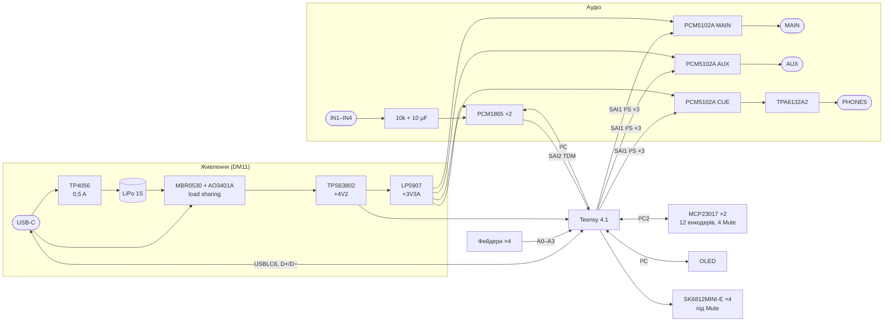

# 03. Принципова схема і макет розташування

> [!NOTE]
> **Статус:** 26.10.2026, перша версія. Схема — `hw/main/main.kicad_sch` (PDF: [hw/main/main.pdf](../hw/main/main.pdf)),
> генерує `python3 hw/sch/main.py` (з теки `digital-mixer/`). **ERC: 0 помилок**; 12 попереджень —
> footprint, яких ще немає (Teensy 4.1 SMD, TPS63802 VSON-HR-10, дросель XFL4015, Kailh Choc —
> робимо на кроці плати за кресленнями). 186 компонентів, 207 кіл, кіл з одним виводом немає.

## 1. Структура

## 2. Виводи Teensy 4.1

Номери — за символом [XenGi/teensy_library](https://github.com/XenGi/teensy_library) (MIT, копія в
`hw/lib/third_party/`). Звірити з карткою PJRC перед footprint.

| Функція | Виводи Teensy | Куди |
|---|---|---|
| SAI1, I²S → ЦАП | 21 BCLK1, 20 LRCLK1, 7 OUT1A, 32 OUT1B, 9 OUT1C | PCM5102A MAIN, AUX, CUE (`AudioOutputI2SHex`) |
| SAI2, TDM ← АЦП | 4 BCLK2, 3 LRCLK2, 5 IN2, 33 MCLK2 | 2 × PCM1865, слоти 1–4 і 5–8 |
| I²C (Wire) | 18 SDA, 19 SCL | PCM1865 0x94 / 0x96, OLED |
| I²C2 (Wire2) | 25 SDA2, 24 SCL2 | MCP23017 0x20 / 0x21 |
| INT розширювачів | 30, 31 | MCP23017 #1, #2 |
| Фейдери | 14–17 (A0–A3) | PTA2043, 100 nF на повзунку |
| Батарея | 38 (A14) | VSYS / 2 |
| Майстер-енкодер | 0 A, 1 B, 2 кнопка | EC11 з кнопкою |
| Кнопки | 10 FX I, 11 FX II, 12 AUX, 28 CUE, 29 SHIFT | Choc PG1350 |
| LED | 35 (TX8, WS2812Serial) | 4 × SK6812MINI-E |
| Керування | 36 XSMT (м'ют ЦАП), 37 EN навушників | 10k на GND — тиша до старту прошивки |
| Живлення | VIN = +4V2, VUSB = VBUS, 3V3 — вихід на цифру | **перемичку VIN–VUSB розрізати** |
| USB | площадки D+ / D− знизу (66 / 67 символу) | USB-C через USBLC6 |

`ПЕРЕВІРИТИ` на макеті: SAI1 (I²S, 64 fs) і SAI2 (TDM, 256 fs) одночасно в бібліотеці Teensy Audio;
обидва порти тактуються від одного аудіо-PLL.

## 3. Вузли — звідки значення

| Вузол | Що на схемі | Джерело |
|---|---|---|
| PCM1865 | I²C (MD0 = GND), адреса MS/AD; VREF 1 µF; AVDD, DVDD, LDO — 0,1 + 10 µF; XI на GND, SCKI = MCLK2; DOUT обох через 33 Ω на одну лінію (поза своїми слотами Hi-Z) | [datasheet](datasheets/pcm1865.pdf), табл. виводів с. 11, TDM с. 58–59, рис. 66 |
| Вхід | джек → 100k на GND → 10k послідовно (з 10 kΩ входу — −6 dB, вхід до +14,6 dBu) → 10 µF електроліт (+ до мікросхеми) | с. 13 (вхідний опір 10 kΩ), [ТЗ](01-spec.md) |
| PCM5102A | SCK = GND (PLL від BCK), FMT / FLT / DEMP = GND; CAPP–CAPM і VNEG 2,2 µF; LDOO 0,1 + 10 µF; вихід 470 Ω + 2,2 nF | [datasheet](datasheets/pcm5102a.pdf), рис. 33 |
| TPA6132A2 | несиметричний вхід 1 µF на IN−, IN+ на GND; G0 = G1 = GND → −6 dB (2,1 Vrms ЦАП → ≈ 1 Vrms); VDD і HPVDD 2,2 µF, HPVSS і накачка 1 µF | [datasheet](datasheets/tpa6132a2.pdf), рис. 27, табл. підсилення |
| TPS63802 | 665k / 91k → 4,15 V; L 0,47 µH XFL4015-471ME; 10 µF вх., 2 × 22 µF вих.; MODE = GND (енергозбереження); EN — з вимикача MSK12C02 + 100k на GND | [datasheet](datasheets/tps63802.pdf), табл. 10-2, 10-5, розд. 10.2.2 |
| TP4056 | R_PROG 2,4k → 500 mA; TEMP на GND; CHRG / STDBY — червоний / зелений LED від VBUS | [datasheet](datasheets/tp4056.pdf) |
| Mute | Kailh Choc PG1350; SK6812MINI-E під вікном LED 5 × 3,15 мм (4,7 мм від осі) | [креслення Kailh](datasheets/kailh-choc-pg1350.pdf) |

## 4. Макет розташування

Ескіз — `docs/mech/layout.py`, розміри з footprint і креслень (не розстановка).

- **Згори** — лише керування: 4 смуги по 18 мм (крок клавіш Choc): 3 енкодери EC11 через 15 мм,
  Mute (Choc) і фейдер 35 мм. Праворуч OLED, майстер-енкодер, 5 кнопок, вимикач на торці.
- **Знизу** — 7 джеків уздовж заднього краю (під енкодерами — глибину не додають), Teensy 4.1 уздовж
  лівого краю microSD до переднього торця (DM12), USB-C на правому торці, кодеки й живлення, акумулятор
  3000 mAh під фейдерами.
- **Розмір — ≈ 116 × 107 мм** (TX-6: 90 × 62 на 6 каналів). Глибину задають 3 енкодери + клавіша +
  фейдер. Скоротити: 2 енкодери на канал (−15 мм) або фейдер 20 мм збоку від енкодерів — `ВІДКРИТО`.
- Висота (`ОЦІНКА`): знизу джеки ~5 мм і акумулятор ~8 мм, згори — фейдер, Choc (≈ 8 мм з клавішею),
  EC11 з валом — корпус ≈ 25–28 мм.

## 5. Що далі

1. Footprint: Teensy 4.1 SMD (креслення PJRC), Kailh Choc з вікном під SK6812, TPS63802 VSON-HR-10,
   XFL4015 — за кресленнями виробників.
2. Наявність у LCSC: TPS63802, TPA6132A2, PCM1865 / PCM5102A, Choc C400229 (є в JLCPCB).
3. Розстановка й розведення 4-шарової плати.
