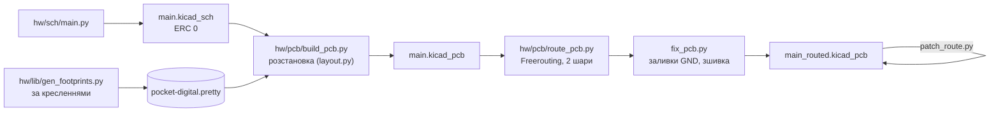
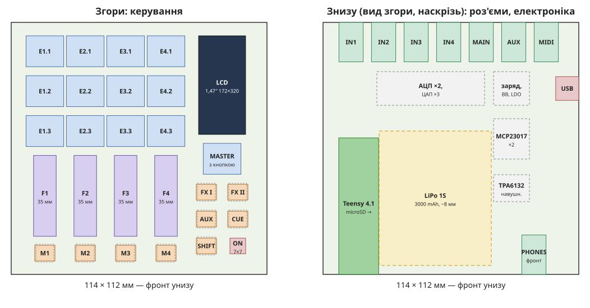

# 04. Друкована плата — ітерація 1

> [!NOTE]
> **Статус:** 26.10.2026. Одна двошарова плата 114 × 127,9 мм (DM22, DM24), розведена:
> **DRC — 0 нез'єднаних, 0 розбіжностей зі схемою, 0 порушень по міді**; лишилася лише косметика
> шовкографії (накладання підписів). Gerber і BOM ще не робили.

## 1. Як згенеровано



```sh
PY=/Applications/KiCad/KiCad.app/Contents/Frameworks/Python.framework/Versions/3.9/bin/python3
python3 hw/lib/gen_symbols.py && python3 hw/lib/gen_footprints.py && python3 hw/sch/main.py
$PY hw/pcb/build_pcb.py                    # -> hw/main/main.kicad_pcb (розстановка, M2, блок перетворювача)
$PY hw/pcb/route_pcb.py --passes 40        # ~30 хв -> hw/main/main_routed.kicad_pcb
$PY hw/pcb/patch_route.py hw/main/main_routed.kicad_pcb NET xa ya xb yb   # закрити один розрив
```

Інструменти — з Rev A (`pcbkit.py`, `route_pcb.py`, `fix_pcb.py`, `patch_route.py`), переведені на
2 шари.

## 2. Розстановка (компоновка A, DM24)



- **Згори** — керування; **знизу** — джеки ззаду, Teensy спереду праворуч (microSD у правий торець),
  USB-C і PHONES — на передньому торці ліворуч від Teensy, електроніка — під правою колонкою,
  акумулятор — під каналами.
- **Виводи THT керування** проходять крізь плату: під ними не стоїть жодна деталь нижнього боку
  (перевіряє DRC: `pth_inside_courtyard` = 0).
- **Отвори M2:** три в кутах, четвертий — на правому краї (≈ 21 мм від кута: кут зайнятий Teensy).
- **Перетворювач TPS63802** розставлено й розведено за прикладом TI (SLVSEU9D, п. 10.2): котушка
  впритул до L1 / L2, вхідний і два вихідні конденсатори біля VIN / VOUT; доріжки блоку зафіксовані.
  BB_L1 / BB_L2 — по 4 мм без переходів.
- **Teensy** лежить пласко на площадках під його отворами; у платі вікно під USB-кінцем — короткі
  дротики від площадок VUSB / D− / D+ модуля до площадок поруч (положення площадок на модулі — з фото
  PJRC, `ОРІЄНТИР`). Перемичку VIN–VUSB на модулі розрізати.

## 3. Результат розводки

| Параметр | Значення |
|---|---|
| Доріжки / переходи | 3139 сегментів, 11,1 м; 847 переходів (з них ≈ 370 — зшивка GND) |
| USB D+ / D− (роз'єм → Teensy) | ≈ 27–30 мм, 2 переходи на лінію |
| Аналогові входи (джек → АЦП) | 26–53 мм |
| BCK АЦП / ЦАП | ≈ 110 мм, 6–9 переходів — найдовші лінії, див. п. 4 |
| SPI дисплея (SCK) | 74 мм |

## 4. Що покращити до замовлення

1. **Тактові лінії I²S / TDM (BCK, LRCK, MCLK) — 110 мм.** Teensy і кодеки на різних кінцях плати.
   Додати послідовні резистори 22–33 Ω біля Teensy (узгодження джерела, менше дзвону й завад) або
   підсунути кодеки ближче до виводів SAI Teensy.
2. **Шовкографія:** прибрати накладання підписів (косметика).
3. **Звірити на деталях:** площадки USB під Teensy, відстань гребінки GMT147 від краю (1,5 мм, з масштабу),
   розташування отворів дисплея (2,31 vs 2,21 мм).
4. **Gerber, BOM** — після п. 1.
