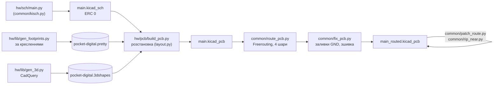

# 04. Друкована плата — ітерація 3 (компоновка C, 4 шари)

> [!NOTE]
> **Статус:** 27.10.2026. Одна чотиришарова плата **104,5 × 136,5 мм** (DM25, DM31), розведена:
> **DRC — 0 порушень, 0 нез'єднаних, 0 розбіжностей зі схемою**. Попередження — шовкографія
> (накладання підписів), напрямні отвори під деталями іншого боку (п. 2) і 2 доріжки, що закінчуються
> на середині іншої доріжки свого кола (з'єднання є, KiCad позначає їх `track_dangling`). Gerber і BOM
> ще не робили.


## 1. Як згенеровано



```sh
PY=/Applications/KiCad/KiCad.app/Contents/Frameworks/Python.framework/Versions/3.9/bin/python3
python3 hw/lib/gen_symbols.py && python3 hw/lib/gen_footprints.py && python3 hw/sch/main.py
../.venv-cq/bin/python hw/lib/gen_3d.py      # 3D-моделі (common/README.md — встановлення CadQuery)
$PY hw/pcb/build_pcb.py                      # -> hw/main/main.kicad_pcb
$PY ../common/route_pcb.py hw/main/main.kicad_pcb --layers 4 --edge 0.6 --passes 60 \
    --hole-keep 0.25 --hole-skip USB_C_Receptacle_GCT_USB4110       # ~20 хв -> main_routed.kicad_pcb
$PY ../common/route_pcb.py ... --resume --passes 30                 # дотрасувати лише відкрите
$PY ../common/patch_route.py hw/main/main_routed.kicad_pcb NET xa ya xb yb [--width W] [--ignore NETS]
$PY ../common/rip_near.py hw/main/main_routed.kicad_pcb NET x y [--radius R]   # зняти шматок кола
$PY ../common/fix_pcb.py hw/main/main_routed.kicad_pcb --edge-keep 0.8 [--no-cleanup]   # перезалити, зшити
```

Інструменти спільні з Rev A — [common/](../../common/README.md).

## 2. Розстановка (DM25)


*Вид знизу (дзеркально): праворуч на рисунку — лівий край плати.*

- **Згори:** ON, дисплей (альбомно, гребінка між IN1 і IN2), MASTER — на одній осі; 12 енкодерів
  EC12SY, 4 фейдери, Mute — колонками на осях джеків; AUX, FX I, FX II, SHIFT — у правій колонці.
- **Знизу:** джеки IN1–4 на задньому торці; USB-C (USB4110, SMD) під MASTER; MAIN / AUX / MIDI /
  PHONES на правому торці; Teensy у передньому правому куті (microSD у передню стінку); живлення
  (заряд, TPS63802, ESD) біля USB-C; три ЦАП і TPA6132A2 між вихідними джеками й Teensy; два АЦП
  під фейдерами між їхніми виводами; три MCP23017 під Mute (розвернуті: I²C і GPB — усередину);
  зона акумулятора 60 × 50 під енкодерами — порожня.
- **Пара USB D+ / D−** прокладена наперед (`usb_pair()`), зафіксована: від переходів біля USBLC6 по
  F.Cu коридором між лапкою MASTER і площадками AUX / FX I / FX II, в обхід вікна Teensy зліва, під
  його площадки 66 / 67 знизу. Кнопки правої колонки повернуті до пари площадкою GND.
- **Блок TPS63802** — за прикладом TI (SLVSEU9D, п. 10.2), доріжки блоку зафіксовані; BB_L1 / BB_L2
  по 4,2 мм без переходів.
- **TPA6132A2 і PCM5102A:** конденсатори живлення й накачки, вихідні резистори 470 Ω — біля виводів
  (поле `Decouples`); TPA6132A2 розвернута на 180°, щоб OUTL / OUTR дивились на джек PHONES.
- **Отвори M2** — у чотирьох кутах. Контур енкодера хрестоподібний (за площадками), тож отвір біля
  MASTER і ON стає в кут.
- **Попередження `npth_inside_courtyard`** (8): напрямні джеків SJ-43514 під дисплеєм / кнопками і
  напрямні USB4110 під MASTER. За кресленнями вони виходять під корпусом на 0,8 / 0,63 мм і плату
  1,6 мм не проходять — деталям згори не заважають.

## 3. Шари, правила, обмеження (DM31)

| Що | Значення | Чому |
|---|---|---|
| Шари | F.Cu сигнали / In1 суцільна GND / In2 сигнали й живлення / B.Cu сигнали | на двох шарах зона ЦАП / TPA6132A2 біля Teensy разом із парою USB не розводилась |
| Доріжки сигналів / живлення | 0,2 / 0,5 мм | як Rev A |
| Пара USB D+ / D− | 0,2 / 0,2 мм над In1, ≈ 90 Ω | `ОЦІНКА` — звірити з калькулятором стеку JLC перед замовленням |
| Зазор | 0,15 мм | як Rev A |
| Мідь — неметалізовані отвори | 0,25 мм заборонними зонами `hole clearance` | мінімум плати знижено до 0,15 лише заради отворів USB4110 (0,175 від власних площадок за кресленням GCT); правила `.kicad_dru` для цього kicad-cli 10 не застосував |
| Тепловий бар'єр | 1 спиця досить | як Rev A (D12); `starved_thermal` — попередження |

## 4. Результат розводки

| Параметр | Значення |
|---|---|
| Доріжки / переходи | 2559 сегментів, 10,6 м; 869 переходів (з них 514 — GND) |
| USB D+ / D− (USBLC6 → Teensy) | **92,5 / 90,9 мм**, різниця 1,6 мм, парою, по 1 переходу |
| USB-C → USBLC6 | 17–20 мм |
| Такти АЦП (BCK / LRCK / MCLK) | 55–60 мм, 3 переходи, через 33 Ω біля Teensy (DM29) |
| Такти ЦАП (BCK / LRCK) | 64–66 мм, 4–5 переходів, через 33 Ω |
| Вхід → RC | до 86 мм |
| SPI дисплея (SCK) | 151 мм |

Після автороутера кілька кіл у зоні ЦАП CUE / TPA6132A2 і GND-площадки без переходу на In1 закрито
вручну: `patch_route.py` (з `--ignore` — крізь чужі доріжки, зняті потім проведено заново) і
`fix_pcb.py` (переходи в острівці GND, де вміщаються).

## 5. Що покращити до замовлення

1. **Імпеданс пари USB** — звірити ширину й зазор 0,2 / 0,2 мм зі стеком JLC (4 шари, 1,6 мм).
2. **Шовкографія:** прибрати накладання підписів (косметика).
3. **Звірити на зразках:** отвори напрямних EC12SY, ніжки кнопки живлення, гребінку й отвори
   GMT147SPI, положення USB-площадок під Teensy (вікно 1,5–5,5 мм від торця).
4. **Gerber, BOM** — після п. 1–3; наявність у LCSC — [03](03-schematic.md), п. 5.
