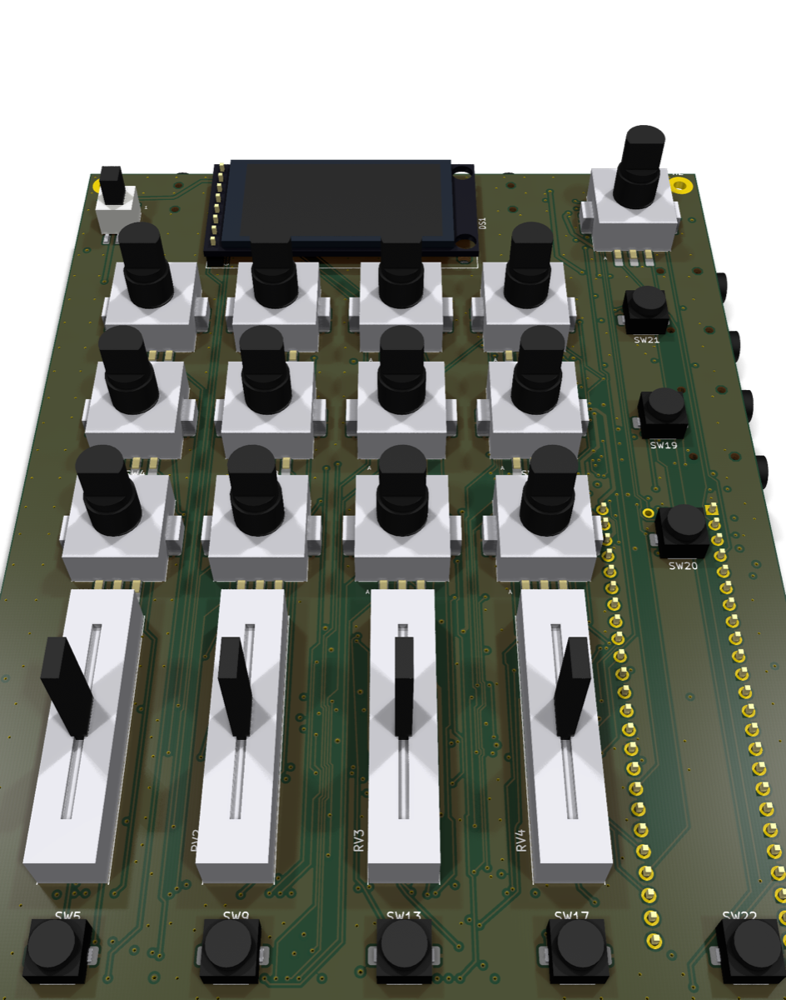
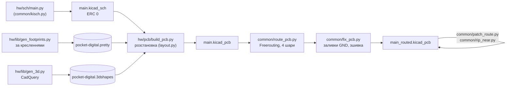
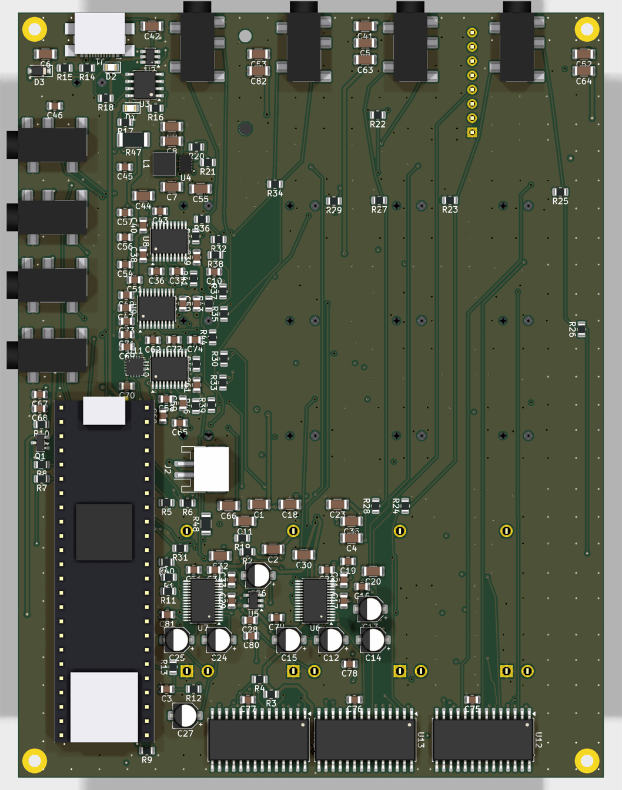

# 04. Друкована плата — ітерація 3 (компоновка C, 4 шари)

> [!NOTE]
> **Статус:** 29.10.2026 (після DM39 — фейдери Alps). Одна чотиришарова плата **104,5 × 136,5 мм** (DM25, DM31), розведена
> заново після DM35 (Teensy на гребінках): **DRC — 0 порушень, 0 нез'єднаних, 0 розбіжностей зі
> схемою**. Попередження — шовкографія (накладання підписів, дрібний текст) і напрямні отвори під
> деталями іншого боку (п. 2). Перевірка перед замовленням — [07](07-review.md). Gerber, BOM і файли NextPCB — [05](05-fab.md).



## 1. Як згенеровано



```sh
PY=/Applications/KiCad/KiCad.app/Contents/Frameworks/Python.framework/Versions/3.9/bin/python3
python3 hw/lib/gen_symbols.py && python3 hw/lib/gen_footprints.py && python3 hw/sch/main.py
../.venv-cq/bin/python hw/lib/gen_3d.py      # 3D-моделі (common/README.md — встановлення CadQuery)
$PY hw/pcb/build_pcb.py                      # -> hw/main/main.kicad_pcb
$PY ../common/route_pcb.py hw/main/main.kicad_pcb --layers 4 --edge 0.6 --passes 60 \
    --hole-keep 0.25 --hole-skip USB_C_Receptacle_GCT_USB4110       # ~20 хв -> main_routed.kicad_pcb
$PY ../common/route_pcb.py ... --resume --passes 30                 # дотрасувати лише відкрите
$PY ../common/patch_route.py hw/main/main_routed.kicad_pcb NET xa ya xb yb [--width W] [--ignore NETS]
$PY ../common/rip_near.py hw/main/main_routed.kicad_pcb NET x y [--radius R]   # зняти шматок кола
$PY ../common/fix_pcb.py hw/main/main_routed.kicad_pcb --edge-keep 0.8 --no-cleanup   # перезалити, зшити (після ручних латок — без очищення)
```

Інструменти спільні з Rev A — [common/](../../common/README.md).

## 2. Розстановка (DM25)



*Вид знизу (дзеркально): праворуч на рисунку — лівий край плати.*

- **Згори:** ON, дисплей (альбомно, гребінка між IN1 і IN2), MASTER — на одній осі; 12 енкодерів
  EC12SY, 4 фейдери, Mute — колонками на осях джеків; AUX, FX I, FX II, SHIFT — у правій колонці.
- **Знизу:** джеки IN1–4 на задньому торці; USB-C (USB4110, SMD) під MASTER; MAIN / AUX / MIDI /
  PHONES на правому торці з кроком 12,5 мм; Teensy у передньому правому куті **на гребінках у наскрізні
  отвори, за 6 мм від переднього краю** (microSD — за прорізом у стінці; DM35); живлення
  (заряд, TPS63802, ESD) біля USB-C; три ЦАП і TPA6132A2 між вихідними джеками й Teensy; два АЦП
  під фейдерами між їхніми виводами; три MCP23017 під Mute (розвернуті: I²C і GPB — усередину);
  зона акумулятора 60 × 50 під енкодерами — порожня.
- **Teensy на гребінках (DM35):** 2 × 24 наскрізні отвори 1,0 мм (площадки 1,7) + 2 отвори D− / D+ для дротів від площадок USB device модуля (вони під його micro-USB — штир не пройде)
  (66 / 67) під отворами USB device модуля за кресленням PJRC; VUSB — площадка 49 для дротика, виходить
  за торець модуля. Зазор 2,5 мм (планка гребінки) — під PSRAM. Відступ 6 мм від краю потрібен, щоб
  отвори D− / D+ не потрапили під кнопку FX II; лапки EC12SY укорочено до 7,95 мм від осі (отвір VIN).
- **Пара USB D+ / D−** прокладена наперед (`usb_pair()`), зафіксована: від переходів біля USBLC6 по
  F.Cu коридором між лапкою MASTER і площадками AUX / FX I / FX II до 2,3 мм перед отворами 66 / 67;
  кінці — автороутером. Кнопки правої колонки повернуті до пари площадкою GND.
- **Блок TPS63802** — за прикладом TI (SLVSEU9D, п. 10.2), доріжки блоку зафіксовані; BB_L1 / BB_L2
  по 4,2 мм без переходів.
- **TPA6132A2 і PCM5102A:** конденсатори живлення й накачки, вихідні резистори 470 Ω — біля виводів
  (поле `Decouples`); TPA6132A2 розвернута на 180°, щоб OUTL / OUTR дивились на джек PHONES.
- **Отвори M2** — у чотирьох кутах. Контур енкодера хрестоподібний (за площадками), тож отвір біля
  MASTER і ON стає в кут.
- **Попередження `npth_inside_courtyard`**: напрямні джеків PJ-327A під дисплеєм / кнопками і
  напрямні USB4110 під MASTER. Вони виходять під корпусом на 0,6 мм (STEP продавця) / 0,63 мм (креслення GCT)
  і плату 1,6 мм не проходять — деталям згори не заважають.
- **Джеки PJ-327A (DM38)** замінили SJ-43514 на розведеній платі без повного перетрасування: передній
  торець корпусу — по краю плати, носик 2 мм назовні; мідь під новими площадками й біля отворів знято,
  ланцюги проведено заново `patch_route.py`; заборонні зони під старі отвори прибрано, під нові — додано.
  AUX OUT (J8) зсунуто на 0,4 мм уздовж краю: його напрямна стояла за 0,02 мм від площадки кнопки AUX згори.
  PH_R пройшов лише доріжкою 0,15 мм в обхід — 39,7 мм і 5 переходів (PH_L — 9,7 мм): ≈ 0,12 Ω
  послідовно з навушниками 16–32 Ω, на звук не впливає.
- **Фейдери Alps RS201111J011 (DM39)** замінили PTA2043 так само латками: центр ходу — на старому місці,
  три виводи Ø1,5 замість трьох Ø1,2 і чотирьох лапок Ø1,7. Під RV4 нові виводи налізли на R12 / R13
  (дільник VBAT_SENSE) і R48 (MIDI) — їх зсунуто на 2–4 мм; доріжки, що заважали, проведено заново
  (38 з'єднань). Відводи +3V3 до АЦП2 — 0,2 мм (≈ 19 мм, струм кілька mA).

## 3. Шари, правила, обмеження (DM31)

| Що | Значення | Чому |
|---|---|---|
| Шари | F.Cu сигнали / In1 суцільна GND / In2 сигнали й живлення / B.Cu сигнали | на двох шарах зона ЦАП / TPA6132A2 біля Teensy разом із парою USB не розводилась |
| Доріжки сигналів / живлення | 0,2 / 0,5 мм | як Rev A |
| Пара USB D+ / D− | 0,2 / 0,2 мм над In1, ≈ 90 Ω | `ОЦІНКА` — звірити зі стеком NextPCB перед замовленням ([05](05-fab.md), п. 6) |
| Зазор | 0,15 мм | як Rev A |
| Мідь — неметалізовані отвори | 0,25 мм заборонними зонами `hole clearance` | мінімум плати знижено до 0,15 лише заради отворів USB4110 (0,175 від власних площадок за кресленням GCT); правила `.kicad_dru` для цього kicad-cli 10 не застосував |
| Тепловий бар'єр | 1 спиця досить | як Rev A (D12); `starved_thermal` — попередження |

## 4. Результат розводки

| Параметр | Значення |
|---|---|
| Доріжки / переходи | 2646 сегментів, 10,2 м; 849 переходів (з них 484 — GND); після DM39 |
| USB D+ / D− (USBLC6 → Teensy) | **71,5 / 69,0 мм**, різниця 2,5 мм, парою, по 1 переходу; допустиму різницю — `ПЕРЕВІРИТИ` разом з імпедансом |
| USB-C → USBLC6 | 17–20 мм |
| Такти АЦП (BCK / LRCK / MCLK) | 55–60 мм, 3 переходи, через 33 Ω біля Teensy (DM29) |
| Такти ЦАП (BCK / LRCK) | 64–66 мм, 4–5 переходів, через 33 Ω |
| Вхід → RC | до 86 мм |
| SPI дисплея (SCK) | 151 мм |

Після автороутера кілька кіл у зоні ЦАП AUX / CUE (AUX_OL / OR / VNEG, +3V3A, DAC_CUE, HP_HPVDD,
CUE_L, +3V3 АЦП2) і GND-виводи АЦП2 без переходу на In1 закрито вручну: `patch_route.py` (з
`--ignore` — крізь чужі доріжки, зняті потім проведено заново) і `fix_pcb.py --no-cleanup`
(перезаливка без очищення: очищення прибирає відрізки, що закінчуються на середині чужих).

## 5. Що покращити до замовлення

1. **Імпеданс пари USB** — звірити ширину й зазор 0,2 / 0,2 мм зі стеком NextPCB (4 шари, 1,6 мм).
2. **Шовкографія:** прибрати накладання підписів (косметика).
3. **Звірити на зразках:** отвори напрямних EC12SY, ніжки кнопки живлення, гребінку й отвори
   GMT147SPI; на Teensy — площадки D− / D+ і VUSB (дроти), доступ до microSD
   при відступі 6 мм.
4. **Gerber, BOM, PCBA** — [05](05-fab.md).
