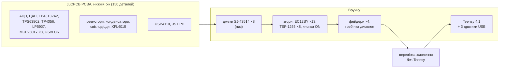

# 05. Виготовлення й збирання (JLCPCB)

> [!NOTE]
> **Статус:** 27.10.2026. Файли згенеровано з розведеної плати ([04](04-pcb.md)): Gerber, свердловка,
> BOM, файли PCBA для JLCPCB, інтерактивний BOM. **Не замовлено.** Перед замовленням — п. 6.

```sh
python3 hw/pcb/fab.py      # з digital-mixer/: усе нижче заново (InteractiveHtmlBom — common/README.md)
```

| Файл | Що це |
|---|---|
| [hw/fab/main-gerber.zip](../hw/fab/main-gerber.zip) | Gerber 4 шарів (F.Cu, In1 GND, In2, B.Cu), маски, паста, шовкографія, контур з вікном під Teensy; свердловка PTH / NPTH окремо — **завантажити на JLCPCB** |
| [hw/fab/bom.csv](../hw/fab/bom.csv) | повний перелік: 67 рядків, 186 деталей; партномер, LCSC, хто монтує |
| [hw/fab/jlc/bom-jlc.csv](../hw/fab/jlc/bom-jlc.csv) | BOM для PCBA — лише деталі, які ставить JLCPCB (34 рядки) |
| [hw/fab/jlc/cpl-jlc.csv](../hw/fab/jlc/cpl-jlc.csv) | координати й повороти тих самих деталей (150 шт., усі — **нижній бік**) |
| [ibom/ibom.html](ibom/ibom.html) | **інтерактивний BOM** (InteractiveHtmlBom, як у mixerli): обидва боки плати, підсвітка деталей рядка, позначки «Закуплено» / «Встановлено» для ручного монтажу |

## 1. Хто що монтує



- **JLCPCB** ставить усе SMD нижнього боку, зокрема корпуси, які паяльником не запаяти: TPS63802
  (VSON), TPA6132A2 (WQFN), TP4056 (площадка під корпусом) — тому PCBA тут не опція, а потреба.
- **Вручну** — верхній бік (енкодерів EC12SY у LCSC немає, кнопки й ON — від продавців з AliExpress),
  вивідні деталі, джеки (у LCSC їх мало; площадки великі, паяються легко) і модуль Teensy.

## 2. Замовлення плати (PCB)

| Параметр | Значення | Чому |
|---|---|---|
| Base Material | FR-4 | |
| Layers | **4** | DM31 |
| Dimensions | 104,5 × 136,5 мм (з Gerber) | |
| PCB Thickness | 1,6 мм | розрахунок пари USB ([04](04-pcb.md), п. 3) |
| Impedance Control | так, стек JLC 4 шари 1,6 мм | пара USB 90 Ω — підібрати ширину / зазор у калькуляторі JLC і за потреби змінити `usb_pair()` (п. 6) |
| Surface Finish | **ENIG** | плоскі площадки під VSON / WQFN і TSSOP з кроком 0,5 мм |
| Outer / Inner Copper | 1 oz / 0,5 oz | |
| Via Covering | Tented | переходи під Teensy й енкодерами закриті маскою |
| Min hole / track | 0,3 мм / 0,15 мм | у межах стандартних можливостей JLC |
| Mark on PCB | Remove Mark (або вказати місце) | шовкографія щільна |

Вікно під USB-кінцем Teensy — внутрішній виріз у контурі (Edge.Cuts), JLC фрезерує його як отвір.

## 3. Замовлення монтажу (PCBA)

1. **PCB Assembly → Standard**, **Assembly Side: Bottom Side** (усі 150 деталей — на нижньому боці).
2. Tooling holes: *Added by JLCPCB*.
3. Завантажити `hw/fab/jlc/bom-jlc.csv` і `hw/fab/jlc/cpl-jlc.csv`.
4. **Підбір деталей:** для рядків із кодом LCSC — перевірити, що JLC знайшов саме його. Для резисторів,
   конденсаторів, світлодіодів код не заданий: JLC пропонує деталь за номіналом і корпусом — брати
   **Basic**, де можна (без доплати за встановлення котушки). Конденсатори — X7R, ≥ 10 V
   (у колонці `Тип` у [bom.csv](../hw/fab/bom.csv)); 22 µF — 1206, ≥ 10 V; 2,2 nF — X7R або C0G.
5. **Перевірити повороти у переглядачі JLC.** Повороти взято з KiCad без поправок: у бібліотеці JLC
   нульове положення деяких корпусів (SOT-23-6, WQFN, ESOP-8, роз'єми) інше. Кожну мікросхему
   звірити за ключем 1-го виводу з [ibom](ibom/ibom.html) і повернути в редакторі JLC, якщо треба.
6. **Деталі `ПЕРЕВІРИТИ`** (немає підтвердженого коду LCSC — п. 4): знайти в каталозі JLC за
   партномером; якщо немає — *Global Sourcing* або надіслати свої (consignment), інакше JLC пропустить
   ці позиції (TPS63802 без JLC не запаяти — п. 1).

## 4. Деталі з кодами LCSC

Перевірено на lcsc.com / jlcpcb.com 27.10.2026; запаси змінюються — дивитися на день замовлення.

| Деталь | Партномер | LCSC | Примітка |
|---|---|---|---|
| АЦП ×2 | PCM1865DBTR | [C181312](https://jlcpcb.com/partdetail/PCM1865DBTR/C181312) | LCSC: «не рекомендовано для нових розробок»; заміна PCM1865QDBTRQ1 — [C2667266](https://www.lcsc.com/product-detail/C2667266.html) (автомобільна версія, той самий корпус) |
| ЦАП ×3 | PCM5102APWR | [C107671](https://jlcpcb.com/partdetail/PCM5102APWR/C107671) | |
| Навушники | TPA6132A2RTER | [C69901](https://www.lcsc.com/product-image/C69901.html) | WQFN — лише PCBA |
| Buck-boost | TPS63802DLAR | `ПЕРЕВІРИТИ` | код у LCSC не підтверджено ([TI](https://ti.com/product/zh-tw/TPS63802/part-details/TPS63802DLAR)) |
| Заряд | TP4056-42-ESOP8 | [C16581](https://jlcpcb.com/partdetail/17264-TP4056_42ESOP8/C16581) | |
| LDO | LP5907MFX-3.3/NOPB | [C80670](https://www.lcsc.com/product-detail/C80670.html) | |
| Розширювачі ×3 | MCP23017-E/SO | [C47023](https://jlcpcb.com/partdetail/MicrochipTech-MCP23017_ESO/C47023) | |
| ESD USB | USBLC6-2SC6 (ST) | [C7519](https://jlcpcb.com/partdetail/C7519) | |
| Ключ load sharing | AO3401A (AOS) | [C15127](https://jlcpcb.com/partdetail/AO3401A/C15127) | Basic |
| Діод load sharing | MBR0530 (JSCJ) | [C77336](https://www.lcsc.com/product-detail/C77336.html) | |
| Дросель | XFL4015-471MEC | [C18221164](https://lcsc.com/product-detail/Power-Inductors_Coilcraft-XFL4015-471MEC_C18221164.html) | |
| USB-C | USB4110-GF-A | `ПЕРЕВІРИТИ` | код у LCSC не знайдено ([DigiKey](https://www.digikey.ca/en/products/detail/gct/USB4110-GF-A/10384547)) |
| Роз'єм акумулятора | S2B-PH-SM4-TB(LF)(SN) | [C295747](https://jlcpcb.com/partdetail/JST-S2B_PH_SM4_TB_LF_SN/C295747) | |
| Джеки ×8 (вручну) | SJ-43514-SMT-TR | C4992301 — `ПЕРЕВІРИТИ` | код — з Flux, запас у LCSC малий; є в DigiKey ([SJ-43514-SMT-TR](https://www.digikey.com/es/products/detail/same-sky-formerly-cui-devices/SJ-43514-SMT-TR/669724)) |

Верхній бік і модулі — з AliExpress / магазинів України (DM7): EC12SY-H6-17.5F5.0-24C24P-SMD ×13,
TSF-1266 ×8, кнопка з фіксацією 5,8 мм SMD, фейдери PTA2043 B10K ×4, дисплей GMT147SPI на
гребінці, Teensy 4.1, акумулятор 1S 3000 mAh з платою захисту і роз'ємом JST PH.

## 5. Ручний монтаж — порядок

1. **Джеки SJ-43514** (низ) — фіксатори в отвори, потім площадки.
2. **Верх: кнопки TSF-1266, кнопка ON, енкодери EC12SY** — напрямні енкодера в отвори (їхнє положення
   звірити до пайки, [04](04-pcb.md), п. 5). Плату класти на м'яку підкладку: знизу вже стоять деталі.
3. **Фейдери PTA2043** і **гребінка дисплея** (дисплей ставити останнім, на стійки M2).
4. **Перевірка без Teensy:** USB-C → заряд (світлодіоди TP4056), кнопка ON → +4V2 ≈ 4,15 V, +3V3A ≈ 3,3 V.
5. **Teensy 4.1:** розрізати перемичку VIN–VUSB на модулі (PJRC); припаяти модуль на площадки знизу;
   крізь вікно — три дротики від площадок USB модуля (VUSB, D−, D+) до площадок 49 / 66 / 67 поруч
   (положення площадок модуля — з фото PJRC, `ОРІЄНТИР`: звірити на модулі до пайки).

Інтерактивний BOM ([ibom.html](ibom/ibom.html)) зручно відкрити поруч під час пайки: клік по рядку
підсвічує місця на платі, позначки «Встановлено» зберігаються в браузері.

## 6. Перед замовленням

1. **Імпеданс пари USB** — у калькуляторі JLC для 4 шарів 1,6 мм підібрати ширину / зазор під 90 Ω;
   якщо відрізняються від 0,2 / 0,2 мм — змінити `usb_pair()` у `hw/pcb/build_pcb.py`, перерозвести.
2. **Коди `ПЕРЕВІРИТИ`** (TPS63802, USB4110, SJ-43514) — знайти в каталозі JLC або вирішити, як
   постачати.
3. **Зразки** EC12SY, кнопки ON, GMT147SPI, Teensy — звірити footprint ([04](04-pcb.md), п. 5).
4. **Шовкографія** — прибрати накладання підписів (косметика).
5. Після правок — `python3 hw/pcb/fab.py` заново.
