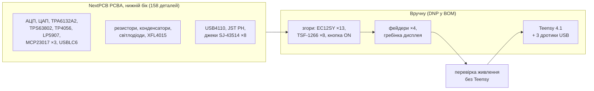

# 05. Виготовлення й збирання (NextPCB)

> [!NOTE]
> **Статус:** 27.10.2026. Файли згенеровано з розведеної плати ([04](04-pcb.md)): Gerber, свердловка,
> BOM, файли PCBA для [NextPCB](https://www.nextpcb.com/), монтажні креслення, інтерактивний BOM.
> **Не замовлено.** Перед замовленням — п. 6.

```sh
python3 hw/pcb/fab.py      # з digital-mixer/: усе нижче заново (InteractiveHtmlBom — common/README.md)
```

| Файл | Що це |
|---|---|
| [hw/fab/main-gerber.zip](../hw/fab/main-gerber.zip) | Gerber 4 шарів (F.Cu, In1 GND, In2, B.Cu), маски, паста, шовкографія, контур з вікном під Teensy; свердловка PTH / NPTH окремо — **завантажити як PCB** |
| [hw/fab/nextpcb/bom-nextpcb.csv](../hw/fab/nextpcb/bom-nextpcb.csv) | **BOM для PCBA**: Designator, Quantity, Manufacturer, Manufacturer Part Number, Description, Package, Procurement Type, Customer Note — 67 рядків, 25 з них `DNP` (ручний монтаж) |
| [hw/fab/nextpcb/centroid-nextpcb.zip](../hw/fab/nextpcb/centroid-nextpcb.zip) | **файл координат** (pick and place): Designator, Mid X / Mid Y (мм), Rotation, Layer — 158 деталей, усі на нижньому боці; той самий CSV — поруч |
| [assembly-bottom.pdf](../hw/fab/nextpcb/assembly-bottom.pdf), [assembly-top.pdf](../hw/fab/nextpcb/assembly-top.pdf) | монтажні креслення (контур, шовкографія, контури деталей з позначеннями); низ — дзеркально, як його бачать на столі |
| [hw/fab/bom.csv](../hw/fab/bom.csv) | повний перелік українською: 186 деталей, виробник, партномер, хто монтує |
| [ibom/ibom.html](ibom/ibom.html) | **інтерактивний BOM** (InteractiveHtmlBom, як у mixerli): обидва боки плати, підсвітка деталей рядка, позначки «Закуплено» / «Встановлено» |

## 1. Хто що монтує



- **NextPCB** ставить усе SMD нижнього боку й закуповує деталі за партномерами BOM. Серед них корпуси,
  які паяльником не запаяти: TPS63802 (VSON), TPA6132A2 (WQFN), TP4056 (площадка під корпусом).
- **Вручну** — верхній бік (EC12SY, кнопки, кнопка ON — з AliExpress, у дистриб'юторів їх немає),
  вивідні деталі й модуль Teensy. Монтаж лише одного боку — без другого трафарету й налаштування.

## 2. Замовлення плати (PCB)

Можливості NextPCB — за їхніми сторінками ([PCB capabilities](https://www.nextpcb.com/pcb-capabilities)):
4–32 шари, контроль імпедансу для 4–20 шарів (±10 %), ENIG.

| Параметр | Значення | Чому |
|---|---|---|
| Layers | **4** | DM31 |
| Material / Thickness | FR-4, 1,6 мм | розрахунок пари USB ([04](04-pcb.md), п. 3) |
| Dimensions | 104,5 × 136,5 мм (з Gerber) | |
| Impedance Control | **так** — пара USB D+ / D− 90 Ω диф. на F.Cu над In1 | ширину / зазор узгодити з їхнім стеком (п. 6) |
| Surface Finish | **ENIG** | плоскі площадки під VSON / WQFN і TSSOP з кроком 0,5 мм |
| Outer / Inner Copper | 1 oz / 0,5 oz | |
| Via | Tented | переходи під Teensy й енкодерами закриті маскою |
| Min track / space, hole | 0,15 / 0,15 мм, 0,3 мм | у межах стандартних можливостей |
| Шовкографія | біла, обидва боки | |

Вікно під USB-кінцем Teensy — внутрішній виріз у контурі (Edge.Cuts), його фрезерують як отвір.

## 3. Замовлення монтажу (PCBA)

Вимоги NextPCB до файлів — [PCB Assembly Files Explanation](https://support.nextpcb.com/portal/en/kb/articles/1-pcb-assembly-files-explanation),
[форма замовлення](https://www.nextpcb.com/quote/assembly): BOM — xls / xlsx / csv з колонками
Designator, Quantity, Manufacturer Part Number (+ Procurement Type: `DNP` — не ставити, `C` — деталі
замовника); centroid — zip / xlsx.

1. **PCB Assembly**, Assembly side: **Bottom**; SMT; кількість плат.
2. Завантажити Gerber (`main-gerber.zip`), BOM (`bom-nextpcb.csv`), centroid (`centroid-nextpcb.zip`)
   і, як додаток, `assembly-bottom.pdf`.
3. **Деталі закуповує NextPCB** (turnkey). Рядки `DNP` — не ставлять (ручний монтаж), але лишаються в
   BOM для повноти.
4. **Повороти** взято з KiCad без поправок. Інженери NextPCB звіряють полярність за кресленням і
   шовкографією; на погодженні (DFM / перевірка BOM) — звірити ключ 1-го виводу кожної мікросхеми
   з [ibom](ibom/ibom.html).
5. **Рядки з приміткою в Customer Note** (партномер не підтверджено) — погодити заміну з інженером.

## 4. Партномери

Знайдено на сторінках дистриб'юторів 27.10.2026; запаси змінюються — дивитися на день замовлення.

| Деталь | Партномер | Джерело | Примітка |
|---|---|---|---|
| АЦП ×2 | PCM1865DBTR | [LCSC](https://jlcpcb.com/partdetail/PCM1865DBTR/C181312) | LCSC: «не рекомендовано для нових розробок»; заміна PCM1865QDBTRQ1 ([LCSC](https://www.lcsc.com/product-detail/C2667266.html)) |
| ЦАП ×3 | PCM5102APWR | [LCSC](https://jlcpcb.com/partdetail/PCM5102APWR/C107671) | |
| Навушники | TPA6132A2RTER | [LCSC](https://www.lcsc.com/product-image/C69901.html), [Arrow](https://www.arrow.com/en/products/tpa6132a2rter/texas-instruments.html) | |
| Buck-boost | TPS63802DLAR | [DigiKey](https://www.digikey.com/en/products/detail/texas-instruments/TPS63802DLAR/10715525) | |
| Заряд | TP4056-42-ESOP8 | [LCSC](https://www.lcsc.com/product-detail/C16581.html) | |
| LDO | LP5907MFX-3.3/NOPB | [LCSC](https://www.lcsc.com/product-detail/C80670.html) | |
| Розширювачі ×3 | MCP23017-E/SO | [LCSC](https://jlcpcb.com/partdetail/MicrochipTech-MCP23017_ESO/C47023) | |
| ESD USB | USBLC6-2SC6 (ST) | [LCSC](https://jlcpcb.com/partdetail/C7519) | |
| Ключ / діод load sharing | AO3401A, MBR0530 (JSCJ) | [AO3401A](https://jlcpcb.com/partdetail/AO3401A/C15127), [MBR0530](https://www.lcsc.com/product-detail/C77336.html) | |
| Дросель | XFL4015-471MEC | [LCSC](https://lcsc.com/product-detail/Power-Inductors_Coilcraft-XFL4015-471MEC_C18221164.html) | |
| USB-C | USB4110-GF-A | [DigiKey](https://www.digikey.ca/en/products/detail/gct/USB4110-GF-A/10384547) | |
| Роз'єм акумулятора | S2B-PH-SM4-TB(LF)(SN) | [LCSC](https://jlcpcb.com/partdetail/JST-S2B_PH_SM4_TB_LF_SN/C295747) | |
| Джеки ×8 | SJ-43514-SMT-TR | [DigiKey](https://www.digikey.com/es/products/detail/same-sky-formerly-cui-devices/SJ-43514-SMT-TR/669724) | |
| Кераміка | CL31B106KAHNNNE, CL21B104KBCNNNC, CL31A226KAHNNNE, CL21B105KAFNNNE, CL21B225KAFNNNE, CL21C222JBFNNNE (Samsung) | [10 µ](https://www.lcsc.com/product-image/C14860.html), [100 n](https://fat.lcsc.com/product-detail/image/CL21B104KBCNNNC_C1711.html), [22 µ](https://www.lcsc.com/product-detail/C12891.html), [1 µ](https://www.futureelectronics.com/p/passives--capacitors--ceramic-capacitors--multilayer-ceramic-capacitors/cl21b105kafnnne-samsung-electro-mechanics-2046528), [2,2 µ](https://www.lcsc.com/product-detail/C19110.html), [2,2 n C0G](https://www.lcsc.com/product-detail/C28260.html) | 100 n і 2,2 µ — у частини дистриб'юторів «не для нових розробок»; рівноцінна заміна допустима |
| Електроліти ×8 | EEE-1CA100SR (Panasonic) | [TME](https://www.tme.eu/gb/details/eee1ca100sr/smd-electrolytic-capacitors/panasonic/) | NRND за Octopart; заміна — 10 µF 16 V 4 × 5,4 SMD |
| Світлодіоди | LTST-C171KRKT, LTST-C171KGKT (Lite-On) | [RS](https://twcn.rs-online.com/web/p/leds/6920941), [Arrow](https://www.arrow.com/en/products/ltst-c171kgkt/lite-on-technology.html?region=nac) | |
| Резистори 0805 1 % | Yageo RC0805FR-07… (10k, 100k, 4K7, 33R, 5K1, 2K4, 1K, 91K, 470R) | [10k](https://www.lcsc.com/product-detail/C84376.html), [4K7](https://jlcpcb.com/partdetail/RC0805FR-074K7L/C60816), [33R](https://www.lcsc.com/product-detail/C126353.html), [91K](https://www.lcsc.com/product-image/C137484.html), [5K1](https://www.lcsc.com/product-image/C84375.html), [2K4](https://www.lcsc.com/product-image/C114521.html) | **665k (RC0805FR-07665KL) — `ПЕРЕВІРИТИ`**: партномер за схемою Yageo, сторінки не знайдено; будь-який 665 kΩ 1 % 0805 |
| Резистори MIDI | RC2010FK-0733RL (33 Ω 2010), RC1206FR-0710RL (10 Ω 1206) | [2010](https://www.ibselectronics.com/part/yageo/rc2010fk-0733rl/419924/), [1206](https://www.lcsc.com/product-image/C108080.html) | |

Ручний монтаж (DNP) — з AliExpress / магазинів України (DM7): EC12SY-H6-17.5F5.0-24C24P-SMD ×13,
TSF-1266 ×8, кнопка з фіксацією 5,8 мм SMD, фейдери PTA2043 B10K ×4, дисплей GMT147SPI на
гребінці, Teensy 4.1, акумулятор 1S 3000 mAh з платою захисту і роз'ємом JST PH.

## 5. Ручний монтаж — порядок

1. **Верх: кнопки TSF-1266, кнопка ON, енкодери EC12SY** — напрямні енкодера в отвори (їхнє положення
   звірити до пайки, [04](04-pcb.md), п. 5). Плату класти на м'яку підкладку: знизу вже стоять деталі.
2. **Фейдери PTA2043** і **гребінка дисплея** (дисплей ставити останнім, на стійки M2).
3. **Перевірка без Teensy:** USB-C → заряд (світлодіоди TP4056), кнопка ON → +4V2 ≈ 4,15 V, +3V3A ≈ 3,3 V.
4. **Teensy 4.1:** розрізати перемичку VIN–VUSB на модулі (PJRC); припаяти модуль на площадки знизу;
   крізь вікно — три дротики від площадок USB модуля (VUSB, D−, D+) до площадок 49 / 66 / 67 поруч
   (положення площадок модуля — з фото PJRC, `ОРІЄНТИР`: звірити на модулі до пайки).

Інтерактивний BOM ([ibom.html](ibom/ibom.html)) зручно відкрити поруч під час пайки: клік по рядку
підсвічує місця на платі, позначки «Встановлено» зберігаються в браузері.

## 6. Перед замовленням

1. **Імпеданс пари USB** — запитати в NextPCB (або їхнім калькулятором стеку) ширину / зазор під 90 Ω
   диф. на зовнішньому шарі над In1; якщо відрізняються від 0,2 / 0,2 мм — змінити `usb_pair()` у
   `hw/pcb/build_pcb.py`, перерозвести.
2. **Партномер 665k** і заміни деталей «не для нових розробок» — погодити під час перевірки BOM.
3. **Зразки** EC12SY, кнопки ON, GMT147SPI, Teensy — звірити footprint ([04](04-pcb.md), п. 5).
4. **Шовкографія** — прибрати накладання підписів (косметика).
5. Після правок — `python3 hw/pcb/fab.py` заново.
