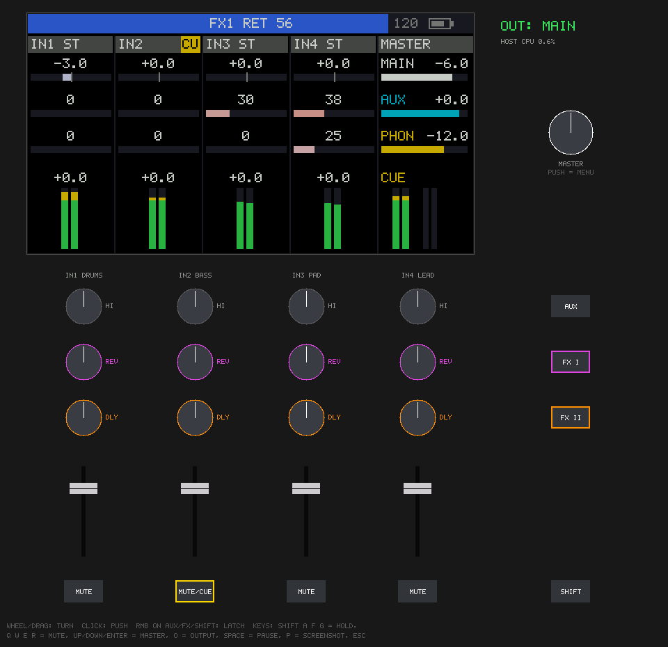
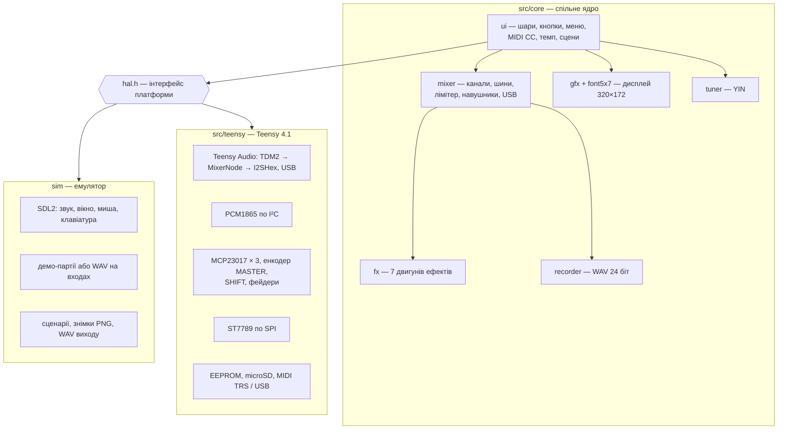
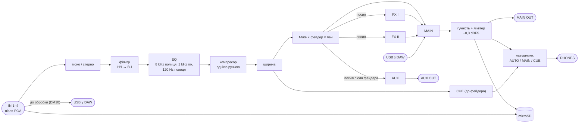
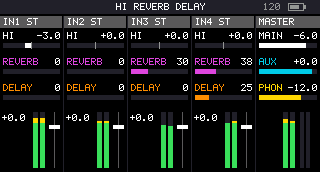
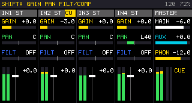
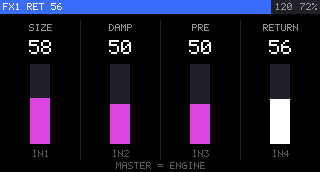
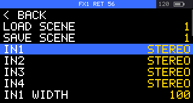
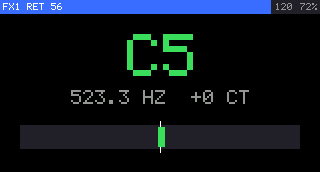
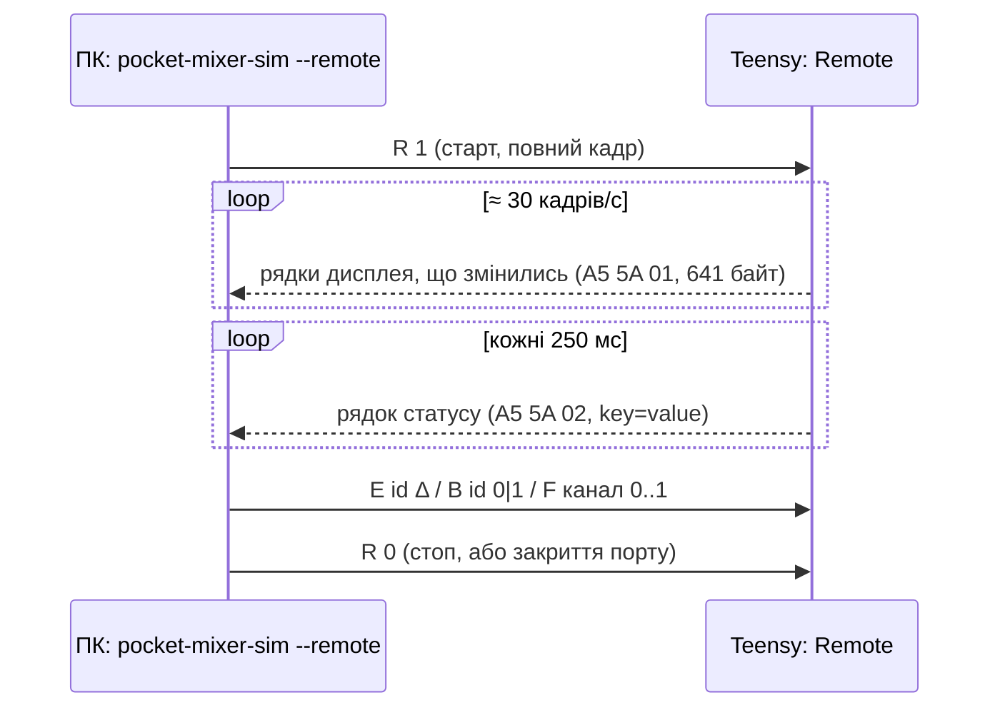
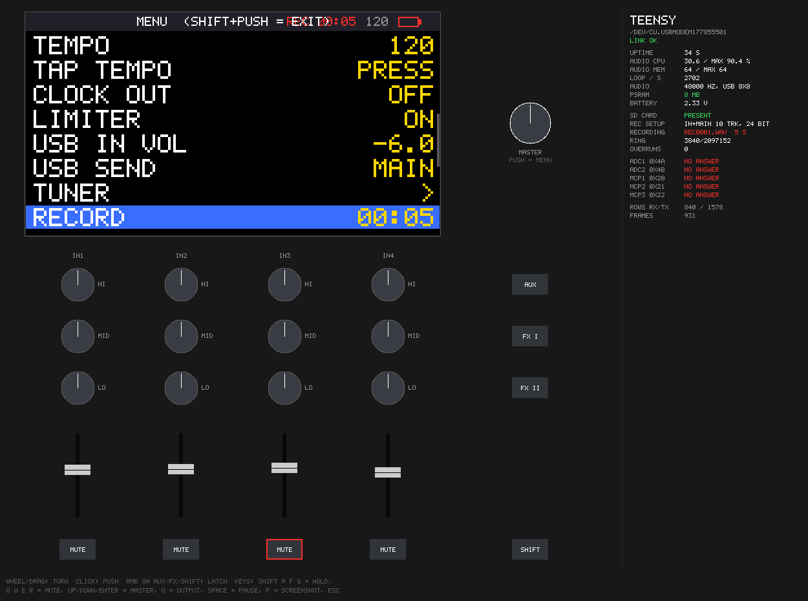

# 06. Прошивка й емулятор

> [!NOTE]
> **Статус:** 28.10.2026, версія 0.2, [firmware/](../firmware/).
>
> **Перевірено:**
> - 78 автоматичних перевірок ядра без заліза проходять (`make test`);
> - емулятор працює у вікні і в режимі без вікна;
> - збірка для Teensy 4.1 (`pio run`) проходить без попереджень у нашому коді.
>
> **Не перевірено:** на залізі прошивка ще не запускалась — плати немає. Що звірити на макеті, зведено в
> п. 8. Рішення — DM32–DM34 у [decisions](decisions.md).



*Емулятор: дисплей (×2) і віртуальна панель у розкладці плати (DM25). Звук іде через колонки комп'ютера.*

## 1. Будова (DM32)

Увесь мікшер написаний як переносне ядро на C++17, без Arduino і без заліза: звук, ефекти, інтерфейс,
малювання дисплея, сцени, MIDI. Під ним два тонкі шари. Перший — для Teensy: кодеки, розширювачі,
дисплей, EEPROM, microSD, USB. Другий — емулятор на SDL2. Тож те, що видно й чути в емуляторі, — це
той самий код, що піде в Teensy.



Сигнальний тракт у `mixer.cpp` — за [ТЗ](01-spec.md), п. 2:



| Файл | Що в ньому |
|---|---|
| `src/core/dsp.h` | біквади за RBJ Audio EQ Cookbook, компресор, лімітер із випередженням 1 мс, метри, швидкі log/exp |
| `src/core/fx.*` | ефекти, кожна шина має власний пул пам'яті int16 |
| `src/core/mixer.*` | обробка блоку (128 відліків), плавні зміни гучності, пану й посилів усередині блоку, метри, вихід на тюнер і рекордер |
| `src/core/params.*` | сцена, налаштування, таблиця параметрів (межі, крок, MIDI CC), CRC |
| `src/core/ui.*` | керування за DM28, меню, MIDI, tap / clock, автозбереження, малювання сторінок |
| `src/core/recorder.h`, `tuner.h`, `gfx.*` | рекордер WAV, тюнер, графіка |
| `src/teensy/*` | `main.cpp` (граф Teensy Audio, HAL), `pcm1865.h`, `controls.*`, `st7789.h`, `pins.h` |
| `sim/*` | емулятор, демо-джерела, PNG, сценарії |
| `tests/test_core.cpp` | перевірки ядра |
| `tools/gen_font.py` | власний шрифт 5 × 7 (великі латинські, цифри, знаки) → `font5x7.h` |

## 2. Емулятор

```sh
brew install sdl2                 # один раз (Linux: libsdl2-dev)
cd digital-mixer/firmware
make sim test                     # емулятор + перевірки ядра
./build/pocket-mixer-sim          # вікно, звук MAIN у колонки
./build/pocket-mixer-sim --in 1 drums.wav --in 2 bass.wav    # свої WAV на входи (зациклено)
```

Без файлів на входах грають вбудовані партії на 120 BPM: IN1 барабани, IN2 бас, IN3 пед, IN4 арпеджіо.

| Дія | Миша | Клавіатура |
|---|---|---|
| Енкодер | колесо над ним або тягнути вгору / вниз; клік — натискання | MASTER: ↑ / ↓, Enter — натискання |
| Фейдер | тягнути або колесо | — |
| Mute 1–4 | клік | Q, W, E, R |
| SHIFT, AUX, FX I, FX II (утримання) | натиснути й тримати; права кнопка — зафіксувати | Shift, A, F, G |
| Який вихід слухати | — | O: MAIN → AUX → PHONES |
| Пауза входів, знімок дисплея, вихід | — | Space, P, Esc |

Інші ключі:
- `--usb file.wav` — стерео «з DAW» у MAIN;
- `--out main.wav` — записати MAIN у файл;
- `--small-mem` — пам'ять ефектів як на Teensy без PSRAM;
- `--midi` — друкувати MIDI OUT.

Сцени зберігаються в `sim-data/`; запис у меню (RECORD) пише `rec-NNNN.wav` — доріжки й розрядність за
пунктами REC TRACKS / REC BITS.

**Сценарії** — для перевірок без вікна. `--headless --script` проганяє звук і інтерфейс за віртуальним
годинником. Команди сценарію:
- `enc e0..e11|m Δ` — повернути енкодер;
- `press` / `release` / `click` — натиснути, відпустити, клацнути: `master`, `mute1..4`, `aux`, `fx1`, `fx2`, `shift`, `e0..e11`;
- `fader N 0..1` — поставити фейдер;
- `wait мс` — чекати;
- `midi B0 07 64` — надіслати MIDI;
- `shot` / `panel файл.png` — знімок дисплея / всього вікна;
- `meters` — надрукувати метри.

Знімки нижче отримано так:
`./build/pocket-mixer-sim --headless --script sim/scripts/demo.txt`.

| Головна (шари FX I, FX II) | SHIFT: gain / pan / фільтр, Cue на IN2 | Утримання FX I |
|---|---|---|
|  |  |  |
| **Меню** | **Тюнер (IN4)** | |
|  |  | |

Чого емулятор **не** показує:
- справжню завантаженість Teensy: «HOST CPU» — це процесор комп'ютера; на Teensy відсоток видно в меню (`FW … CPU`);
- 16-бітні ЦАП і USB (п. 7);
- брязкіт контактів і швидкість енкодерів;
- оновлення дисплея по SPI.

## 3. Керування (DM28, як реалізовано)

Енкодери нумеруються так: канал 1–4 × ряд 1–3, ряд 1 — біля дисплея.

| Що | Дія |
|---|---|
| Енкодери без кнопок | ряд 1 — EQ HI, ряд 2 — MID, ряд 3 — LO, ±15 dB по 0,5 dB; швидке обертання — ×2 / ×4 |
| Натискання енкодера | скинути параметр ряду до типового |
| **AUX** | клацнути — ряд 1 стає посилом у AUX (ще раз — назад), і поки шар увімкнено, MASTER крутить гучність виходу AUX; утримувати + MASTER — те саме без перемикання шару |
| **FX I / FX II** | клацнути — ряд 2 / 3 стає посилом у FX; утримувати — сторінка ефекту: енкодери каналів 1–3 (будь-який ряд) — три параметри, каналу 4 — повернення, MASTER — двигун, натискання — скидання |
| **SHIFT** | утримувати — ряди gain / pan / фільтр; натискання енкодера ряду 3 — фільтр ↔ компресор (окремо на канал). У меню SHIFT MODE = TOGGLE: натискання вмикає SHIFT, наступне — вимикає (на дисплеї «SHIFT ON») |
| SHIFT + Mute | Cue (фіксується); у навушниках CUE, якщо хоч один канал у Cue (AUTO) |
| MASTER | гучність MAIN; SHIFT + MASTER — навушники; натискання — меню. Гучності: з OFF — одразу −48 dB, нижче −30 dB крок 3 dB, до −12 — 1 dB, вище — 0,5 dB; швидке обертання — ×2 / ×4 |
| Меню | MASTER — вибір, натискання — змінити / виконати / підтвердити, SHIFT + натискання — вихід |
| Фейдер | рівень: 0,75 ходу = 0 dB, верх = +6 dB, низ = вимкнено |
| Метри каналів | рівень **після фейдера й пану** — що канал віддає в мікс; червона позначка CLIP — лише перевантаження **входу АЦП** (зменшити GAIN): обробка у float сама не кліпує, вихід MAIN тримає лімітер |

**Меню:**
- сцени: LOAD / SAVE 1–8;
- канали: IN1–4 STEREO / MONO і ширина стерео;
- навушники: джерело PHONES AUTO / MAIN / CUE;
- темп: TEMPO, TAP, CLOCK OUT;
- LIMITER;
- USB: гучність входу з DAW, USB SEND (MAIN чи вхід — для стерео-збірки);
- TUNER;
- запис: RECORD (старт / стоп, файл `RECNNNN.WAV` у корені SD), REC TRACKS — що писати: MAIN (2 доріжки),
  IN 1-4 (8 доріжок входів до обробки), IN+MAIN (10); REC BITS — 16 / 24 біт. Під час запису ці два пункти
  заблоковано («STOP FIRST»); 8 і 10 доріжок — лише з PSRAM, без неї — «NEED PSRAM»;
- MIDI CH, режим CONTROLLER;
- BRIGHTNESS, напрямок енкодерів (ENC DIR), SHIFT MODE (HOLD / TOGGLE);
- FADER CAL — калібрування фейдерів: «ALL FADERS DOWN» → MASTER → «ALL FADERS UP» → MASTER. Межі кожного фейдера (і напрямок, якщо фейдер підключено навпаки) зберігаються в налаштуваннях; по краях мертві зони 2 %; хід менше половини шкали — FAIL, старі межі лишаються; SHIFT + натискання — скасувати;
- BATTERY (відсоток і напруга; на головному екрані — піктограма; від USB — «USB»: міряється VSYS, з USB він ≈ 4,7 В), версія та завантаження процесора.

**Сцени й налаштування:**
- поточний стан зберігається автоматично через 3 с після останньої зміни — кнопка живлення знімає живлення одразу (DM27);
- 8 сцен і налаштування лежать у слотах по 400 байт емульованого EEPROM Teensy (4284 байти).

## 4. Ефекти

Кожна шина має 3 параметри (0–100) і рівень повернення в MAIN.

| Двигун | P1 | P2 | P3 | Як зроблено |
|---|---|---|---|---|
| REVERB | розмір | демпфування | передзатримка 0–100 мс | Freeverb (Jezar, public domain): 8 гребінчастих + 4 всепропускних фільтри на бік |
| DELAY | час у долях такту (1/16…1/1, з тріолями й крапками) | зворотний зв'язок | тон | пінг-понг, час іде за темпом; зміна часу плавна, як на стрічці |
| CHORUS | швидкість 0,05–5 Hz | глибина | зворотний зв'язок (до флендера) | дві модульовані лінії, LFO зсунуті на 90° |
| FILTER | частота 40 Hz–16 kHz | резонанс | глибина LFO (1 такт) | фільтр стану з топологічно збереженим перетворенням (Zavalishin), НЧ |
| DIST | драйв | тон | зниження частоти дискретизації й розрядності | м'яке обмеження |
| TAPE | час 40–700 мс | зворотний зв'язок | wow / flutter | насичення й НЧ у петлі |
| FREEZE | довжина 1/8…2 такти | HOLD (> 50 — заморозити) | швидкість 0,5–2× | петля з переходом 10 мс на стику |

Пам'ять — int16. Пул шини:
- з PSRAM: 480 000 відліків, затримка до 5 с стерео;
- без PSRAM: 72 000 відліків, затримка до 0,75 с.

Без PSRAM довгі затримки обрізаються за пулом. PSRAM ставимо (DM35): Teensy на гребінках, зазор 2,5 мм під чип.

## 5. MIDI (DM34)

Мікшер приймає CC і program change через USB MIDI. MIDI OUT — на TRS (DM20) і на USB. Канал 1 мікшера
відповідає базовому MIDI-каналу (MIDI CH у меню, типово 1), канали 2–4 — наступним; майстер — базовий + 4.

| CC | Канал мікшера (MIDI 1–4) | CC | Майстер (MIDI 5) |
|---|---|---|---|
| 7 | рівень (фейдер) | 7 / 8 / 9 / 10 | MAIN / AUX / навушники / USB з DAW |
| 8 | пан / баланс | 11 | темп 40–240 BPM |
| 9 | gain (PGA) | 20 / 25 | двигун FX I / FX II |
| 10 | ширина | 21–23 / 26–28 | параметри FX I / FX II |
| 74 | фільтр | 24 / 29 | повернення FX I / FX II |
| 85 / 86 / 87 | EQ HI / MID / LO | PC 0–7 | сцени 1–8 |
| 93 | компресор | | |
| 102 / 103 / 104 | посили AUX / FX I / FX II | | |
| 110 / 111 | Mute / Cue (≥ 64 — увімкнено) | | |

Номери 7–9, 74, 85–87 і 93 — як у TX-6 ([00](00-research.md), п. 9); решта наші.

Інша поведінка:
- **Режим CONTROLLER:** фейдери шлють CC 7, енкодери — CC свого параметра; мікс не змінюється, бо енкодери керують окремою копією сцени.
- **MIDI clock:** вихід 24 PPQN за темпом (CLOCK OUT). Clock, що приходить по USB, задає темп; показується як EXT.

## 6. Teensy: як зібрати й залити

```sh
cd digital-mixer/firmware
pio run                  # збірка (PlatformIO, платформа teensy)
pio run -t upload        # залити через Teensy Loader
```

Тип USB — `USB_MIDI_AUDIO_SERIAL`: аудіо, MIDI і послідовний порт разом.

**Пам'ять за `teensy_size` (збірка 28.10.2026):**
- FLASH: 165 КБ коду й даних;
- RAM1: 163 КБ змінних (зокрема буфер дисплея 110 КБ) + 132 КБ коду, 197 КБ вільно під стек;
- RAM2: 480 КБ вільно під `malloc` — пули ефектів (2 × 144 КБ) і буфер рекордера (64 КБ) без PSRAM.

**Що звідки на залізі:**

| Вузол | Як | Джерело |
|---|---|---|
| АЦП PCM1865 × 2 (I²C 0x4A / 0x4B) | входи ADC1 L/R ← VINL1/VINR1, ADC2 ← VINL2/VINR2; `I2S_FMT` = 0x53: TDM, кадр синхронізації в 1 BCK, слот 32 біт; `TDM_OSEL` = 4 канали; `TX_TDM_OFFSET` 1 і 129; PGA −12…+32 dB по 0,5 dB | [pcm1865.pdf](datasheets/pcm1865.pdf), с. 58–59, 89–96 |
| TDM2 Teensy | кадр 256 BCK, синхронізація на 1 BCK раніше за дані (`FSE`), MCLK2 = 512 fs на піні 33; PCM1865 у режимі slave сам визначає 256 / 384 / 512 fs | `output_tdm2.cpp` (Teensyduino 1.162); [pcm1865.pdf](datasheets/pcm1865.pdf), табл. на с. 24 |
| 24 біти з TDM | бібліотека ділить 32-бітний слот на два 16-бітні канали (старша й молодша половини), `MixerNode` складає їх назад | `input_tdm2.cpp` (`memcpy_tdm_rx`) |
| ЦАП PCM5102A × 3 | `AudioOutputI2SHex`: пін 7 — MAIN, 32 — AUX, 9 — CUE; XSMT і EN навушників піднімаються лише після налаштування кодеків | `output_i2s_hex.cpp`; [03](03-schematic.md), п. 2 |
| MCP23017 × 3 (I²C2, 400 kHz) | входи з підтяжками 100k, переривання на будь-яку зміну, INTA = INTB (MIRROR); читання GPIOA + GPIOB при низькому INT і кожні 4 мс (антибрязкіт 5 мс) | [mcp23017.pdf](datasheets/mcp23017.pdf), табл. 3-1, регістр IOCON |
| Енкодери | квадратурний декодер за кодом Грея: крок рахується при поверненні в стан спокою A = B = 1; MASTER — на перериваннях пінів 0, 1 | креслення [EC12SY](datasheets/ec12sy-smd-encoder-drawing.png): 24 фіксації / 24 імпульси |
| Дисплей ST7789V | SPI 15 MHz (мінімальний період такту запису 66 нс); COLMOD 16 біт, MADCTL `MV + MY` (0xA0 — перевірено на модулі GMT147SPI, 0x60 дає зображення догори дриґом), INVON; статуси верхнього ряду — на 14 пікселів від краю через заокруглені кути панелі; надсилаються лише рядки, що змінилися, по 6 за раз, ≈ 30 кадрів/с | datasheet Sitronix ST7789V v1.3 (позначений як конфіденційний, тому лише локально) |
| Підсвітка | ШІМ 20 kHz на піні 28 | [03](03-schematic.md) |
| Фейдери, батарея | 12 біт, усереднення; батарея = A14 × 2 | [03](03-schematic.md) |

### Тест пам'яті під Teensy

`pio run -e memtest -t upload` — тестова прошивка (`src/memtest/`) виводить у послідовний порт:
- обсяг PSRAM, що бачить ядро, і результат запису / читання п'яти шаблонів по всій PSRAM;
- чи відповідає флеш на більших площадках (LittleFS QSPI NOR / NAND).

Будь-який символ у порт запускає тест знову. **28.10.2026:** PSRAM 8 МБ на менших площадках — усі 5 шаблонів без
помилок (≈ 0,5 с на прохід 8 МБ); флешу на більших площадках немає.

### Пульт на ПК (справжній Teensy)

Емулятор показує дисплей **справжнього** Teensy, керує ним з ПК і виводить сервісні дані:

```sh
./build/pocket-mixer-sim --remote                  # перший /dev/cu.usbmodem*
./build/pocket-mixer-sim --remote /dev/cu.usbmodem177855501
```

Звук у цьому режимі не грає — він на Teensy. Миша й клавіші — ті самі, що в емуляторі; сценарії
(`--script`) теж ідуть на Teensy. Обмін — через послідовний порт USB (`src/teensy/remote.h`):



- Рядок іде лише цілим: якщо буфер USB заповнений, він лишається «зміненим» і йде з наступним кадром.
  Інакше `Serial.write` обрізає пакет після тайм-ауту, і на ПК лишаються биті символи.
- Щойно ПК рухає фейдер, Teensy перестає читати свої АЦП фейдерів (на голому модулі вони висять у повітрі)
  до `R 0`.
- **Сервісний блок:**
  - час роботи;
  - `AudioProcessorUsage` і максимум, блоки аудіопам'яті;
  - проходи `loop()` за секунду;
  - частота, канали USB, обсяг PSRAM, напруга VSYS;
  - карта SD, налаштування й стан запису (файл, секунди, заповнення буфера, `overruns`);
  - відповідь I²C від PCM1865 0x4A / 0x4B і MCP23017 0x20–0x22 (опитування раз на 5 с);
  - лічильники рядків.

**Перевірено 28.10.2026** на голому Teensy 4.1 з PSRAM і картою SD (без плати мікшера):
- енкодери, кнопки, фейдери, меню й SHIFT з ПК;
- запис IN+MAIN, 24 біт → `REC0001.WAV`, 0 переповнень, буфер ≤ 4 КБ із 2 МБ;
- I²C-пристрої, як і слід без плати, — NO ANSWER.



## 7. Обмеження версії 0.1

1. **USB-аудіо.**
   - **Типова збірка** (`pio run`) — стандартне ядро Teensy: стерео 44,1 kHz; у DAW іде MAIN або один вхід (USB SEND у меню).
   - **Збірка `uac2`** — ядро UAC2 з [grrrr/teensy-4-usbAudio](https://github.com/grrrr/teensy-4-usbAudio) (MIT, форк alex6679, ревізія `e842379`). Вона дає 48 kHz і 8 каналів, як у ТЗ (п. 3.4). Як зібрати:
     ```sh
     sh tools/setup_uac2.sh     # копія ядра Teensy з файлами UAC2 у tools/ext (не в git)
     pio run -e uac2
     ```
     **Перевірено 28.10.2026:** прошивка збирається на ядрі 1.162. Розбір USB-дескрипторів з ELF показав:
     - Audio Class 2.0;
     - 8 каналів у DAW і 8 з DAW, 16 біт;
     - ізохронні асинхронні потоки зі зворотним зв'язком;
     - пакет 784 байти = 49 відліків × 8 × 2, тобто 48 kHz;
     - MIDI і послідовний порт.

     **Перевірено на голому Teensy 4.1 (macOS, 28.10.2026):**
     - macOS бачить «Teensy MIDI_Audio»: 8 входів, 8 виходів, 48 000 Hz, плюс MIDI-порт і послідовний порт;
     - тестова збірка `PLATFORMIO_BUILD_FLAGS="-D MIXER_USB_TEST_TONE" pio run -e uac2 -t upload` подає на 8 каналів синуси 250…2000 Hz −12 dBFS;
     - запис через CoreAudio показав на кожному каналі −12,0 dBFS і свою частоту;
     - 20 с потоку — рівно 960 000 відліків, 0 розривів: синхронізація частоти працює.

     **Не перевірено:** Windows, iOS, звук із DAW у Teensy (без ЦАП його нікуди вивести). MIDI-порт macOS показав під назвою «M8» — CoreMIDI запам'ятав назву від попередньої прошивки з тим самим VID/PID; перейменовується в Audio MIDI Setup.

     Бібліотеку автори тестували з Teensyduino 1.59. На ядрі 1.159 наш новий тулчейн не збирається, тож її файли накладено на ядро 1.62 — на macOS це працює (див. вище). З DAW приходять 8 каналів; мікс бере перші 2.
2. **Виходи 16 біт:** Teensy Audio передає блоки int16. Входи доходять у 24 бітах (п. 6), а ЦАП і USB
   отримують 16; тому й USB у збірці `uac2` — 16 біт (24-бітний кадр нічого б не додав). Повні 24 біти на ЦАП — лише через власний драйвер SAI1; поки не потрібно.
3. **Рекордер:** з PSRAM пише до 10 доріжок (REC TRACKS) через буфер 2 МБ. Без PSRAM — лише MAIN
   стерео, буфер 64 КБ ≈ 0,2 с. Затримки карти довші за це дають пропуски; їх рахує лічильник
   `overruns`. На дисплей мікшера він не виводиться, але видний на пульті ПК (п. 6).
4. **Немає:** DJ-режиму, синта, секвенсора (ТЗ, п. 3.7); заряду батареї у відсотках за кривою LiPo —
   зараз лінійно 3,3–4,2 В.

## 8. Перевірити на макеті

| Що | Як | Що змінити, якщо не так |
|---|---|---|
| Синхронізація TDM з PCM1865 | осцилограф: LRCK2 / BCK2 / DOUT; тон на IN1 → слот 0, IN3 → слот 4 | `TX_TDM_OFFSET` (1 / 129) у `main.cpp` |
| SAI1 і SAI2 одночасно від одного аудіо-PLL | обидва порти працюють, `AudioProcessorUsage` | [03](03-schematic.md), п. 2 |
| Орієнтація й зсув дисплея | на модулі на breadboard: орієнтація — MADCTL 0xA0 (28.10.2026); зсув і кольори — ще звірити | `St7789::MADCTL`, `OFFSET_Y` (34), INVON |
| Швидкість SPI дисплея | 15 → 30 MHz без артефактів | `St7789::SPI_HZ` |
| Напрямок енкодерів | меню ENC DIR | порядок A/B у `controls.cpp` |
| Фейдери: межі й напрямок | меню FADER CAL, потім низ = вимкнено, верх = +6 dB | калібрування зберігається в налаштуваннях |
| Шум INT розширювачів, брязкіт | швидке обертання, натискання | період опитування, антибрязкіт |
| Завантаження процесора | меню FW → CPU, ціль ≤ 50 % ([01](01-spec.md), п. 6) | розмір пулів, кількість гребінок reverb |
| Підсвітка ШІМ на піні 28 | яскравість змінюється | [03](03-schematic.md): `ПЕРЕВІРИТИ` |

## 9. Що далі

1. Перевірити збірку `uac2` з ядром UAC2: 8 каналів у Windows, macOS, iOS ([README](../README.md) — наступний крок макета).
2. На макеті пройти таблицю п. 8.
3. Показувати на дисплеї пропуски рекордера й стан карти; крива розряду LiPo.
